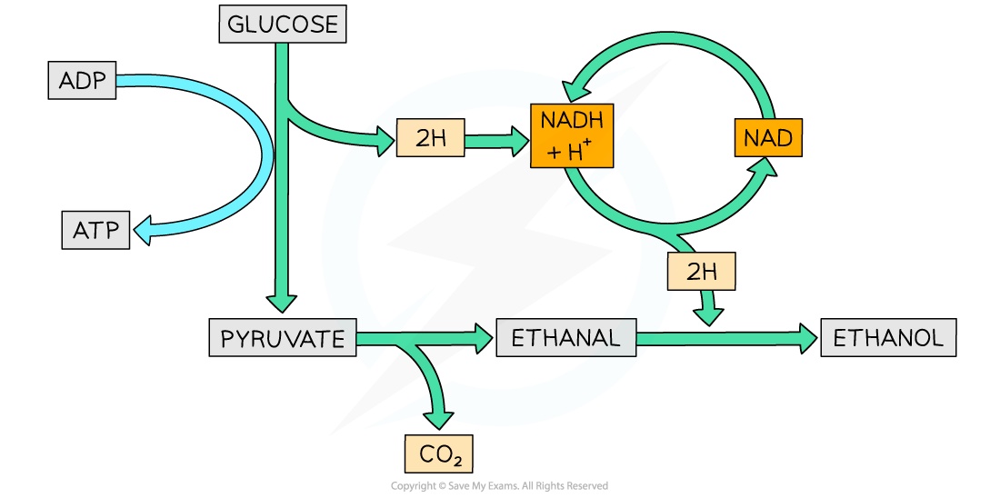
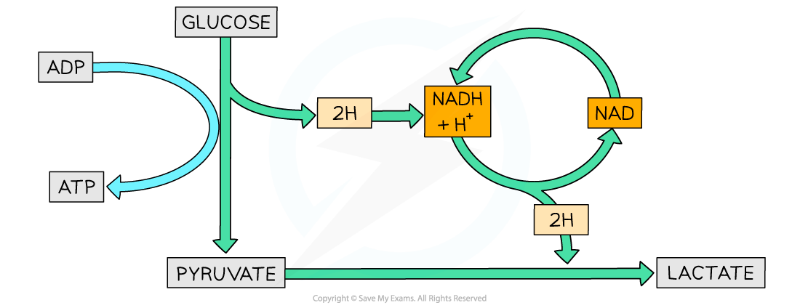

# Anaerobic Respiration

## Anaerobic Respiration

> **Spec point** — `spcpt_Yj3GjYk5Jds5Pwmp` · outline respiration in anaerobic conditions in mammals (lactate fermentation) and in yeast cells (ethanol fermentation)

## Anaerobic respiration

- Sometimes cells experience conditions with **little or no oxygen**
- There are several consequences when there is not enough oxygen available for respiration:

  - There is **no final acceptor of electrons** from the electron transport chain
  - The electron transport chain **stops** functioning
  - No more ATP is produced via oxidative phosphorylation
  - Reduced NAD and FAD aren’t oxidised by an electron carrier
  - No oxidised NAD and FAD are available for dehydrogenation in the Krebs cycle
  - The Krebs cycle stops
- However, there is still a way for cells to produce some ATP in low oxygen conditions through **anaerobic** respiration

### Anaerobic pathways

- Some cells are able to **oxidise the reduced NAD** produced during glycolysis so it can be used for further hydrogen transport
- This means that **glycolysis can continue** and **small amounts of ATP** are still produced
- Different cells use different pathways to achieve this

  - Yeast and microorganisms use **ethanol fermentation**
  - Other microorganisms and mammalian muscle cells use **lactate fermentation**

### Ethanol fermentation

- In this pathway, reduced NAD transfers its hydrogens to ethanal to form ethanol
- In the first step of the pathway, **pyruvate is decarboxylated** to ethanal

  - Producing **CO****2**
- Then **ethanal is reduced** to ethanol by the enzyme alcohol dehydrogenase
- Ethanal is the hydrogen acceptor
- Ethanol cannot be further metabolised; it is a waste product

*The pathway of ethanol fermentation*

### Lactate fermentation

- In this pathway, reduced NAD transfers its hydrogens to pyruvate to form lactate
- **Pyruvate is reduced** to lactate by the enzyme lactate dehydrogenase
- Pyruvate is the hydrogen acceptor
- The final product lactate can be further metabolised

*The pathway of lactate fermentation*

#### Metabolisation of lactate

- After lactate is produced two things can happen:

  1. It can be **oxidised back to pyruvate** which is then channelled into the Krebs cycle for ATP production
  2. It can be **converted into glycogen** for storage in the liver

- The oxidation of lactate back to pyruvate needs extra oxygen

  - This extra oxygen is referred to as an **oxygen debt**
  - It explains why animals **breathe deeper and faster after exercise**

> **Exam Hint**
> Note that ethanol fermentation is a two-step process (lactate fermentation is a one-step process). Carbon dioxide is also produced alongside the waste ethanol. This waste ethanol is what makes yeast vital in making alcoholic drinks like beer!
