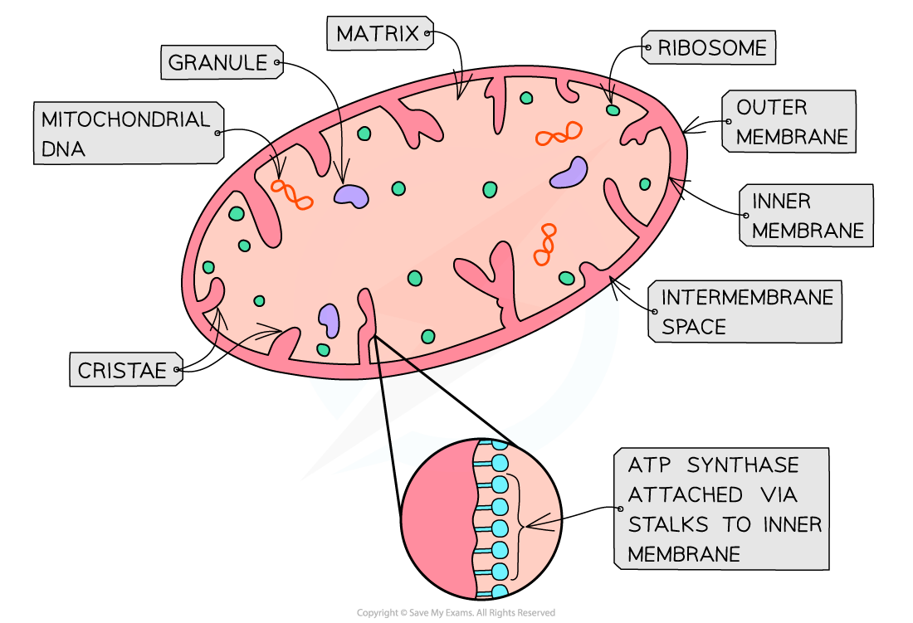
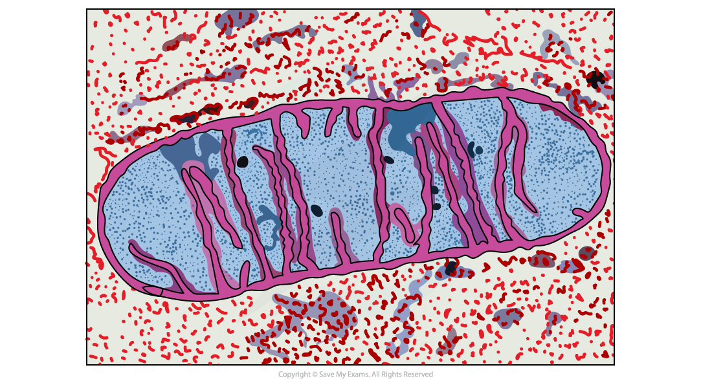

# Structure & Function of Mitochondria

## Structure & Function of the Mitochondria

> **Spec point** — `spcpt_v3ZQMtKF3sXCBQJK` · State where each of the four stages in aerobic respiration occurs in eukaryotic cells:
• glycolysis in the cytoplasm
• link reaction in the mitochondrial matrix
• Krebs cycle in the mitochondrial matrix
• oxidative phosphorylation on the inner membrane of mitochondria

## Structure & function of the mitochondria

- Mitochondria are rod-shaped organelles 0.5 - 1.0 µm in diameter
- They are the **site of aerobic respiration** in eukaryotic cells
- The function of mitochondria is to **synthesise ATP**
- Synthesis of ATP in the mitochondria occurs during the last stage of respiration called **oxidative phosphorylation**

  - This relies on membrane proteins that make up the ‘electron transport chain’ and the ATP synthase enzyme—the details of this are covered [later in the notes](https://www.savemyexams.com/a-level/biology/cie/25/revision-notes/12-energy-and-respiration/12-2-respiration/aerobic-respiration-oxidative-phosphorylation/)

*The structure of a mitochondrion*

#### Structure

- Mitochondria have **two phospholipid membranes**, an outer and an inner membrane
- The outer membrane is:

  - Smooth
  - Permeable to several small molecules
- The inner membrane is:

  - Folded (cristae)
  - **Less permeable**
  - The site of the **electron transport chain **(used in oxidative phosphorylation)
  - Location of** ATP synthase **(used in oxidative phosphorylation)
- The intermembrane space:

  - Has a low pH due to the **high concentration of protons**
  - The concentration gradient across the inner membrane is formed during oxidative phosphorylation and is **essential for ATP synthesis**
- The matrix:

  - Is an aqueous solution within the inner membranes of the mitochondrion
  - Contains ribosomes, enzymes and circular mitochondrial DNA necessary for mitochondria to function

*Electron micrograph of mitochondria*

### Relationship between structure and function

- The structure of mitochondria makes them well-adapted to their function
- They have a **large surface area **due to the presence of **cristae** (inner folds) which enables the membrane to hold many electron transport chain proteins and ATP synthase enzymes
- More active cell types can have larger mitochondria with longer and more tightly-packed cristae to enable the **synthesis of more ATP** because they have a** larger surface area**
- The **number** of mitochondria in each cell can vary depending on cell activity

  - Muscle cells are more active and have more mitochondria per cell than fat cells due to the **differing levels of metabolic activity** in those cell types
  - And the resulting different levels of demand for ATP in those cells

> **Exam Hint**
> Exam questions can sometimes ask you to explain how the structure of a mitochondrion helps it carry out its function effectively. It is not enough to say that cristae **increase the surface area** of the inner membrane. You need to explain that an increased surface area of the inner membrane means there are** more electron transport chain carriers** and **ATP synthase** enzymes which results in **more ATP** being produced.
> 
> Be prepared to identify the different structures and locations in a mitochondrion from an electron micrograph.
