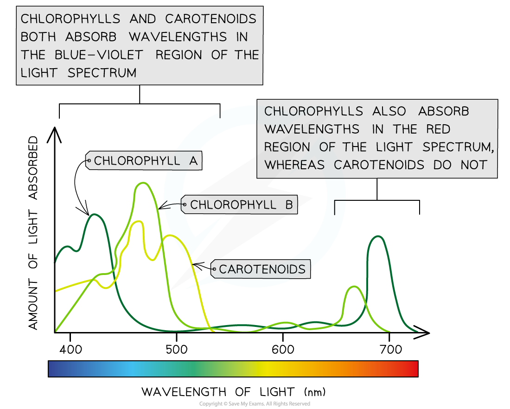
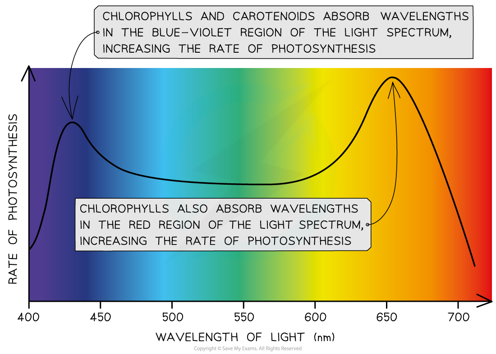
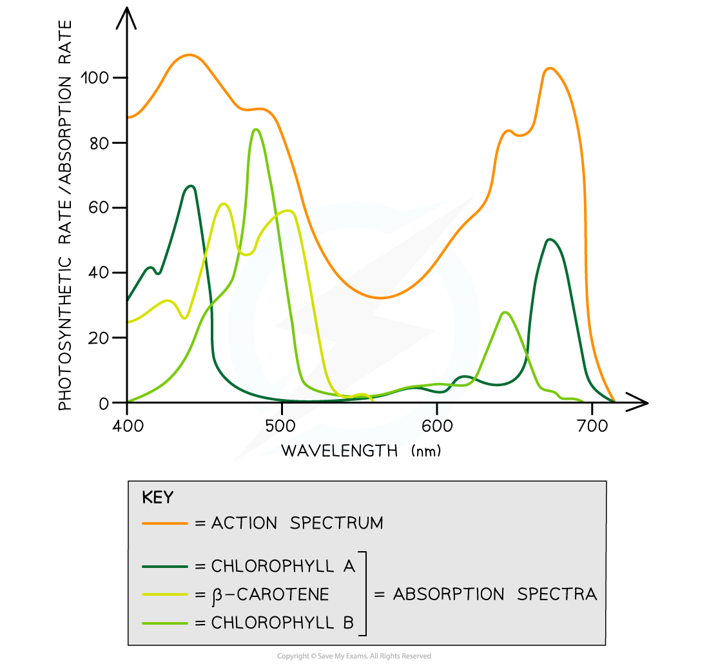

# Absorption Spectra & Action Spectra

## Absorption Spectra & Action Spectra

> **Spec point** — `spcpt_ZPVkhzZPJVxbswc5` · interpret absorption spectra of chloroplast pigments and action spectra for photosynthesis

## Absorption spectra & action spectra

### Absorption spectra

- An **absorption spectrum** is a graph that shows the **absorbance** of different wavelengths of light by a particular pigment

  - **[Chlorophylls](https://www.savemyexams.com/a-level/biology/cie/25/revision-notes/13-photosynthesis/13-1-photosynthesis-as-an-energy-transfer-process/chloroplast-pigments/?_ai=internal-linking)** absorb wavelengths in the **blue-violet and red regions** of the light spectrum
  - **Carotenoids** absorb wavelengths of light mainly in the **blue-violet region** of the spectrum

*Absorption spectra of chlorophyll A, chlorophyll B and carotenoid pigments*

### Action spectra

- An **action spectrum** is a graph that shows the **rate of photosynthesis** at different wavelengths of light

  - The rate of photosynthesis is **highest** at the **blue-violet** and **red** regions of the light spectrum
  - This is because these are the wavelengths of light that plants can **absorb** (i.e. the wavelengths of light that chlorophylls and carotenoids can absorb)

*Photosynthetic action spectrum*

- There is a strong **correlation** between the cumulative absorption spectra of all pigments and the action spectrum:

  - Both graphs have** two main peaks** (at the **blue-violet** region and the **red** region of the light spectrum)
  - Both graphs have a **trough** (in the **green-yellow** region of the light spectrum)

*An overlay of the photosynthetic absorption and action spectra shows there is a strong cumulative correlation*
