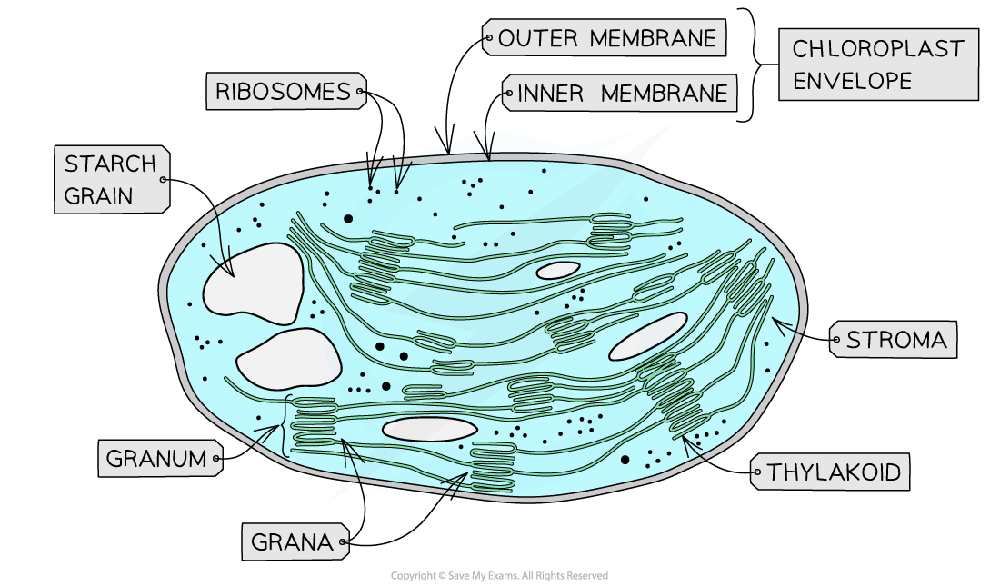

# Chloroplasts

## Chloroplast Structures & their Functions

> **Spec point** — `spcpt_dbzyw24g3NdRFt2T` · describe the relationship between the structure of chloroplasts, as shown in diagrams and electron micrographs, and their function

## Chloroplast structures & their functions

- Chloroplasts are the **organelles** in plant cells where **photosynthesis** occurs
- Each chloroplast is surrounded by a **double-membrane envelope**

  - Each of the envelope membranes is a phospholipid bilayer
- Chloroplasts are filled with a fluid known as the **stroma**

  - The stroma is the site of the[ light-independent stage ](https://www.savemyexams.com/a-level/biology/cie/25/revision-notes/13-photosynthesis/13-1-photosynthesis-as-an-energy-transfer-process/stages-of-photosynthesis/?_ai=internal-linking)of photosynthesis

- A separate **system of membranes** is found in the stroma

  - This membrane system is the site of the **light-dependent stage** of photosynthesis
  - The membrane contains the [pigments](https://www.savemyexams.com/a-level/biology/cie/25/revision-notes/13-photosynthesis/13-1-photosynthesis-as-an-energy-transfer-process/chloroplast-pigments/?_ai=internal-linking), **enzymes** and **electron carriers** required for the light-dependent reactions
  - This membrane system consists of a series of flattened, fluid-filled sacs known as [thylakoids](https://www.savemyexams.com/a-level/biology/cie/25/revision-notes/13-photosynthesis/13-1-photosynthesis-as-an-energy-transfer-process/thylakoids-and-the-stroma/)
  - These thylakoids stack up to form structures known as **grana** (singular; granum)
  - Grana are connected by membranous channels called **stroma lamellae**, which ensure the stacks of sacs are connected but distanced from each other
  - The membranes of the grana create a **large surface area** to **increase the number of light-dependent reactions **that can occur
  - This membrane system provides a large number of pigment molecules in an arrangement that ensures **as much light as necessary is captured**
- The stroma also contains small (70S) **ribosomes**, a loop of **DNA** and **starch grains**:

  - The loop of DNA codes for some of the **chloroplast proteins** (other chloroplast proteins are coded for by the DNA in the plant cell nucleus)
  - The proteins coded for by this loop of chloroplast DNA are **produced at the 70S ribosomes**
  - Sugars formed during photosynthesis are **stored** as **starch** inside starch grains

*An electron micrograph showing the structures within a chloroplast*

> **Exam Hint**
> Make sure you can identify the **structures **of a chloroplast on a diagram **AND **that you can explain the **function** of each of these structures.
> 
> It is also important to be able to describe the **compartmentalisation **within a chloroplast and how that separates the reactions of the light-dependent and the light-independent stages.
