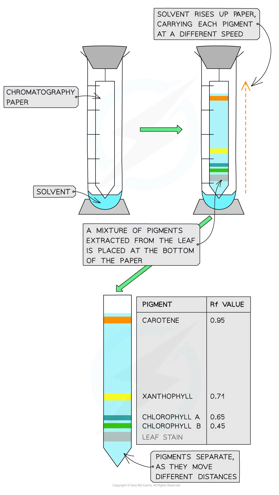

# Chromatography of Chloroplast Pigments

## Chromatography of Chloroplast Pigments

> **Spec point** — `spcpt_KnCb5cKqgz29Zgrw` · describe and use chromatography to separate and identify chloroplast pigments

## Chromatography of chloroplast pigments

- **Chromatography** is an experimental technique that is used to **separate mixtures**:

  - The mixture is **dissolved** in a fluid/**solvent** (called the mobile phase) and the dissolved mixture then passes through a static material (called the stationary phase)
  - **Different components** within the mixture travel through the material at **different speeds**
  - This causes the different components to **separate**
  - A retardation factor (**R****f**) can be calculated for each component of the mixture

**R****f**** value = distance travelled by component ÷ distance travelled by solvent**

- Two of the most common techniques for separating these photosynthetic pigments are:

  - **Paper chromatography**—the mixture of pigments is passed through paper ([cellulose](https://www.savemyexams.com/a-level/biology/cie/22/revision-notes/2-biological-molecules/2-2-carbohydrates--lipids/2-2-6-cellulose/))
  - **Thin layer chromatography**—the mixture of pigments is passed through a thin layer of adsorbent (e.g. silica gel), through which the mixture travels faster and separates more distinctly
- Chromatography can be used to separate and identify chloroplast pigments that have been extracted from a leaf, as each pigment will have a unique Rf value
- The Rf value demonstrates how far a dissolved pigment travels through the stationary phase

  - A** smaller R****f**** value** indicates the pigment is **less soluble** and **larger**
- Although specific Rf values depend on the solvent that is being used, in general:

  - **Carotenoids** have the **highest R****f**** values** (usually close to 1)
  - **Chlorophyll B** has a **much lower R****f**** value**
  - **Chlorophyll A** has an Rf value somewhere **between** those of carotenoids and chlorophyll B
  - **Small R****f**** values** indicate the pigment is l**ess soluble** and **larger**

*Paper chromatography can be used to separate the photosynthetic pigments found within chloroplasts. Rf values can then be calculated for each pigment.*

> **Exam Hint**
> Make sure you learn the **approximate R****f**** values** for the different pigments within chloroplasts (or at least their values relative to each other). This means you should be able to identify different chloroplast pigments based on their Rf values alone.
