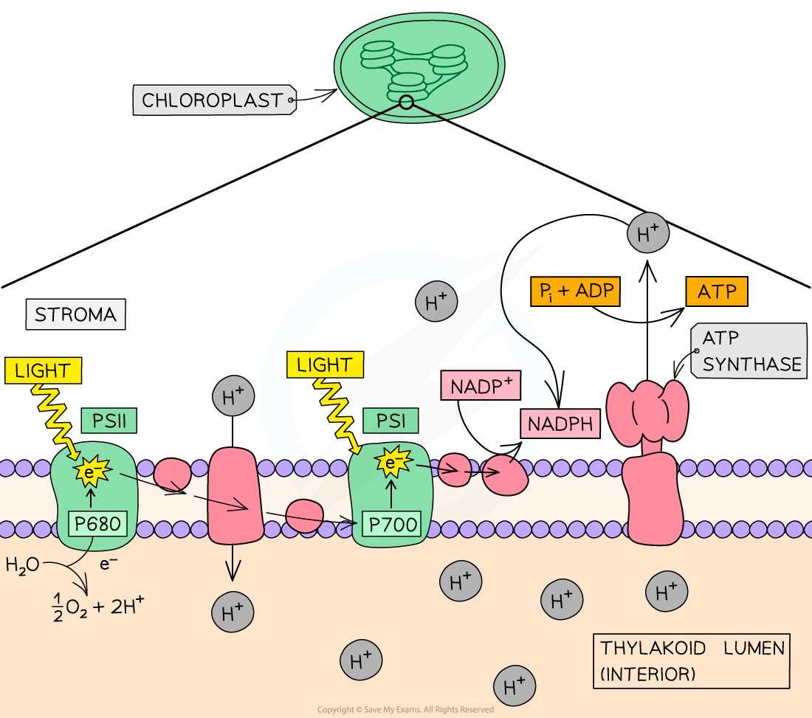
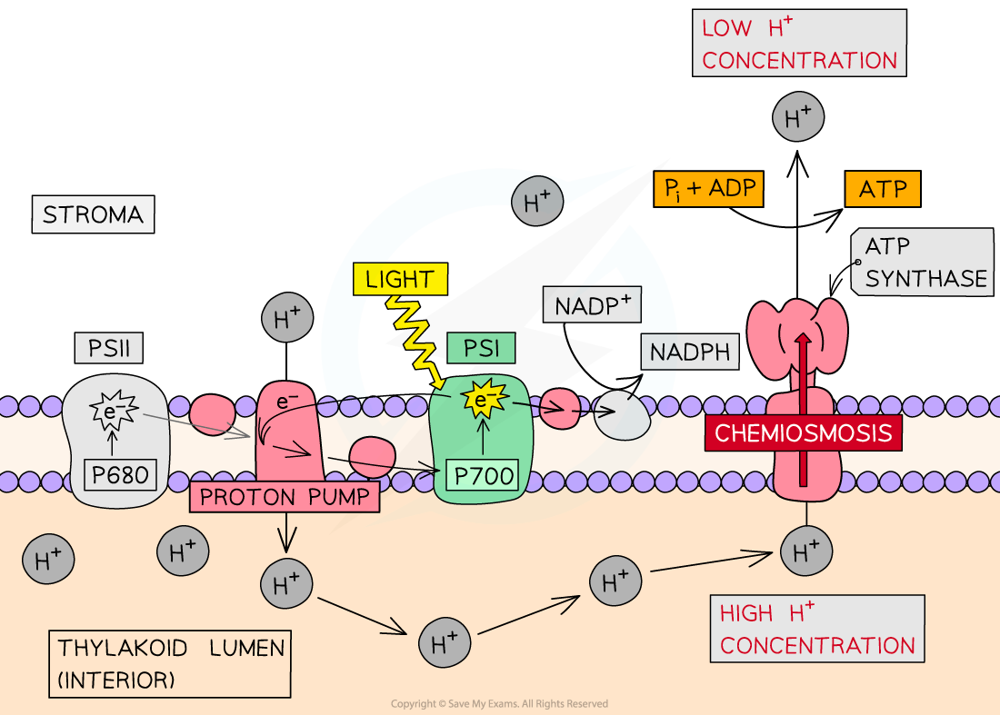
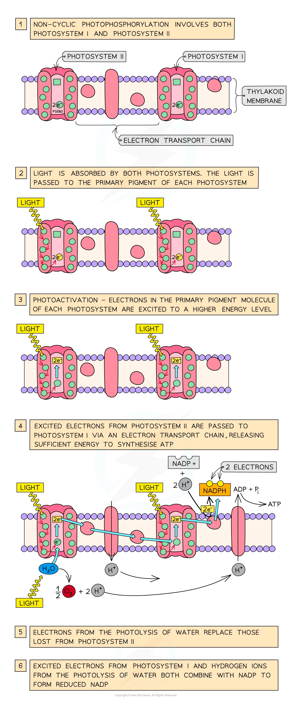
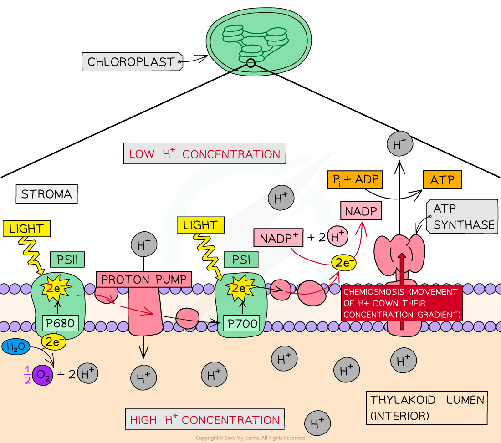

# Photophosphorylation

## Types of Photophosphorylation

> **Spec point** — `spcpt_CGjYYCHSckzF4n8T` · state that cyclic photophosphorylation and non-cyclic photophosphorylation occur during the light-dependent stage of photosynthesis

## Types of photophosphorylation

- The **thylakoid membrane** is the site of the **light-dependent stage** of photosynthesis
- During the **light-dependent** stage of photosynthesis:

  - Light energy is used to break down water (photolysis) to produce hydrogen ions, electrons and oxygen in the** thylakoid lumen**
  - A proton gradient is formed as energy released from electrons passing along the electron transport chain is used to pump protons from the stroma into the thylakoid lumen (photolysis of water adds further protons to the lumen), resulting in a high concentration of hydrogen ions in the thylakoid lumen
  - Electrons travel through an **electron transport chain** of proteins within the membrane
  - **Reduced NADP** (NADPH) is produced when hydrogen ions in the stroma and electrons from the electron transport chain combine with the **carrier molecule NADP**
  - **ATP** is produced during a process known as **photophosphorylation** (ADP + Pi → ATP) using the proton gradient between the thylakoid lumen and stroma to drive the enzyme ATP synthase
- The photophosphorylation of ADP to ATP can be **cyclic** or **non-cyclic**, depending on the pattern of electron flow in photosystem I or photosystem II or both

  - In **cyclic** photophosphorylation, **only photosystem I** is involved
  - In **non-cyclic** photophosphorylation, **both photosystem I and photosystem II** are involved
- **Photosystems** are collections of photosynthetic pigments that absorb light energy and transfer the energy onto electrons, each photosystem contains a** primary pigment**

  - **Photosystem II **has a primary pigment that absorbs light at a wavelength of 680nm and is therefore called **P680**
  - Photosystem II is at the beginning of the electron transport chain and is where the photolysis of water takes place
  - **Photosystem I **has a primary pigment that absorbs light at a wavelength of 700nm and is therefore called **P700**
  - Photosystem I is in the middle of the electron transport chain
- The energy carried by the ATP is then used during the **light-independent** reactions of photosynthesis

*The light-dependent stage of photosynthesis takes place in the thylakoid membrane and thylakoid lumen*

## Cyclic Photophosphorylation

> **Spec point** — `spcpt_hfX3pFnrzzcPT3ZV` · explain that in cyclic photophosphorylation:
• only photosystem I (PSI) is involved
• photoactivation of chlorophyll occurs
• ATP is synthesised

## Cyclic photophosphorylation

- Cyclic photophosphorylation involves **photosystem I (PSI) only**
- **Light is absorbed** by photosystem I (located in the thylakoid membrane) and passed to the photosystem I **primary pigment **(P700)
- An **electron** in the primary pigment molecule (i.e. the chlorophyll molecule) is **excited** to a **higher energy level **and is emitted from the chlorophyll molecule in a process known as **photoactivation**
- This excited electron is captured by an electron acceptor, and transported via a **chain of electron carriers** known as an **electron transport chain **before being passed back to the chlorophyll molecule in photosystem I (hence: *cyclic*)
- As electrons pass through the electron transport chain they provide energy to transport protons (H+) from the stroma to the thylakoid lumen via a **proton pump**
- A build-up of protons in the thylakoid lumen can then be used to drive the **synthesis of ATP** from ADP and an inorganic phosphate group (Pi) by the process of **chemiosmosis**
- **Chemiosmosis** is the movement of chemicals (protons) down their concentration gradient, the energy released from this can be used by ATP synthase to synthesise ATP
- The ATP then passes to the** light-independent reactions**

*Cyclic photophosphorylation*

> **Exam Hint**
> Make sure you know the difference between the two forms of photophosphorylation!
> 
> Cyclic photophosphorylation differs from non-cyclic photophosphorylation in two key ways:
> 
> - Cyclic photophosphorylation **only** **involves photosystem I** (whereas non-cyclic photophosphorylation involves photosystems I and II)
> - Cyclic photophosphorylation **does not produce reduced NADP** (whereas non-cyclic photophosphorylation does)

## Non-cyclic Photophosphorylation

> **Spec point** — `spcpt_5xg2grHQNxHKtZN8` · explain that in non-cyclic photophosphorylation:
• photosystem I (PSI) and photosystem II (PSII) are both involved
• photoactivation of chlorophyll occurs
• the oxygen-evolving complex catalyses the photolysis of water
• ATP and reduced NADP are synthesised

## Non-cyclic photophosphorylation

- Non-cyclic photophosphorylation involves **both photosystem I and photosystem II**

### Photosystem II

- **Light is absorbed **by **photosystem II** (located in the thylakoid membrane) and passed to the photosystem II **primary pigment (P680)**
- An **electron** in the primary pigment molecule (i.e. the chlorophyll molecule) is **excited** to a **higher energy level** and is emitted from the chlorophyll molecule in a process known as **photoactivation**
- This excited electron is passed down a **chain of electron carriers** known as an **electron transport chain**, before being passed on to photosystem I
- During this process, **ATP is synthesised** from ADP and an inorganic phosphate group (Pi) by the process of **chemiosmosis**
- The ATP then passes to the **light-independent reactions**
- Photosystem II contains a **water-splitting enzyme** called the **oxygen-evolving complex** which catalyses the breakdown (**photolysis**) of water by light:

**2H****2****O → 4H****+**** + 4e****-**** + O****2**

- As the excited electrons **leave** the primary pigment of photosystem II and are passed on to photosystem I, they are **replaced** by **electrons** from the **photolysis** of water

### Photosystem I

- At the **same time** as the photoactivation of electrons in photosystem II,** electrons in** **photosystem I also undergo photoactivation**
- The excited electrons from photosystem I also pass along an **electron transport chain**
- These electrons **combine** with **hydrogen ions** (produced by the photolysis of water) and the **carrier molecule NADP** to give **reduced NADP**:

**2H****+**** + 2e****-**** + NADP → reduced NADP**

- The reduced NADP (NADPH) then passes to the **light-independent reactions** to be used in the **synthesis of carbohydrate**

*Non-cyclic photophosphorylation*

> **Exam Hint**
> Remember—the **oxygen **produced during the photolysis of water is a **waste product** of this process.
> 
> The **hydrogen ions** and **electrons **produced during the photolysis of water are **useful products**.
> 
> The electrons replace those that have been lost from the primary pigment molecule of photosystem II (as photosystem II passes its electrons on to photosystem I).
> 
> The hydrogen ions combine with the electrons from photosystem I to form reduced NADP (NADPH).

## Photophosphorylation & Chemiosmosis

> **Spec point** — `spcpt_PmkH5mCBMXz7vQgC`

## Photophosphorylation & chemiosmosis

- During **photophosphorylation**, energetic (excited) **electrons** are captured by an electron acceptor in a **thylakoid membrane**
- These energetic electrons are then passed along a chain of electron carriers (known as the **electron transport chain**)
- The electron carriers are alternately **reduced** (as they **gain** an electron) and then **oxidised** (as they **lose** the electron by passing it to the next carrier)
- The excited electrons **gradually release their energy** as they pass through the electron transport chain
- The released energy is used to **actively transport protons (H****+**** ions)** across the thylakoid membrane, from the **stroma** (the fluid within chloroplasts) to the **thylakoid lumen** (the space within [thylakoids](https://www.savemyexams.com/a-level/biology/cie/25/revision-notes/13-photosynthesis/13-1-photosynthesis-as-an-energy-transfer-process/thylakoids-and-the-stroma/))
- A **‘proton pump’** transports the protons across the thylakoid membrane, from the stroma to the thylakoid lumen
- This creates a **proton gradient**, with a **high concentration** of protons in the **thylakoid lumen** and a **low concentration** in the **stroma**
- Protons then return to the stroma (moving down the proton concentration gradient) by **facilitated diffusion **through **transmembrane** **ATP synthase** enzymes in a process known as **chemiosmosis**
- This process provides the energy needed to **synthesise ATP** by adding an inorganic phosphate group (Pi) to ADP (**ADP + P****i**** → ATP**)
- The whole process is known as **photophosphorylation** as **light** provides the initial **energy source** for ATP synthesis
- After being passed down the electron transport chain, the de-energised electrons from photosystem II are **taken up by photosystem I**

*The process of photophosphorylation first involves the active transport of protons across the thylakoid membrane. These protons then move back across the thylakoid membrane via a process of facilitated diffusion known as chemiosmosis*

> **Exam Hint**
> Make sure you understand the **direction of movement **of **protons **across the thylakoid membrane during photophosphorylation.
> 
> Protons are first actively transferred from the stroma to the thylakoid space. These protons then move from the thylakoid space back to the stroma during chemiosmosis.
