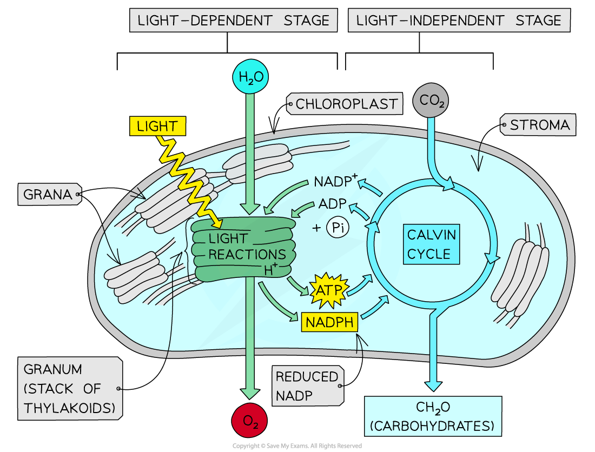

# Stages of Photosynthesis

## The Two Stages of Photosynthesis

> **Spec point** — `spcpt_jp3xWWqgJZJprNyc` · explain that energy transferred as ATP and reduced NADP from the light-dependent stage is used during the light-independent stage (Calvin cycle) of photosynthesis to produce complex organic molecules

## The two stages of photosynthesis

- Photosynthesis occurs in two distinct stages:

  - The **light-dependent stage**, which takes place in the [thylakoids](https://www.savemyexams.com/a-level/biology/cie/25/revision-notes/13-photosynthesis/13-1-photosynthesis-as-an-energy-transfer-process/thylakoids-and-the-stroma/)
  - The **light-independent stage**, which takes place in the **stroma**

### Summary of the light-dependent stage

- **Reduced NADP** is **produced **when hydrogen ions combine with the **carrier molecule NADP** using electrons from the **photolysis** of water
- **ATP** is **produced ** in a process called **photophosphorylation**

  - Photophosphorylation uses a proton (H+) gradient, set up when energy from electrons passing along the electron transport chain is used to pump protons into the thylakoid space
- **Energy from** **ATP** and **hydrogen from reduced NADP** are passed from the light-dependent stage to the light-independent stage of photosynthesis

### Summary of the light-independent stage

- The energy and hydrogen (from the light-dependent stage) are used
- This takes place in reactions known collectively as the **Calvin cycle**
- Complex organic molecules are produced, including (but not limited to) **carbohydrates**, such as:

  - **Starch** (for storage)
  - **Sucrose** (for translocation around the plant)
  - **Cellulose** (for making cell walls)

*Photosynthesis occurs in two, closely-linked stages: the light-dependent stage, which takes place in the thylakoids, and the light-independent stage, which takes place in the stroma*

> **Exam Hint**
> Remember, the whole purpose of the light-dependent reactions is to produce **ATP** and **reduced NADP**, which are then supplied into the stroma and used to complete the process of photosynthesis through the light-independent reactions.
