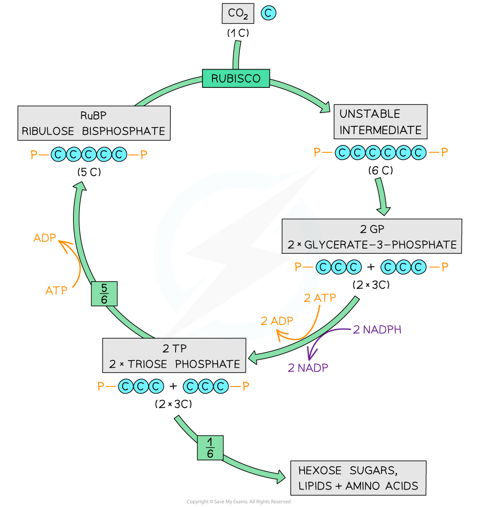

# The Calvin Cycle

## Stages of the Calvin Cycle

> **Spec point** — `spcpt_FtKg528Cm4GZQCQh` · outline the three main stages of the Calvin cycle:
• rubisco catalyses the fixation of carbon dioxide by combination with a molecule of
ribulose bisphosphate (RuBP), a C compound, to yield two molecules of glycerate -phosphate (GP), a C compound
• GP is reduced to triose phosphate (TP) in reactions involving reduced NADP and ATP
• RuBP is regenerated from TP in reactions that use ATP

## Stages of the Calvin cycle

- **Energy from** **ATP** and **hydrogen from reduced NADP** are passed from the [light-dependent stage](https://www.savemyexams.com/a-level/biology/cie/25/revision-notes/13-photosynthesis/13-1-photosynthesis-as-an-energy-transfer-process/stages-of-photosynthesis/?_ai=internal-linking) to the light-independent stage of photosynthesis
- The energy and hydrogen are used during the **light-independent** reactions (known collectively as the [Calvin cycle](https://www.savemyexams.com/a-level/biology/cie/22/revision-notes/13-photosynthesis/13-1-photosynthesis-as-an-energy-transfer-process/13-1-8-the-calvin-cycle/)) to produce complex organic molecules, including (but not limited to) **carbohydrates**, such as:

  - **Starch** (for storage)
  - **Sucrose** (for translocation around the plant)
  - [Cellulose](https://www.savemyexams.com/a-level/biology/cie/22/revision-notes/2-biological-molecules/2-2-carbohydrates--lipids/2-2-6-cellulose/) (for making cell walls)
- This stage of photosynthesis does not, in itself, require energy from light (hence **light-independent**) and can therefore take place in light or darkness
- However, as it requires inputs of ATP and reduced NADP from the light-dependent stage, the Calvin cycle cannot continue indefinitely in darkness, as these inputs will run out
- There are **three main steps** within the **Calvin cycle**:

  - **Rubisco** catalyses the **fixation of carbon dioxide** by combination with a molecule of **ribulose bisphosphate** (RuBP), a 5-carbon compound, to yield two molecules of **glycerate 3-phosphate** (GP), a 3-carbon compound
  - **GP is reduced** to **triose phosphate** (TP) in a reaction involving reduced NADP and ATP
  - **RuBP is** **regenerated** from TP in reactions that use ATP

### Carbon fixation

- Carbon dioxide combines with a five-carbon (5C) sugar known as **ribulose bisphosphate** (RuBP)
- An **enzyme** called **rubisco** (ribulose bisphosphate carboxylase) catalyses this reaction
- The resulting six-carbon (6C) compound is **unstable** and splits in two
- This gives two molecules of a three-carbon (3C) compound known as **glycerate 3-phosphate **(GP)
- The carbon dioxide has been **‘fixed’** (it has been removed from the external environment and has become part of the organic matter of the plant cell)
- Glycerate 3-phosphate (GP) is **not a carbohydrate** but the next step in the Calvin cycle converts it into one

### Reduction of glycerate 3-phosphate

- **Energy from ATP** and **hydrogen from reduced NADP** – both produced during the light-dependent stage of photosynthesis – are used to **reduce glycerate 3-phosphate **(GP) to a phosphorylated three-carbon (3C) sugar known as **triose phosphate** (TP)
- **One-sixth** of the triose phosphate (TP) molecules are used to produce useful organic molecules needed by the plant:

  - Triose phosphates can condense to become **hexose phosphates** (6C), which can be used to produce **starch, sucrose or cellulose**
  - Triose phosphates can be converted to **glycerol** and glycerate 3-phosphates to **fatty acids**, which join to form **lipids for cell membranes**
  - Triose phosphates can be used in the **production of amino acids for protein synthesis**

### Regeneration of ribulose bisphosphate

- **Five-sixths **of the triose phosphate (TP) molecules are used to **regenerate ribulose bisphosphate** (RuBP)
- This process** requires ATP**

*The Calvin cycle*

## Calvin Cycle Intermediates

> **Spec point** — `spcpt_MkV83k9DQNMzn82Q` · state that Calvin cycle intermediates are used to produce other molecules, limited to GP to produce some amino acids and TP to produce carbohydrates, lipids and amino acids

## Calvin cycle intermediates

- Intermediate molecules of the Calvin cycle (such as **glycerate 3-phosphate** and **triose phosphate**) are used to produce other molecules
- Glycerate 3-phosphate (GP) is used to produce some **amino acids**
- Triose phosphate (TP) is used to produce:

  - **Hexose phosphates** (6C), which can be used to produce starch, sucrose or cellulose
  - **Lipids** for cell membranes
  - **Amino acids** for protein synthesis
