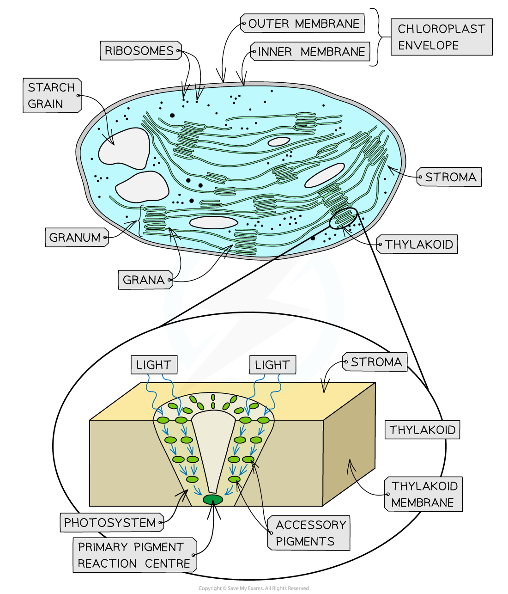

# Thylakoids & the Stroma

## Thylakoids & the Stroma

> **Spec point** — `spcpt_NG9C6rJY9SrzTpM3` · state that within a chloroplast, the thylakoids (thylakoid membranes and thylakoid spaces), which occur in stacks called grana, are the site of the light-dependent stage and the stroma is the site of the light-independent stage

## Thylakoids & the stroma

- Plant cells contain **chloroplasts** which are the site of photosynthesis

  - Chloroplasts are filled with a fluid known as the **stroma**
- The **system of membranes** found in the stroma of the chloroplast consists of a series of flattened fluid-filled sacs known as [thylakoids](https://www.savemyexams.com/a-level/biology/cie/25/revision-notes/13-photosynthesis/13-1-photosynthesis-as-an-energy-transfer-process/thylakoids-and-the-stroma/)

  - In places, these thylakoids stack up to form structures known as **grana** (singular; granum)
- The **light-dependent stage** of photosynthesis occurs in the **thylakoid membranes** and the **thylakoid spaces** (the spaces inside the thylakoids)
- The thylakoid membranes contain the **pigments**, **enzymes** and **electron carriers** required for the light-dependent reactions
- The membranes of the grana create a **large surface area** to **increase the number of light-dependent reactions **that can occur

  - This membrane system provides a large number of pigment molecules in an arrangement that ensures **as much light as necessary is captured**
- The pigment molecules are arranged in **light-harvesting clusters** known as **photosystems**

  - In a photosystem, the different pigment molecules are arranged in **funnel-like structures **the thylakoid membrane
  - Each pigment molecule passes energy down to the next pigment molecule in the cluster until it reaches the primary pigment reaction centre

*An example of a photosystem in a chloroplast thylakoid membrane: a light-harvesting cluster of photosynthetic pigments involved in the light-dependent stage of photosynthesis*

- The **stroma** is the fluid that fills the chloroplasts and surrounds thylakoids
- CO2, sugars, enzymes and other molecules are **dissolved** in the stroma fluid
- The stroma is the site of the **light-independent stage** of photosynthesis

> **Exam Hint**
> Don’t get confused between the light-dependent and light-independent reactions—you need to know where each of these sets of reactions occurs.
> 
> The photosynthetic pigments required to absorb light energy are only found in the **thylakoid membranes**, meaning that the reactions that occur here are **dependent on light** (light-dependent)!
