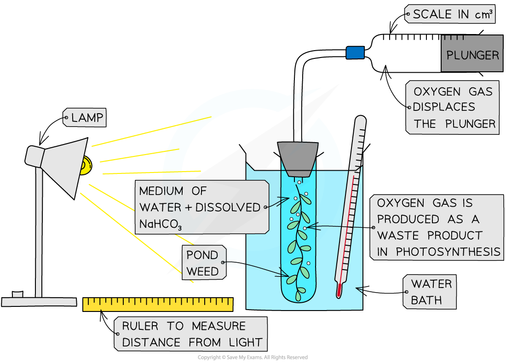

# Investigating the Rate of Photosynthesis

## Investigating the Rate of Photosynthesis: Redox Indicators

> **Spec point** — `spcpt_6f2wrDJfjXYfXMg7` · describe and carry out investigations using redox indicators, including DCPIP and methylene blue, and a suspension of chloroplasts to determine the effects of light intensity and light wavelength on the rate of photosynthesis

## Investigating the rate of photosynthesis: redox indicators

- The **light-dependent reactions** of photosynthesis take place in the thylakoid membrane and involve the**[release of high-energy electrons](https://www.savemyexams.com/a-level/biology/cie/25/revision-notes/13-photosynthesis/13-1-photosynthesis-as-an-energy-transfer-process/photophosphorylation/?_ai=internal-linking)** from *chlorophyll a* molecules
- These electrons are **picked up by electron acceptors** and then passed down the electron transport chain
- However, if a **redox indicator** (such as **DCPIP** or **methylene blue**) is present, the indicator **takes up the electrons instead**
- This causes the indicator to **change colour**

  - DCPIP: oxidised (**blue**) → accepts electrons → reduced (**colourless**)
  - Methylene blue: oxidised (**blue**) → accepts electrons → reduced (**colourless**)
  - *The colour of the reduced solution may appear green because the chlorophyll has a green colour*
- The **rate** at which the redox indicator changes colour from its **oxidised** state to its **reduced** state can be used as a measure of the **rate of photosynthesis**

  - When light is at a higher intensity, or at more preferable light wavelengths, the rate of photoactivation of electrons is faster, therefore the rate of reduction of the indicator is faster

### Method

1. Leaves are crushed in a liquid known as an **isolation medium**

  - This produces a concentrated leaf extract that contains a **suspension of intact and functional chloroplasts**
  - The medium must have the **same water potential** as the leaf cells (so the chloroplasts don’t shrivel or burst) and contain a **buffer** (to keep the pH constant)
  - It should also be **ice cold** (to avoid damaging the chloroplasts and to maintain membrane structure)
2. Small tubes are set up with **different intensities**, or **different colours (wavelengths) **of light shining on them

  - If different intensities of light are used, they must all be of the same wavelength (same colour of light)
  - If different wavelengths of light are used, they must all be of the same light intensity
3. **DCPIP** of **methylene blue** indicator is added to each tube, as well as a small volume of the leaf extract
4. The **time taken** for the redox indicator to go **colourless** is recorded

  - This is a measure of the **rate of photosynthesis**

> **Exam Hint**
> In chemistry, the acronym ‘**OIL RIG**’ is used to remember if something is being oxidised or reduced.
> 
> - **Oxidation **Is **Loss **(of electrons)
> - **Reduction **Is **Gain **(of electrons)
> 
> Therefore DCPIP in its oxidised state has *not* accepted electrons and in its reduced state *has* accepted electrons.

## Investigating the Rate of Photosynthesis: Aquatic Plants

> **Spec point** — `spcpt_BQVPfYJ6D27Gg92z` · describe and carry out investigations using whole plants, including aquatic plants, to determine the effects of light intensity, carbon dioxide concentration and temperature on the rate of photosynthesis

## Investigating the rate of photosynthesis: aquatic plants

- Investigations to determine the effects of [light intensity, carbon dioxide concentration and temperature](https://www.savemyexams.com/a-level/biology/cie/25/revision-notes/13-photosynthesis/13-2-investigation-of-limiting-factors/limiting-factors-of-photosynthesis/?_ai=internal-linking) on the **rate of photosynthesis** can be carried out using **aquatic plants**, such as *Elodea* or *Cabomba* (types of **pondweed**)
- The effect of these limiting factors on the rate of photosynthesis can be investigated in the following ways:

  - **Light intensity**—change the distance (*d*) of a light source from the plant (light intensity is proportional to 1/*d*2)
  - **Carbon dioxide concentration**—add different quantities of sodium hydrogencarbonate (NaHCO3) to the water surrounding the plant, this dissolves to produce CO2
  - **Temperature (of the solution surrounding the plant)**—place the boiling tube containing the submerged plant in water baths of different temperatures
- Whilst changing one of these factors during the investigation (as described below), **ensure the other two remain constant**

  - For example, when investigating the effect of light intensity on the rate of photosynthesis, a glass tank should be placed in between the lamp and the boiling tube containing the pondweed to absorb heat from the lamp – this prevents the solution surrounding the plant from changing temperature

### Method

1. Ensure that the water is** **well aerated before use by bubbling air through it

  - This will ensure that oxygen gas given off by the plant during the investigation **forms** **bubbles** and does not dissolve in the water
2. Ensure that the plant has been **well illuminated** before starting the experiment

  - This will ensure that the plant contains all the enzymes required for photosynthesis and that any changes in rate are due to the independent variable rather than an increase in enzyme activity
3. Cut the stem of the pondweed cleanly just before placing it into the boiling tube

  - Cutting the stem at an angle provides a larger surface area from which bubbles can form
4. Set up the apparatus (as shown below) in a **darkened room**

  - This ensures that the lamp is the only light source and so allows light intensity to be controlled
  - Ensure that the pondweed is fully submerged in **sodium hydrogencarbonate solution **(1%); this ensures that the pondweed has a controlled **supply of carbon dioxide** for photosynthesis
5. Measure the **volume of gas** collected in the gas syringe in a **set period of time**, e.g. 5 minutes
6. Repeat step 5 at least twice more
7. **Change the independent variable** and repeat step 5 again

  - The independent variable could be the light intensity, carbon dioxide concentration or temperature depending on which limiting factor you are investigating
8. Record the results in a table and plot a graph of the volume of oxygen produced per minute against the independent variable

*Aquatic plants can be used to measure the effect of limiting factors on the rate of photosynthesis; this is because it is easy to collect the oxygen that they produce, providing a measure of the reaction rate*

> **Exam Hint**
> Learn the 3 limiting factors and how each one can be altered in a laboratory environment:
> 
> - Light intensity – the distance of the light source from the plant (intensity ∝ 1/*d*2)
> - Temperature - changing the temperature of the water bath the test tube sits in
> - Carbon dioxide - the concentration of NaHCO3 dissolved in the water the pondweed is in
> 
> Also, remember that the variables *not* being tested (the control variables) must be kept constant.
