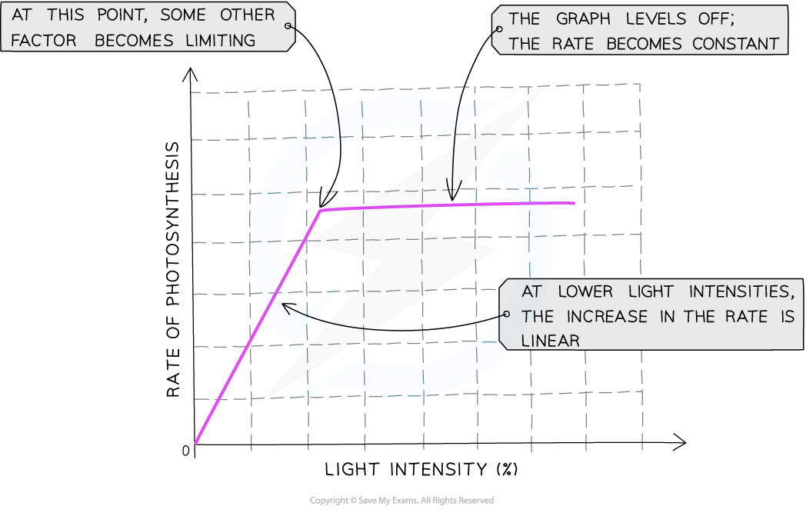
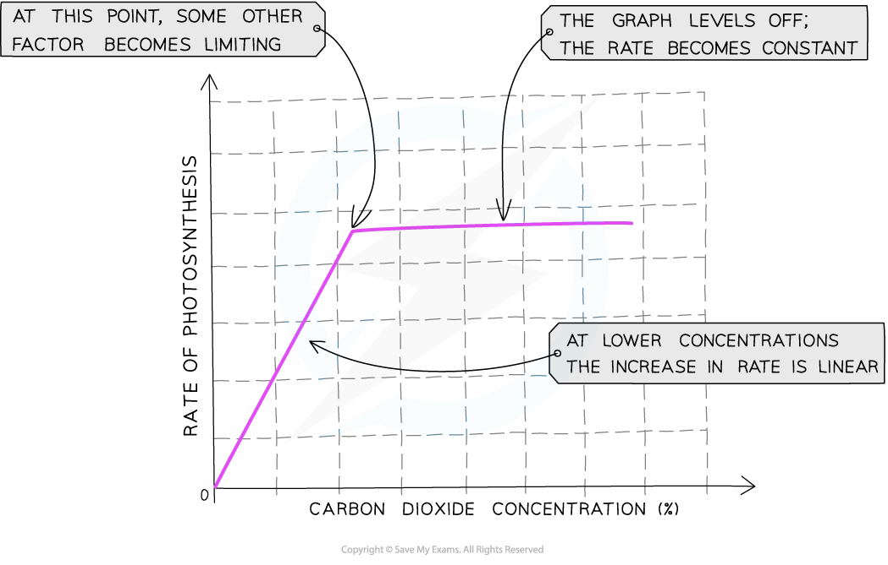
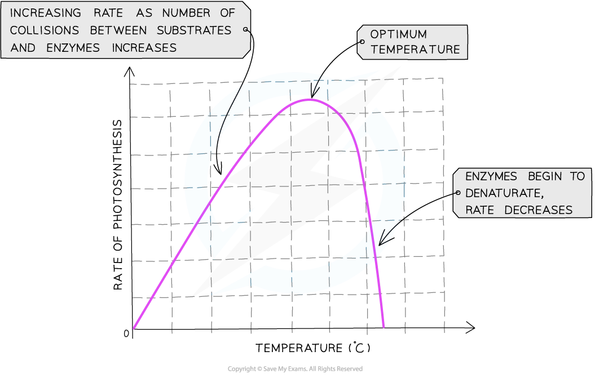

# Limiting Factors of Photosynthesis

## Limiting Factors of Photosynthesis

> **Spec point** — `spcpt_G4gKbmpKRq6y9b2C` · state that light intensity, carbon dioxide concentration and temperature are examples of limiting factors of photosynthesis

## Limiting factors of photosynthesis

- Plants need several factors for **photosynthesis** to occur:

  - The presence of **[photosynthetic pigments](https://www.savemyexams.com/a-level/biology/cie/25/revision-notes/13-photosynthesis/13-1-photosynthesis-as-an-energy-transfer-process/chloroplast-pigments/?_ai=internal-linking)**
  - A supply of **carbon dioxide**
  - A supply of **water**
  - **Light** energy
  - A **suitable** **temperature**
- If there is a **shortage** of any of these factors, photosynthesis cannot occur at its **maximum possible rate**
- The main external factors that affect the rate of photosynthesis are:

  - **light intensity**
  - **carbon dioxide concentration**
  - **temperature**
- These are known as the [limiting factors of photosynthesis](https://www.savemyexams.com/a-level/biology/cie/22/revision-notes/13-photosynthesis/13-2-investigation-of-limiting-factors/13-2-1-limiting-factors-of-photosynthesis/)
- If any one of these factors is **below the optimum level **for the plant, its rate of photosynthesis will be **reduced**, even if the other two factors are at the optimum level

> **Exam Hint**
> Light intensity, CO2 concentration and temperature are the three limiting factors of photosynthesis that you need to learn.
> 
> Although a lack of water can reduce the rate of photosynthesis, water shortages usually affect other processes in the plant before affecting photosynthesis.

## Limiting Factors of Photosynthesis: Effects

> **Spec point** — `spcpt_chxRwNgxhdDprFpr` · explain the effects of changes in light intensity, carbon dioxide concentration and temperature on the rate of photosynthesis

## Limiting factors of photosynthesis: effects

### Light intensity

- When temperature and carbon dioxide concentration remain constant, changes in light intensity affect the rate of photosynthesis
- **The rate of photosynthesis increases as light intensity increases**:

  - The greater the light intensity, the more energy is supplied to the plant and therefore **the faster the light-dependent stage** of photosynthesis can occur
  - This **produces more ATP and reduced NADP for the **[Calvin cycle ](https://www.savemyexams.com/a-level/biology/cie/22/revision-notes/13-photosynthesis/13-1-photosynthesis-as-an-energy-transfer-process/13-1-8-the-calvin-cycle/)(light-independent stage), which can then also occur at a greater rate
  - During this stage of the graph below, light intensity is said to be a limiting factor of photosynthesis
- At some point, if light intensity continues to increase, the relationship above will no longer apply and the rate of photosynthesis will reach a **plateau**
- At this point, **light intensity is no longer a limiting factor** of photosynthesis – another factor is limiting the rate of photosynthesis
- The factors which could be limiting the rate when the line on the graph is horizontal include **temperature** being too low or too high, or not enough **carbon dioxide**

*The effect of light intensity on the rate of photosynthesis*

### Carbon dioxide concentration

- **The rate of photosynthesis increases as carbon dioxide concentration increases**:

  - Carbon dioxide is one of the raw materials required for photosynthesis
  - It is required for the** light-independent stage of photosynthesis **when CO2 is combined with the five-carbon compound ribulose bisphosphate (RuBP)
  - This means the more carbon dioxide that is present, the faster this step of the **Calvin cycle** can occur and **the faster the overall rate of photosynthesis**
- This trend will continue until some other factor required for photosynthesis prevents the rate from increasing further because it is in short supply
- The factors which could be limiting the rate when the line on the graph is horizontal include **temperature** being too low or too high, or not enough **light**

*The effect of carbon dioxide concentration on the rate of photosynthesis*

### Temperature

- **As temperature increases the rate of photosynthesis increases as the reaction is controlled by enzymes**
- However, as the reaction is controlled by enzymes,** this trend only continues up to a certain temperature**

  - Beyond this temperature (known as the **optimum temperature**) the enzymes begin to **denature** and the rate of reaction **decreases**

*The effect of temperature on the rate of photosynthesis*

- For most metabolic reactions, temperature has a large effect on the reaction rate
- For photosynthesis, **temperature has little significant effect on the light-dependent reactions**

  - This is because the light-dependent reactions are driven by energy from light rather than the kinetic energy of the reacting molecules
- However,** the Calvin cycle is affected by temperature, as the light-independent reactions are enzyme-controlled reactions**

  - E.g., [rubisco catalyses the reaction](https://www.savemyexams.com/a-level/biology/cie/25/revision-notes/13-photosynthesis/13-1-photosynthesis-as-an-energy-transfer-process/the-calvin-cycle/?_ai=internal-linking) between CO2 and the five-carbon compound ribulose bisphosphate

> **Exam Hint**
> Interpreting graphs of limiting factors can be confusing for many students, so here's a quick tip.
> 
> In the section of the graph where the rate is increasing (the line is going up), the limiting factor is whatever the label on the x-axis (the bottom axis) of the graph is. In the section of the graph where the rate is not increasing (the line is horizontal), the limiting factor will be something other than what is on the x-axis (choose from temperature, light intensity or carbon dioxide concentration).
