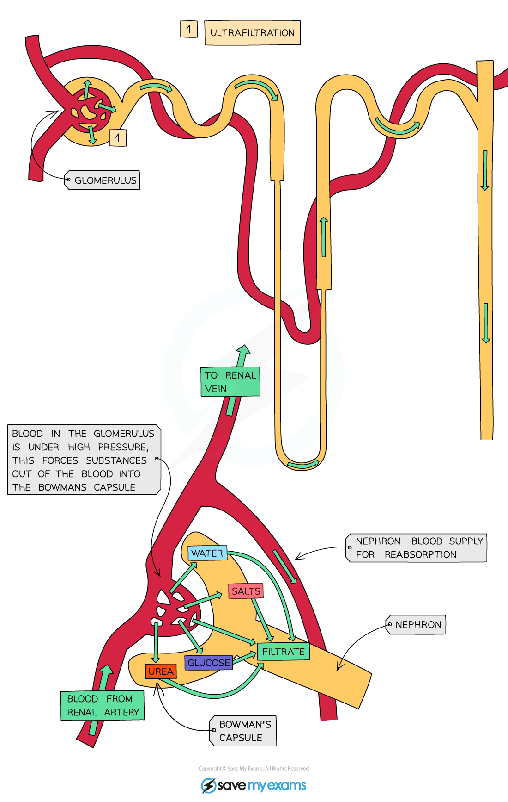
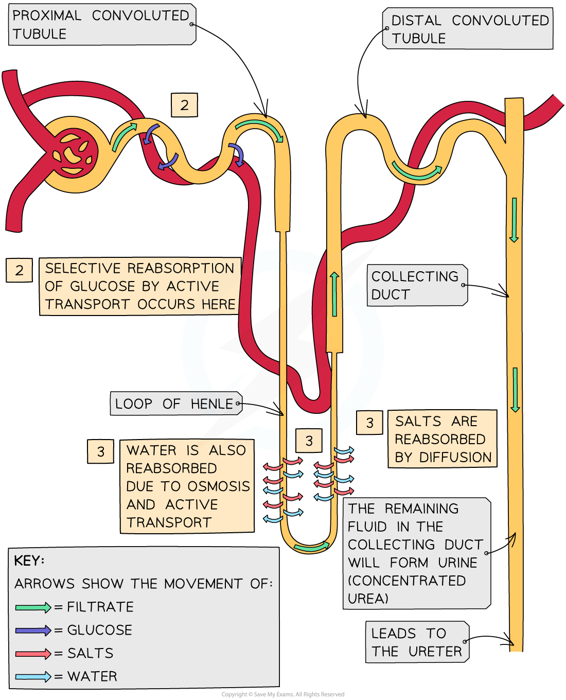
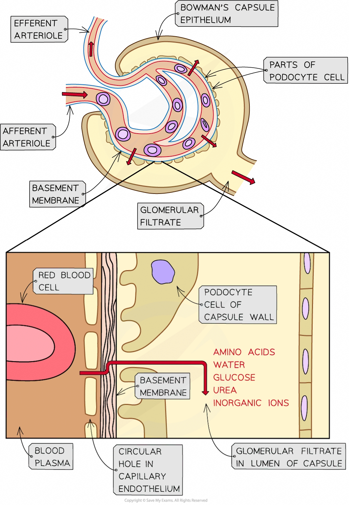
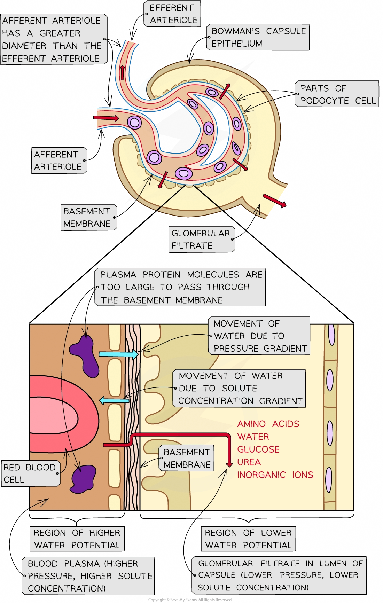
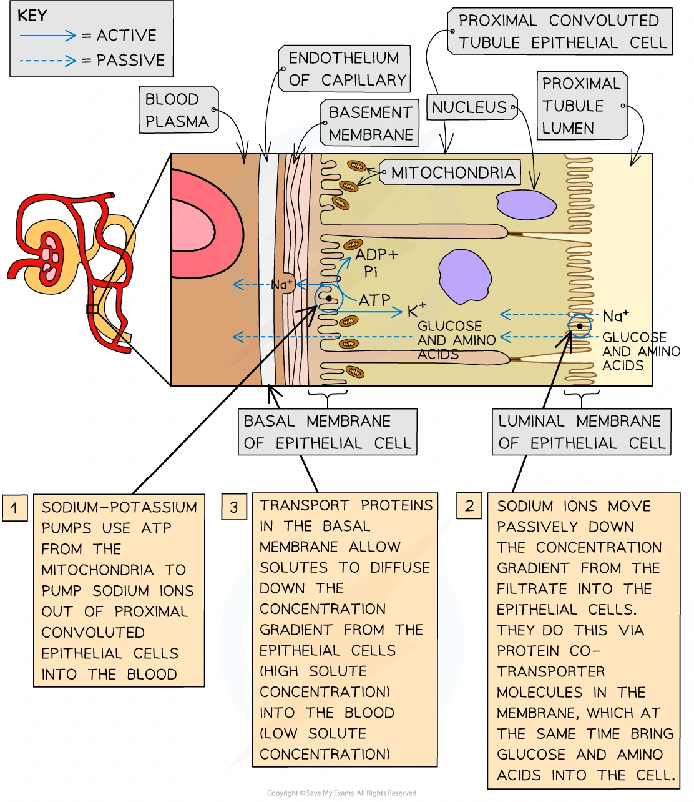

# Formation of Urine

## Formation of Urine in the Nephron

> **Spec point** — `spcpt_qgKPpQnX4SRNgHVF` · describe and explain the formation of urine in the nephron, limited to:
• the formation of glomerular filtrate by ultrafiltration in the Bowman’s capsule
• selective reabsorption in the proximal convoluted tubule

## Formation of urine in the nephron

- The nephron is the **functional unit** of the kidney

  - The nephrons are responsible for the **formation of urine**
- The process of urine formation in the kidneys occurs in **two stages**:

1. **Ultrafiltration**
2. **Selective reabsorption**

| **Stage** | **Name of process** | **Where process occurs** | **Explanation of process** |
|---|---|---|---|
| 1 | Ultrafiltration | Bowman's capsule | Small molecules (including **amino acids, water, glucose, urea and inorganic ions**) are filtered out of the blood capillaries of the glomerulus and **into the Bowman's capsule** to form filtrate known as glomerular filtrate |
| 2 | Selective reabsorption | Proximal convoluted tubule | **Useful molecules** are taken back (**reabsorbed**) from the filtrate and returned to the blood as the filtrate flows along the nephron |

*Ultrafiltration overview from the glomerulus to the Bowman's capsule*

*Selective reabsorption overview*

- After the necessary reabsorption of amino acids, water, glucose and inorganic ions is complete, **the filtrate eventually leaves the nephron** and is now referred to as **urine**
- This urine then flows out of the kidneys, along the ureters and into the **bladder**, where it is temporarily stored

## Ultrafiltration

> **Spec point** — `spcpt_zkjcw4R2gHfPpDSq` · relate the detailed structure of the Bowman’s capsule and proximal convoluted tubule to their functions in the formation of urine

## Ultrafiltration

- Arterioles branch off the **renal artery** and lead to each nephron, where they form a knot of capillaries (the **glomerulus**) sitting inside the cup-shaped **Bowman’s capsule**
- The efferent arteriole (carrying blood away from the glomerulus) is narrower than the afferent arteriole (bringing blood in), which keeps the blood pressure in the glomerular capillaries high

  - This blood is already at high pressure because it is coming directly from the renal artery which is connected to the **aorta**)
- This eventually causes the smaller molecules being carried in the blood to be **forced out of the capillaries and into the Bowman’s capsule**, where they form what is known as the **filtrate**
- The blood in the **glomerular capillaries** is **separated** from the **lumen** of the **Bowman’s capsule** by **two cell layers** with a **basement membrane** in between them:

  - The first cell layer is the ***endothelium***** of the capillary**—each capillary endothelial cell is perforated by thousands of tiny membrane-lined circular holes
  - The next layer is the **basement membrane**—this is made up of a network of collagen and glycoproteins
  - The second cell layer is the ***epithelium***** of the Bowman’s capsule**—these epithelial cells have many tiny finger-like projections with gaps in between them and are known as **podocytes**
- As blood passes through the glomerular capillaries, the holes in the capillary endothelial cells and **the gaps between the podocytes** allows substances dissolved in the blood plasma to pass into the Bowman’s capsule

  - The fluid that filters through from the blood into the Bowman’s capsule is known as the **glomerular filtrate**
  - The main substances that pass out of the capillaries and form the glomerular filtrate are: **amino acids, water, glucose, urea and inorganic ions** (mainly Na+, K+ and Cl-)
- **Red and white blood cells** and **platelets** remain in the blood as they are **too large** to pass through the holes in the capillary endothelial cells
- The **basement membrane** acts as a **filter** as it **stops large protein molecules** from getting through

*Ultrafiltration occurs when small molecules (such as amino acids, water, glucose, urea and inorganic ions) filter out of the blood and into the Bowman’s capsule to form glomerular filtrate. These molecules must pass through three layers during this process: the capillary endothelium, the basement membrane and the Bowman’s capsule epithelium*

### How ultrafiltration occurs

- Ultrafiltration occurs due to the **differences in water potential** between the **plasma** in the **glomerular capillaries** and the **filtrate** in the **Bowman’s capsule**

  - Water moves down a water potential gradient, from a region of higher water potential to a region of lower water potential
  - Water potential is **increased **by **high pressure** and **decreased **by the presence of **solutes**

| **Factor affecting water potential** | **How factor affects water potential in the glomerulus and Bowman’s capsule** | **Resulting movement of water** |
|---|---|---|
| Pressure | As the afferent arteriole is **wider** than the efferent arteriole, the **blood pressure** is relatively **high** in the **glomerular capillaries**  This **raises** the water potential of the blood plasma in the glomerular capillaries above the water potential of the filtrate in the Bowman’s capsule | Water moves down the water potential gradient, from the blood plasma in the glomerular capillaries into the Bowman’s capsule |
| Solute concentration | Whilst the basement membrane allows most solutes within the blood plasma to filter into the Bowman’s capsule, **plasma protein molecules are too big** to get through and stay in the blood  As a result, the solute concentration in the blood plasma in the glomerular capillaries is higher than that in the filtrate in the Bowman’s capsule  This makes the water potential of the blood plasma **lower** than that of the filtrate in the Bowman’s capsule | Water moves down the water potential gradient from the Bowman’s capsule into the blood plasma in the glomerular capillaries |

- Overall, the effect of the pressure gradient **outweighs** the effect of solute gradient
- Therefore, the water potential of the blood plasma in the glomerulus is **higher** than the water potential of the filtrate in the Bowman’s capsule

  - This means that as blood flows through the glomerulus, there is an **overall movement of water down the water potential gradient from the blood into the Bowman’s capsule**

*As blood flows through the glomerulus, there is an overall movement of water down the water potential gradient from the blood plasma (region of higher water potential) into the Bowman’s capsule (region of lower water potential)*

## Selective Reabsorption

> **Spec point** — `spcpt_hB3nzgdBdz9zydgC` · relate the detailed structure of the Bowman’s capsule and proximal convoluted tubule to their functions in the formation of urine

## Selective reabsorption

- Many of the substances that end up in the **glomerular filtrate** actually need to be **kept** by the body
- These substances are **reabsorbed** into the blood as the filtrate passes along the nephron

  - This process is knowns as **selective reabsorption **as **only certain substances **are reabsorbed
- **Glucose** reabsorption occurs in the **proximal convoluted tubule**
- The lining of the proximal convoluted tubule is composed of a single layer of epithelial cells, which are adapted to carry out reabsorption in several ways:

  - Microvilli
  - Co-transporter proteins
  - A high number of mitochondria
  - Tightly packed cells
- Most of the water and inorganic ions (salts) in the filtrate are also reabsorbed in the proximal convoluted tubule; more water can be reabsorbed later in the collecting duct (see Osmoregulation)

| **Adaptation of proximal convoluted tubule epithelial cell** | **How adaptation aids reabsorption** |
|---|---|
| Many microvilli present on the luminal membrane (the cell surface membrane that faces the lumen) | This increases the surface area for reabsorption |
| Many co-transporter proteins in the luminal membrane | Each type of co-transporter protein transports a specific solute (e.g. glucose or a particular amino acid) across the luminal membrane |
| Many mitochondria | These provide energy for sodium-potassium (Na+-K+) pump proteins in the basal membranes of the cells |
| Cells tightly packed together | This means that no fluid can pass between the cells (all substances reabsorbed must pass through the cells) |

### How the selective reabsorption of solutes occurs

- Blood capillaries are located very close to the outer surface of the proximal convoluted tubule

  - As the blood in these capillaries comes straight from the glomerulus, it has lost much of its water, inorganic ions and other small solutes, so its water potential is relatively low
- The basal membranes (of the proximal convoluted tubule epithelial cells) are the sections of the cell membrane that are closest to the blood capillaries
- **Sodium-potassium pumps** in these **basal membranes** move sodium ions out of the epithelial cells and into the blood, where they are carried away

  - This **lowers the concentration of sodium ions inside the epithelial cells**
  - This causes sodium ions in the filtrate to diffuse down their concentration gradient through the luminal membranes (of the epithelial cells)
- These sodium ions do not diffuse freely through the luminal membranes

  - They must pass through **co-transporter proteins** in the membrane
- There are several types of these co-transporter proteins

  - Each type transports **a** **sodium ion and another solute** from the filtrate (e.g., glucose or a particular amino acid)
- Once inside the epithelial cells, these solutes diffuse down their concentration gradients, passing through transport proteins in the basal membranes (of the epithelial cells) into the blood

### Molecules reabsorbed from the proximal convoluted tubule during selective reabsorption

- **All glucose** in the glomerular filtrate is reabsorbed into the blood

  - This means no glucose should be present in the urine
- **Amino acids, vitamins and inorganic ions** are reabsorbed
- The movement of all these solutes from the proximal convoluted tubule into the capillaries **increases** the water potential of the **filtrate** and **decreases** the water potential of the **blood** in the capillaries

  - This creates a steep water potential gradient and **causes water to move into the blood by osmosis**
- A significant amount of **urea** is reabsorbed too

  - The concentration of urea in the filtrate is higher than in the capillaries, causing urea to diffuse from the filtrate back into the blood

*Selective reabsorption in the proximal convoluted tubule*
