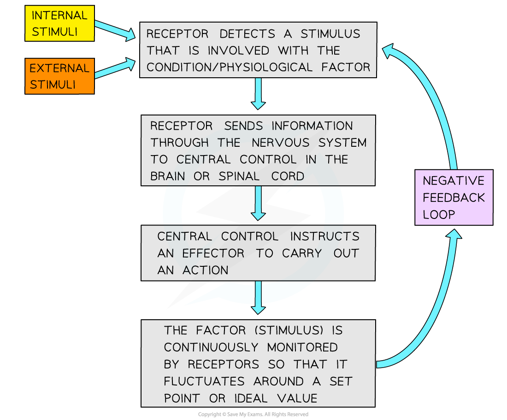

# Homeostasis

## Homeostasis

> **Spec point** — `spcpt_xPCS7cStXwQ2n9mR` · explain what is meant by homeostasis and the importance of homeostasis in mammals

## Homeostasis

- In order to **function** properly and **efficiently**, organisms have different **control systems** that ensure their **internal conditions** are kept relatively **constant**

  - The process of maintaining constant internal body conditions is known as **homeostasis**
- Homeostasis is **critically important** for organisms as it ensures the maintenance of **optimal conditions** for **enzyme action** and **cell function**
- Examples of physiological factors that are **controlled** by **homeostasis** in **mammals** include:

  - Core body temperature
  - Metabolic waste (e.g. carbon dioxide and urea)
  - Blood pH
  - Concentration of glucose in the blood
  - Water potential of the blood
  - Concentration of the respiratory gases (carbon dioxide and oxygen) in the blood

> **Exam Hint**
> Learn the following definition for homeostasis: Homeostasis is the regulation of the internal conditions of a cell or organism to maintain optimum conditions for function, in response to internal and external changes.

## Principles of Homeostasis

> **Spec point** — `spcpt_XWVjxTccZ3nrnws6` · explain the principles of homeostasis in terms of internal and external stimuli, receptors, coordination systems (nervous system and endocrine system), effectors (muscles and glands) and negative feedback

## Principles of homeostasis

- The majority of homeostatic control mechanisms in organisms use **negative feedback** to maintain **homeostatic balance**

  - This means keeping certain physiological factors, such as blood glucose concentration, **within certain limits**
- Negative feedback control loops involve:

  - A **receptor** (or sensor)—to **detect** a **stimulus **that is involved with a condition or physiological factor
  - A **coordination system** (nervous system and endocrine system)—to **transfer information** between different parts of the body
  - An **effector** (muscles and glands)—to **carry out a response**
- Outcome of a negative feedback loop:

  - The factor / stimulus is **continuously monitored**
  - If there is an **increase **in the factor, the body responds to make the factor **decrease**
  - If there is a **decrease **in the factor, the body responds to make the factor **increase**

*A flow diagram of a negative feedback control loop*

- Homeostasis in **mammals** relies on **two different coordination systems** to transfer information between different parts of the body:

  - **Nervous system**—information is transmitted as **electrical impulses** that travel along **neurones**
  - **Endocrine system**—information is transmitted as [chemical messengers called hormones](https://www.savemyexams.com/a-level/biology/cie/25/revision-notes/15-control-and-coordination/15-1-control-and-coordination-in-mammals/the-endocrine-system/?_ai=internal-linking) that travel in the **blood**

> **Exam Hint**
> Although the nervous and endocrine systems are both important in homeostasis and the regulation of certain physiological factors, there are some fundamental differences between them.
> 
> Information is transmitted through these two systems in different ways (electrical impulses vs. hormones).
> 
> Also, the nervous system is usually required for fast, but short-lived responses, whereas the endocrine system is usually involved in slower, but longer-lasting responses (although this is not always the case and some hormones can act very quickly)!
