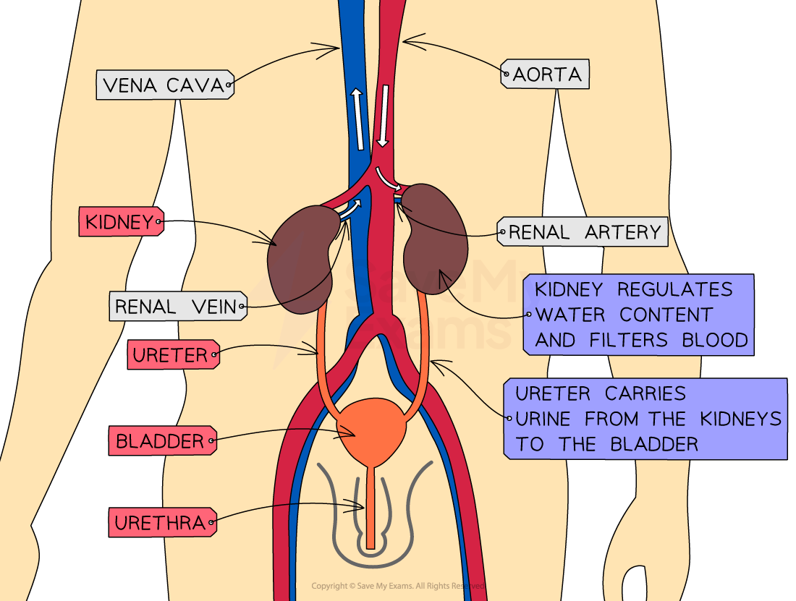
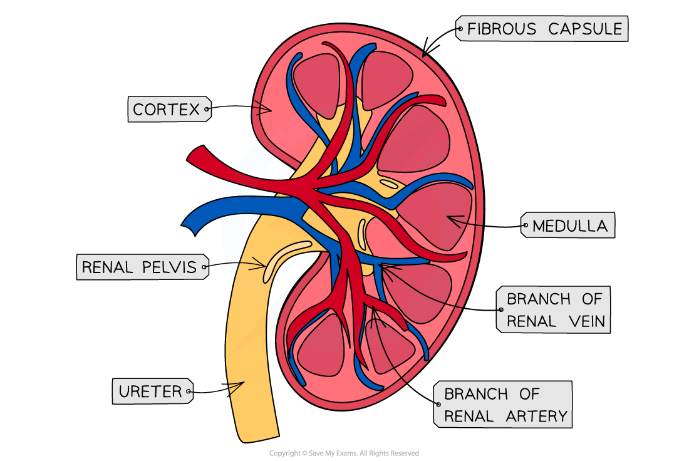

# Kidney Structure

## Structure of the Human Kidney

> **Spec point** — `spcpt_Ftx5JMq36NP6xCgs` · describe the structure of the human kidney, limited to:
• fibrous capsule
• cortex
• medulla
• renal pelvis
• ureter
• branches of the renal artery and renal vein

## Structure of the human kidney

- Humans have **two** kidneys
- The kidneys are responsible for carrying out two very important functions:

  - As an **[osmoregulatory organ](https://www.savemyexams.com/a-level/biology/cie/25/revision-notes/14-homeostasis/14-1-homeostasis-in-mammals/osmoregulation/?_ai=internal-linking)**—**they regulate the water content of the blood** (vital for maintaining blood pressure)
  - As an **excretory organ**—**they excrete the toxic waste products of metabolism** (such as **[urea](https://www.savemyexams.com/a-level/biology/cie/25/revision-notes/14-homeostasis/14-1-homeostasis-in-mammals/production-of-urea/?_ai=internal-linking)**) and substances in excess of requirements (such as **salts**)

*The position of the kidneys and their associated structures*

| **Structure** | **Function** |
|---|---|
| Renal artery | Carries oxygenated blood (containing urea and salts) to the kidneys |
| Renal vein | Carries deoxygenated blood (that has had urea and excess salts removed) away from the kidneys |
| Kidney | Regulates water content of blood and filters blood |
| Ureter | Carries urine from the kidneys to the bladder |
| Bladder | Stores urine (temporarily) |
| Urethra | Releases urine outside of the body |

- The kidney itself is surrounded by a fairly tough outer layer known as the **fibrous capsule**
- Beneath the fibrous capsule, the kidney has **three main areas**:

  - The **cortex** (contains the glomerulus, Bowman’s capsule, proximal convoluted tubule, and distal convoluted tubule of the nephrons)
  - The **medulla** (contains the loop of Henle and collecting duct of the nephrons)
  - The **renal pelvis** (where the ureter joins the kidney)

*A cross-section of a kidney (as seen when cut in half vertically)*

> **Exam Hint**
> Make sure you can identify all the structures mentioned on this page if you are presented with a diagram of the kidney and its associated structures, or a diagram with a vertical cross-section of the kidney itself.
