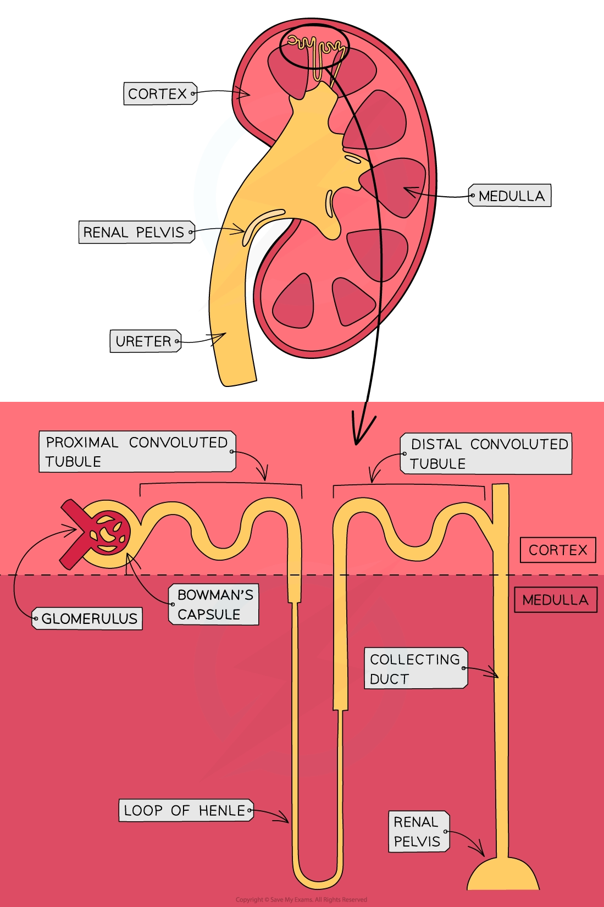

# Nephron Structure

## Nephron Structure

> **Spec point** — `spcpt_sKCsp4jfKhP2qf5r` · Identify, in diagrams, photomicrographs and electron micrographs, the parts of a nephron and its associated blood vessels and structures, limited to:
• glomerulus
• Bowman’s capsule
• proximal convoluted tubule
• loop of Henle
• distal convoluted tubule
• collecting duct

## Nephron structure

- Each kidney contains **thousands** of **tiny tubes**, known as **nephrons**
- The nephron is the **functional unit** of the kidney—the nephrons are responsible for the **[formation of urine](https://www.savemyexams.com/a-level/biology/cie/25/revision-notes/14-homeostasis/14-1-homeostasis-in-mammals/formation-of-urine/?_ai=internal-linking)**

*The location and structure of a nephron within the kidney across the cortex and the medulla*

> **Exam Hint**
> As well as in diagrams, you should be able to identify the parts of the nephron described above in photomicrographs and electron micrographs too (examples of these can be found online or in your Cambridge International AS & A Level coursebook).
