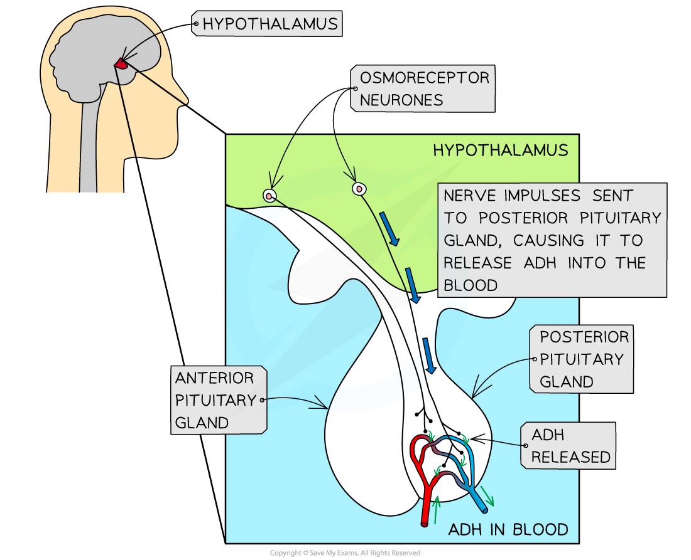
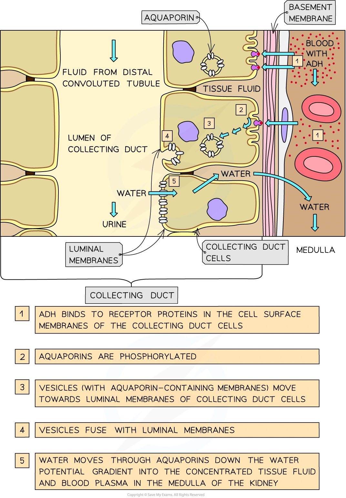

# Osmoregulation

## Osmoregulation

> **Spec point** — `spcpt_5YhYYgxkMDH3KFFX` · describe the roles of the hypothalamus, posterior pituitary gland, antidiuretic hormone (ADH), aquaporins and collecting ducts in osmoregulation

## Osmoregulation

- The control of the **water potential** of body fluids is known as **osmoregulation**

  - Osmoregulation is a key part of [homeostasis](https://www.savemyexams.com/a-level/biology/cie/25/revision-notes/14-homeostasis/14-1-homeostasis-in-mammals/homeostasis/?_ai=internal-linking)
- Specialised **sensory neurones**, known as **osmoreceptors**, monitor the water potential of the blood (these osmoreceptors are found in an area of the brain known as the **hypothalamus**)
- If the osmoreceptors detect a **decrease** in the water potential of the **blood**, nerve impulses are sent along these sensory neurones to the **posterior pituitary gland** (another part of the brain just below the hypothalamus)
- These nerve impulses stimulate the posterior pituitary gland to release **antidiuretic hormone (ADH)**
- ADH molecules enter the blood and travel throughout the body
- ADH causes the **kidneys** to **reabsorb** more water
- This **reduces the loss of water in the urine**

*When osmoreceptors detect a decrease in blood water potential, nerve impulses stimulate the release of ADH at the posterior pituitary gland. This ADH then travels in the blood to the kidneys, causing them to increase water reabsorption*

### The effect of ADH on the kidneys

- Water is reabsorbed by **osmosis** from the **filtrate** in the **nephron**
- This reabsorption occurs as the filtrate passes through structures known as **collecting ducts**
- **ADH** causes the ***luminal membranes*** of the collecting duct cells to become **more permeable **to water
- ADH does this by causing an **increase** in the number of **aquaporins** (water-permeable channels) in the luminal membranes of the collecting duct cells. This occurs in the following way:

  - Collecting duct cells contain **vesicles**, the membranes of which contain many **aquaporins**
  - ADH molecules bind to receptor proteins, activating a signalling cascade that leads to the **phosphorylation** of the aquaporin molecules
  - This activates the aquaporins, causing the **vesicles** to **fuse** with the **luminal membranes** of the collecting duct cells
  - This **increases the permeability** of the membrane to water
- As the filtrate in the nephron travels along the collecting duct, water molecules move from the collecting duct (**high water potential**), through the aquaporins, and into the **tissue fluid** and **blood plasma** in the **medulla** (**low water potential**)

  - As the filtrate in the collecting duct loses water it becomes more **concentrated**
  - As a result, a **small volume of concentrated urine** is produced. This flows from the kidneys, through the ureters and into the bladder

*How ADH affects water reabsorption in the collecting duct of the nephron*

> **Exam Hint**
> If the water potential of the blood is **too high**, the exact **opposite **happens:
> 
> - Osmoreceptors in the hypothalamus detect the increase in water potential
> - Fewer nerve impulses are sent to the posterior pituitary gland
> - Less ADH is released into the blood
> - Aquaporins are moved out of the luminal membranes of the collecting duct cells
> - Collecting duct cells become less permeable to water
> - The filtrate flows along collecting duct but loses little water and is very dilute
> - A large volume of dilute urine is produced
> - This flows from the kidneys, through the ureters and into the bladder
