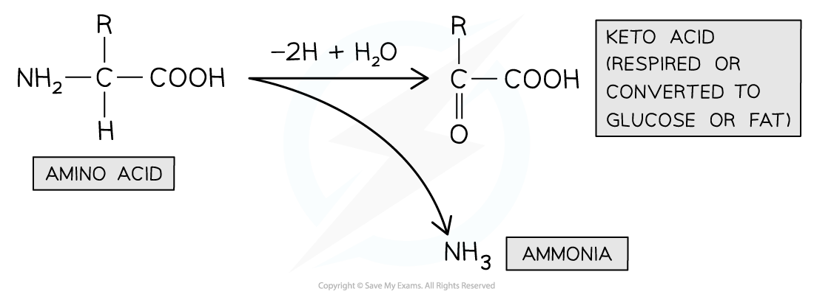

# Production of Urea

## Production of Urea

> **Spec point** — `spcpt_NWtB7pxSbGT68RQQ` · state that urea is produced in the liver from the deamination of excess amino acids

## Production of urea

- Many **metabolic reactions** within the body produce **waste products**
- The removal of these waste products is known as **excretion**
- Many excretory products are formed in humans, with two in particular (**carbon dioxide** and **urea**) being formed in **much** **greater quantities** than others

### Urea

- **Urea** is produced in the **liver**
- It is produced from **excess amino acids**
- If more protein is eaten than is required, the excess **cannot be stored** in the body
- However, the amino acids within the protein can still provide **useful energy**
- To make this energy accessible, the **amino group** is **removed** from each amino acid
- This process is known as **deamination**:

  - The amino group (**-NH****2**) of an amino acid is removed, together with an extra hydrogen atom
  - These combine to form **ammonia** (NH3)
  - The remaining keto acid may enter the Krebs cycle to be **respired**, be converted to **glucose**, or converted to **glycogen / fat for storage**

*The deamination of an amino acid chemical formulae*

- **Ammonia **is a **very soluble** and **highly toxic** compound that is produced during deamination; it can be very damaging if allowed to build up in the blood

  - It dissolves in the blood to form alkaline ammonium hydroxide, disrupting blood pH
  - It can impact the reactions of cell metabolism such as respiration
  - It interferes with cell signalling processes
- This is avoided by **converting ammonia** to **urea**

  - Urea is **much less toxic** than ammonia, so it can be safely transported in the blood to the kidneys
- Ammonia is **combined with carbon dioxide** to form urea

*The formation of urea chemical formulae*
