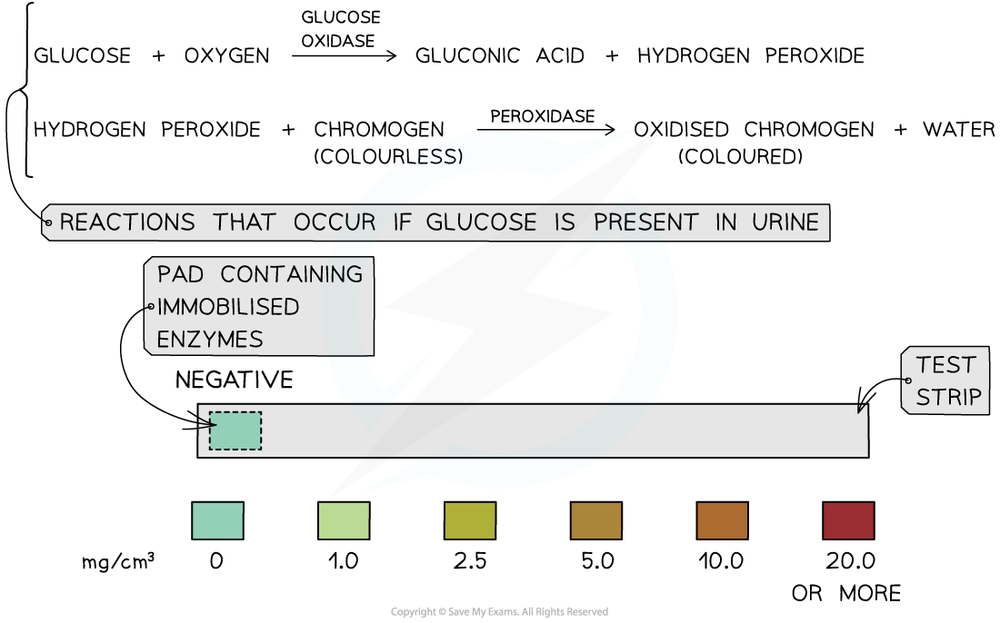
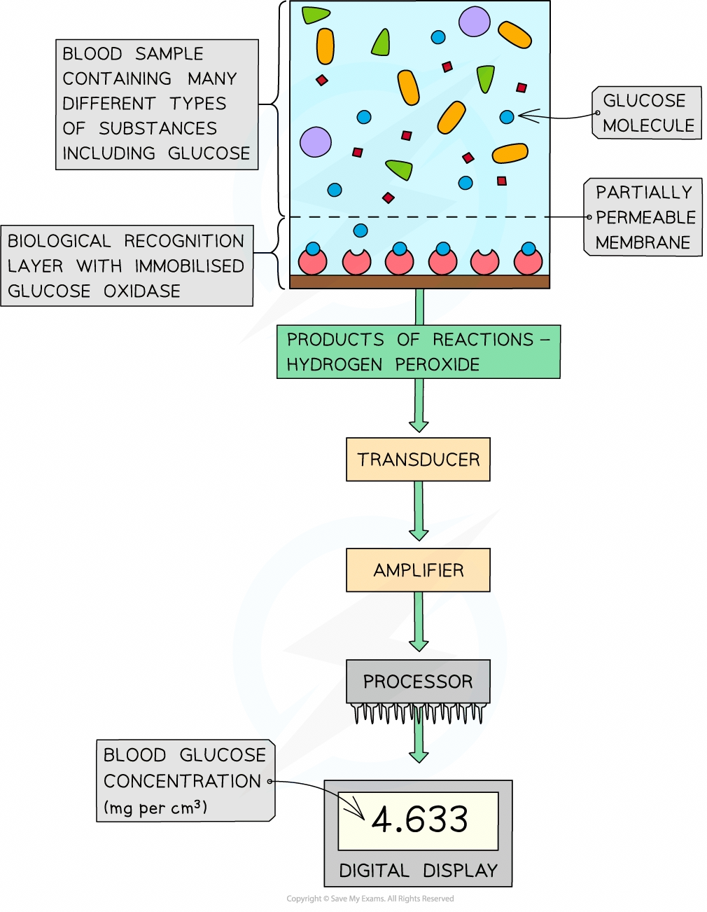

# Test Strips & Biosensors

## Test Strips & Biosensors

> **Spec point** — `spcpt_n4NRDYVkSWDH8PVh`

## Test strips & biosensors

### Measuring urine glucose concentration

- People with **diabetes** cannot **[control](https://www.savemyexams.com/a-level/biology/cie/25/revision-notes/14-homeostasis/14-1-homeostasis-in-mammals/the-control-of-blood-glucose/?_ai=internal-linking)**[ their blood glucose concentration](https://www.savemyexams.com/a-level/biology/cie/25/revision-notes/14-homeostasis/14-1-homeostasis-in-mammals/the-control-of-blood-glucose/?_ai=internal-linking) so that it remains within normal, safe limits
- The presence of **glucose** in **urine** is an **indicator** that a person may have diabetes

  - If blood glucose concentration increases above a value known as the **renal threshold**, not all of the glucose from the filtrate in the[ proximal convoluted tubule](https://www.savemyexams.com/a-level/biology/cie/25/revision-notes/14-homeostasis/14-1-homeostasis-in-mammals/formation-of-urine/?_ai=internal-linking) is **reabsorbed** and some will be left in the urine
- **Test strips** can be used to test urine for the **presence and concentration of glucose**
- **Two enzymes** are **immobilised** on a small pad at one end of the test strip:

  - glucose oxidase
  - peroxidase
- The pad is immersed in the urine sample for a short time
- If glucose is present:

  - Glucose oxidase catalyses a reaction in which **glucose** is **oxidised** to form **gluconic acid** and **hydrogen peroxide**
  - Peroxidase then catalyses a reaction between the **hydrogen peroxide** and a colourless chemical in the pad to form a **brown compound** and water
- The colour of the pad is compared to a **colour chart**

  - Different colours represent different concentrations of glucose (the higher the concentration of glucose present, the darker the colour)
- Urine tests only show whether or not the blood glucose concentration was above the renal threshold **whilst urine was collecting in the bladder**

  - They do not indicate the **current** blood glucose concentration

*Top: the chemical reactions catalysed by the immobilised glucose oxidase and peroxidase enzymes on the end-pad of a urine test strip.  Bottom: an example of the colour chart used to interpret the colour of the end-pad of a urine test strip.*

### Measuring blood glucose concentration

- A **biosensor** can be used by people with **diabetes** to show their **current **blood glucose concentration
- Similar to the test strips, a biosensor uses **glucose oxidase** (but no peroxidase) [immobilised ](https://www.savemyexams.com/a-level/biology/cie/22/revision-notes/3-enzymes/3-2-factors-that-affect-enzyme-action/3-2-8-enzyme-activity-immobilised-v-free/)on a **recognition layer**
- Covering the recognition layer is a **partially permeable membrane** that only allows small molecules from the blood to reach the immobilised enzymes
- When a small sample of blood is tested, glucose oxidase catalyses a reaction in which any **glucose** in the blood sample is **oxidised** to form **gluconic acid** and **hydrogen peroxide**
- The hydrogen peroxide produced is **oxidised** at an **electrode** that detects **electron transfers**
- The **electron flow is proportional to the glucose concentration** of the blood sample
- The biosensor amplifies the current, which is then read by a processor to produce a digital reading for blood glucose concentration
- This process is complete within a matter of seconds

*The parts of a glucose biosensor*

> **Exam Hint**
> The urine test strip will only produce a positive result for glucose. Other sugars such as fructose, sucrose and lactose will give a negative result. This is due to the specificity of the glucose oxidase enzyme.
