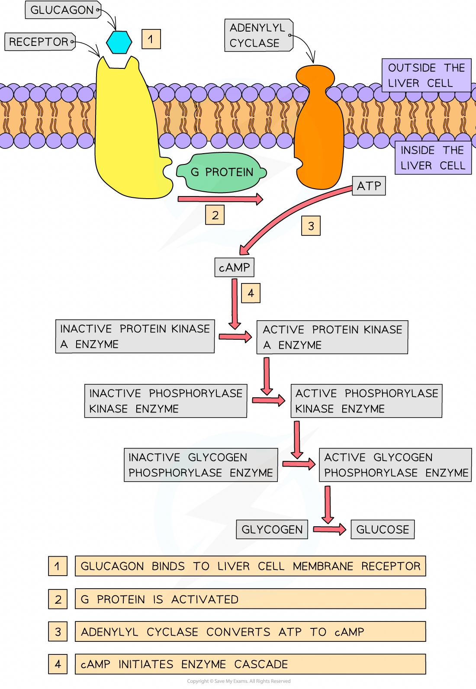
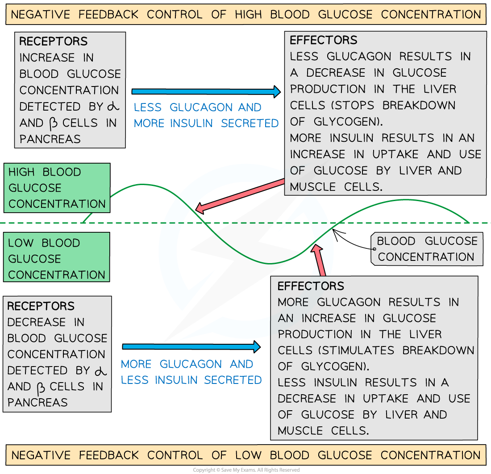

# The Control of Blood Glucose

## The Control of Blood Glucose

> **Spec point** — `spcpt_BxZVBN3njqnq4zY3` · describe the principles of cell signalling using the example of the control of blood glucose concentration by glucagon, limited to:
• binding of hormone to cell surface receptor causing conformational change
• activation of G-protein leading to stimulation of adenylyl cyclase
• formation of the second messenger, cyclic AMP (cAMP)
• activation of protein kinase A by cAMP leading to initiation of an enzyme cascade
• amplification of the signal through the enzyme cascade as a result of activation of more and more enzymes by phosphorylation
• cellular response in which the final enzyme in the pathway is activated, catalysing the breakdown of glycogen

## The control of blood glucose

- If the concentration of glucose in the blood **decreases** below a certain level, cells may not have enough glucose for **respiration** and may not be able to function normally
- If the concentration of glucose in the blood **increases** above a certain level, this can also **disrupt the normal function of cells**, potentially causing major problems
- The control of blood glucose concentration is a key part of **[homeostasis](https://www.savemyexams.com/a-level/biology/cie/25/revision-notes/14-homeostasis/14-1-homeostasis-in-mammals/homeostasis/?_ai=internal-linking)**
- Blood glucose concentration is controlled by **two hormones** secreted by **[endocrine tissue](https://www.savemyexams.com/a-level/biology/cie/25/revision-notes/15-control-and-coordination/15-1-control-and-coordination-in-mammals/the-endocrine-system/?_ai=internal-linking)** in the **pancreas**
- This tissue is made up of groups of cells known as the **islets of Langerhans**
- The islets of Langerhans contain **two cell types**:

  - **α cells** that secrete the hormone **glucagon**
  - **β cells** that secrete the hormone **insulin**
- These α and β cells act as the **receptors** and initiate the response for controlling blood glucose concentration
- The control of blood glucose concentration by **glucagon** can be used to demonstrate the principles of [cell signalling](https://www.savemyexams.com/a-level/biology/cie/22/revision-notes/4-cell-membranes--transport/4-1-fluid-mosaic-membranes/4-1-4-cell-signalling/)

### Decrease in blood glucose concentration

- If a **decrease** in blood glucose concentration occurs, it is **detected** by the **α and β cells** in the pancreas:

  - The **α cells** respond by **secreting** **glucagon**
  - The **β cells** respond by **stopping the secretion of insulin**
- The decrease in blood **insulin** concentration **reduces** the use of **glucose** by liver and muscle cells
- **Glucagon** binds to **receptors** in the cell surface membranes of **liver cells**
- This binding causes a **conformational change** in the receptor protein that activates a **G protein**
- This activated G protein activates the enzyme **adenylyl cyclase**
- Active adenylyl cyclase catalyses the conversion of **ATP** to the second messenger, **cyclic AMP **(cAMP)
- **cAMP** binds to **protein kinase A enzymes**, activating them
- Active protein kinase A enzymes activate **phosphorylase kinase enzymes** by adding **phosphate groups** to them
- Active phosphorylase kinase enzymes activate **glycogen phosphorylase enzymes**
- Active glycogen phosphorylase enzymes **catalyse the breakdown of glycogen to glucose**

  - This process is known as **glycogenolysis**
- The enzyme cascade described above **amplifies** the original signal from glucagon and results in the **releasing of extra glucose by the liver** to increase the blood glucose concentration back to a normal level

*The effect of glucagon released by pancreatic ɑ cells when a decrease in blood glucose concentration is detected*

### Increase in blood glucose concentration

- When the blood glucose concentration increases to above the normal range it is detected by the **β cells** in the pancreas
- The β cells respond by secreting the hormone **insulin**

  - Insulin-containing vesicles move towards the cell-surface membrane where they release insulin into the capillaries
- Once in the bloodstream, insulin circulates around the body
- It **stimulates the uptake of glucose** by muscles cells, fat cells and the liver

### Action of insulin

- Insulin increase the uptake of glucose into target cells

  - The **target cells **of insulin include muscle cells, fat storage cells, adipose tissue and liver cells; all of these cells have specific insulin receptors on their cell surface membranes
  - Insulin **binds to specific receptors** on the membranes of these target cells
  - The binding of insulin to receptors on target cells stimulates the cells to **add more glucose transporter proteins to their cell surface membranes,** increasing the permeability of the cells to glucose
  
    - These glucose transporter proteins are known as **GLUT** proteins
    - When blood glucose levels are low GLUT proteins are stored inside the cell in the membranes of vesicles, but when insulin binds to the surface receptors the vesicles move to the cell surface membrane and fuse with it, adding GLUT proteins to the membrane
  - The rate of **facilitated diffusion** of glucose into the target cells increases as a result of the increase in GLUT proteins
- Insulin causes activation of an enzyme known as **glucokinase**

  - Glucokinase **phosphorylates glucose**, trapping it inside cells
- Insulin causes activation of another enzyme; **glycogen synthase**

  - Glycogen synthase **converts glucose into glycogen** in a process known as glycogenesis

> **Exam Hint**
> Make sure you know where this response to a decrease in blood glucose concentration occurs! The enzyme cascade only occurs in liver cells, there are no glucagon receptors on muscle cells.

## Negative Feedback Control of Blood Glucose

> **Spec point** — `spcpt_fDYZzBHh7yz4M2pq` · explain how negative feedback control mechanisms regulate blood glucose concentration, with reference to the effects of insulin on muscle cells and liver cells and the effect of glucagon on liver cells

## Negative feedback control of blood glucose

- Blood glucose concentration is **regulated** by **negative feedback** control mechanisms
- In negative feedback systems:

  - **Receptors** **detect** whether a specific level is **too low** or **too high**
  - This information is communicated through the **hormonal or nervous system** to effectors
  - **Effectors** **react** to counteract the change by **bringing the level back to normal**
- In the control of blood glucose concentration:

  - **α and β cells** in the pancreas act as the **receptors**
  - They release the **hormones glucagon** (secreted by α cells) and **insulin** (secreted by β cells)
  - **Liver cells **act as the **effectors** in response to **glucagon** and **liver, muscle and fat cells** act as the **effectors** in response to **insulin**

*How negative feedback control mechanisms regulate blood glucose concentration*
