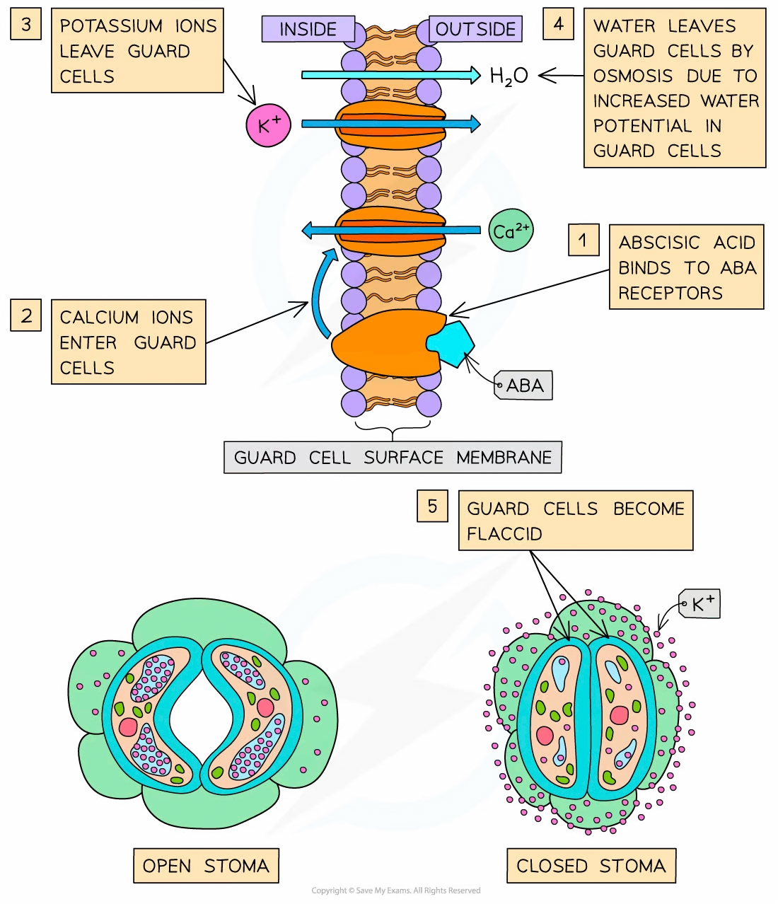

# Abscisic Acid & Stomatal Closure

## Abscisic Acid & Stomatal Closure

> **Spec point** — `spcpt_4KjT4YxSc462dTKx` · describe the role of abscisic acid in the closure of stomata during times of water stress, including the role of calcium ions as a second messenger

## Abscisic acid & stomatal closure

- During times of **water stress,** the hormone **abscisic acid** (**ABA**) is produced by plants to **stimulate the closing of their stomata**

  - Certain environmental conditions can cause water stress, such as **very high temperatures** or **reduced water supplies**
- **Guard cells** have **ABA receptors** on their cell surface membranes
- ABA binds with these receptors, **inhibiting the proton pumps** and therefore **stopping** the [active transport](https://www.savemyexams.com/a-level/biology/cie/22/revision-notes/4-cell-membranes--transport/4-2-movement-into--out-of-cells/4-2-3-active-transport/) of hydrogen (H+) ions out of the guard cells
- ABA also causes **calcium (Ca****2+****) ions** to move **into the cytoplasm **of the guard cells through the cell surface membranes
- The calcium ions act as **second messengers**:

  - They cause [channel proteins](https://www.savemyexams.com/a-level/biology/cie/22/revision-notes/4-cell-membranes--transport/4-2-movement-into--out-of-cells/4-2-1-diffusion/#channel-proteins)** **to **open** that allow negatively charged ions to leave the guard cells
  - This stimulates the **opening of further channel proteins** that allow **potassium (K****+****) ions** to **leave** the guard cells
  - The calcium ions also stimulate the **closing of channel proteins** that allow potassium (K+) ions to **enter** the guard cells
- This **loss of ions increases the water potential** of the guard cells
- Water **leaves** the guard cells by **osmosis**
- The guard cells become **flaccid**, causing the stomata to **close**

*Closure of a stoma in response to abscisic acid (ABA)*
