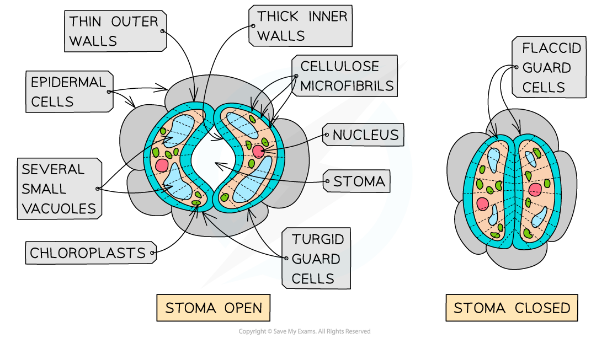
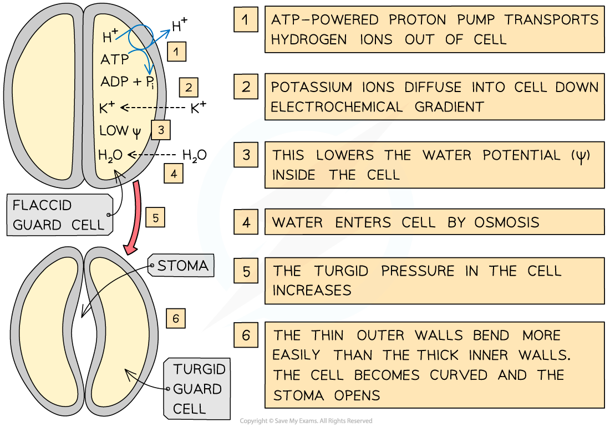

# Guard Cells

## Guard Cells

> **Spec point** — `spcpt_G45qRtZr5DmYqb2m` · describe the structure and function of guard cells and explain the mechanism by which they open and close stomata

## Guard cells

### Structure of guard cells

- Each stoma is surrounded by **two guard cells**
- Guard cells have the following features:

  - **Thick** cell walls facing the air outside the leaf and the **stoma**
  - **Thin** cell walls facing **adjacent epidermal cells**
  - [Cellulose](https://www.savemyexams.com/a-level/biology/cie/22/revision-notes/2-biological-molecules/2-2-carbohydrates--lipids/2-2-6-cellulose/)** microfibrils** arranged in bands around the cell
  - Cell walls have **no plasmodesmata**
  - Cell surface membrane is often **folded** and contains **many channel and carrier proteins**
  - Cytoplasm has a **high density of chloroplasts and mitochondria**
  - Chloroplasts have [thylakoids](https://www.savemyexams.com/a-level/biology/cie/25/revision-notes/13-photosynthesis/13-1-photosynthesis-as-an-energy-transfer-process/thylakoids-and-the-stroma/) but with **few grana** (unlike those in mesophyll cell chloroplasts)
  - Mitochondria have **many cristae**
  - **Several small vacuoles** rather than one large vacuole

*The structure of guard cells when the stoma is open and closed*

### Mechanism to open stomata

- Guard cells **open** when they **gain water** and become **turgid**
- Guard cells gain water by **osmosis**
- A **decrease in water potential** in the guard cells is required for water to enter the cells by osmosis
- In response to light, ATP-powered proton pumps in the guard cell surface membranes actively transport **hydrogen (H****+****) ions** **out of the guard cell**
- This leaves the **inside** of the guard cells **negatively charged** compared to the outside
- This causes [channel proteins](https://www.savemyexams.com/a-level/biology/cie/22/revision-notes/4-cell-membranes--transport/4-2-movement-into--out-of-cells/4-2-1-diffusion/#channel-proteins) in the guard cell surface membranes to **open, allowing potassium (K****+****) ions** to move down the electrical gradient and **enter** the guard cells
- The potassium (K+) ions also diffuse into the guard cells down a concentration gradient

  - The combination of the electrical gradient and concentration gradient is known as an **electrochemical gradient**
- The influx of potassium (K+) ions **increases the solute concentration** inside the guard cells, **lowering the water potential** inside the cells
- Water now **enters** the guard cells by **osmosis** through **aquaporins** in the guard cell surface membranes

  - Most of the water enters the vacuoles, causing them to increase in size
- This increases the **turgor pressure** of the guard cells, causing the stoma to **open**

  - The bands of cellulose microfibrils only allow the guard cells to increase in length (not diameter)
  - The **thin outer walls of the guard cells bend more easily** than thick inner walls
  - This causes the guard cells to become **curved**, opening up the stoma

*An outline of the mechanism to open stomata*

### Mechanism to close stomata

- When certain environmental stimuli are detected (that lead to the closing of the stomata), the proton pumps in the guard cell surface membranes **stop actively transporting hydrogen (H****+****) ions out of the guard cell**
- The **potassium (K****+****) ions leave **the guard cells
- The **water potential gradient **is now **reversed** and water **leaves** the guard cells by **osmosis**
- This causes the guard cells to become **flaccid**, closing the stoma
