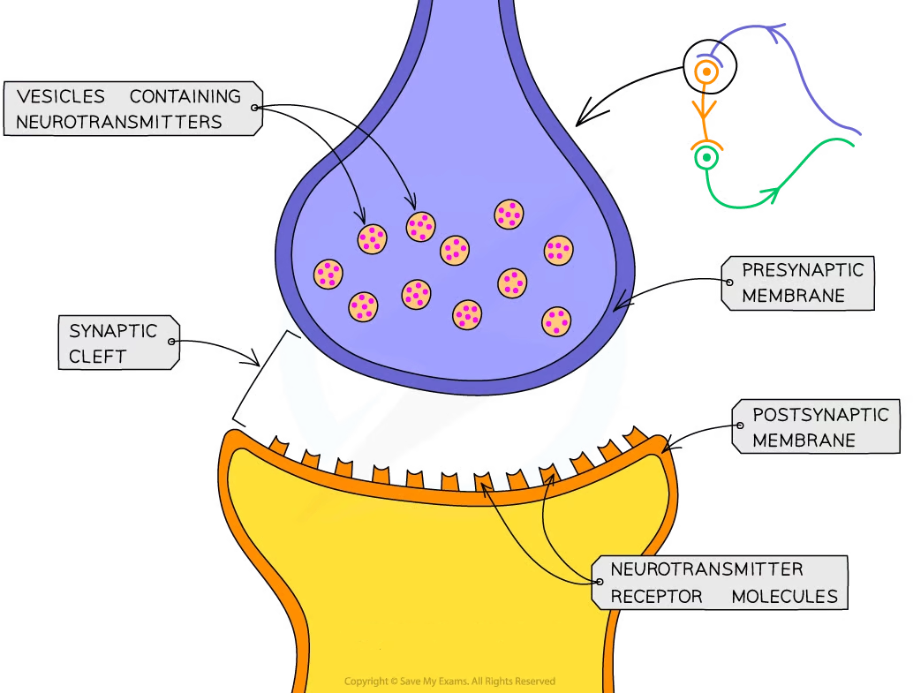
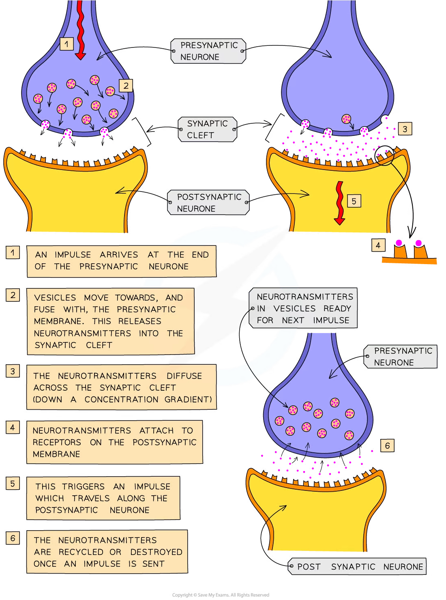
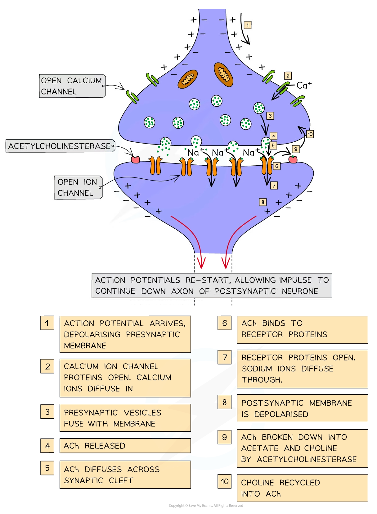

# Cholinergic Synapses

## Cholinergic Synapses

> **Spec point** — `spcpt_n9t9BGShtVHJhSxD` · describe the structure of a cholinergic synapse and explain how it functions, including the role of calcium ions

## Cholinergic synapses

- Where two neurones meet, they do not actually come into physical contact with each other

  - A very small gap, known as the **synaptic cleft**, separates them
- The ends of the two neurones, along with the synaptic cleft, form a **synapse**

*A synapse*

### Synaptic transmission—basic mechanism

- Electrical impulses cannot ‘jump’ across synapses
- When an electrical impulse arrives at the end of the axon on the **presynaptic neurone**, chemical messengers called **neurotransmitters** are released from **vesicles** at the **presynaptic membrane**
- The neurotransmitters **diffuse** across the **synaptic cleft** and **bind temporarily with receptor molecules** on the **postsynaptic membrane**
- This **stimulates** the postsynaptic neurone to generate an electrical **impulse** that then travels down the **axon** of the **postsynaptic neurone**
- The neurotransmitters are then **destroyed** or **recycled** to prevent continued stimulation of the second neurone, which could cause repeated impulses to be sent

*The basic mechanism of synaptic transmission*

### Synaptic transmission—detailed mechanism

- There are over **40** different known neurotransmitters
- One of the key neurotransmitters used throughout the nervous system is **acetylcholine** **(ACh)**
- Synapses that use the neurotransmitter ACh are known as <u>**choline**</u>**rgic synapses**
- The detailed process of synaptic transmission using ACh is as follows:

  - The arrival of an **action potential** at the **presynaptic membrane** causes **depolarisation** of the membrane
  - This **stimulates voltage-gated calcium ion channel proteins** to **open**
  - **Calcium ions** diffuse down an **electrochemical gradient** from the tissue fluid surrounding the synapse (high concentration of calcium ions) into the **cytoplasm** of the **presynaptic neurone** (low concentration of calcium ions)
  - This **stimulates ACh-containing vesicles to fuse with the presynaptic membrane**, releasing ACh molecules into the synaptic cleft
  - The ACh molecules **diffuse** across the synaptic cleft and **temporarily bind to receptor proteins in the postsynaptic membrane**
  - This causes a **conformational change** in the receptor proteins, which then **open**, **allowing sodium ions to diffuse** down an electrochemical gradient into the cytoplasm of the postsynaptic neurone
  - The **sodium ions cause depolarisation of the postsynaptic membrane**, re-starting the electrical impulse (that can now continue down the axon of the postsynaptic neurone)
  - To prevent the sodium ion channels from staying permanently open and to stop permanent depolarisation of the postsynaptic membrane, the **ACh molecules are broken down and recycled**
  - The enzyme **acetylcholinesterase** catalyses the **hydrolysis** of the ACh molecules into **acetate** and **choline**
  - The **choline is absorbed back into the presynaptic membrane** and reacts with **acetyl coenzyme A** to form **ACh**, which is then packaged into presynaptic vesicles ready to be used when another action potential arrives

*Synaptic transmission using acetylcholine (ACh)*
