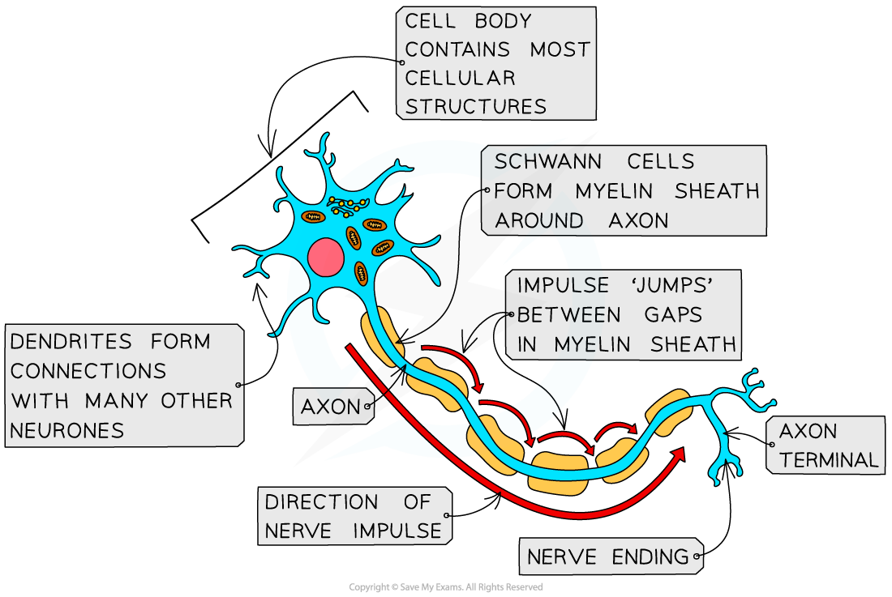

# Neurones

## Neurones

> **Spec point** — `spcpt_kv4RRb3qZFrwwgNw` · describe the structure and function of a sensory neurone and a motor neurone and state that intermediate neurones connect sensory neurones and motor neurones

## Neurones

- A neurones has a **long fibre** known as an **axon**
- The axon is **insulated** by a **fatty sheath** with small, uninsulated sections along its length (called **nodes of Ranvier**)

  - The sheath is made of **myelin**, a substance that is made by specialised cells known as **Schwann cells**
  - Myelin is made when Schwann cells wrap themselves around the axon along its length
- This means that action potentials do not occur along the whole axon; instead the action potential jumps from one node of Ranvier to the next
- This means the impulse travels along the axon much faster than along an unmyelinated axon (saltatory conduction)
- Their **cell bodies** contain many extensions called **dendrites**

  - This means they can **connect** to **many other neurones **and receive **impulses** from them, forming a **network** for easy **communication**

*An example of a neurone*

- There are **three main types **of neurone: **sensory, relay and motor**

  - **Sensory** neurones carry impulses from **receptors** to the **CNS** (brain or spinal cord)
  - **Intermediate **(*aka* relay) neurones are found entirely within the CNS and **connect** **sensory** and **motor** neurones
  - **Motor** neurones carry impulses from the **CNS** to **effectors** (muscles or glands)

*The three types of neurone—the red line shows the direction of impulses. Note that axons always carry nerve impulses away from the cell body*

- Each type of neurone has a **slightly different structure**
- **Motor neurones **have:

  - A large cell body at one end, that lies within the spinal cord or brain
  - A nucleus that is always in its cell body
  - Many highly-branched dendrites extend from the cell body, providing a large surface area for the axon terminals of other neurones
- **Sensory neurones** have the same basic structure as motor neurones, but have:

  - A cell body that branches off in the middle of the cell - it may be near the source of stimuli or in a swelling of a spinal nerve known as a ganglion

> **Exam Hint**
> You may be asked to identify the different types of neurone in a diagram. It can be helpful to memorise the key differences between them—such as the location and size of the cell body.
