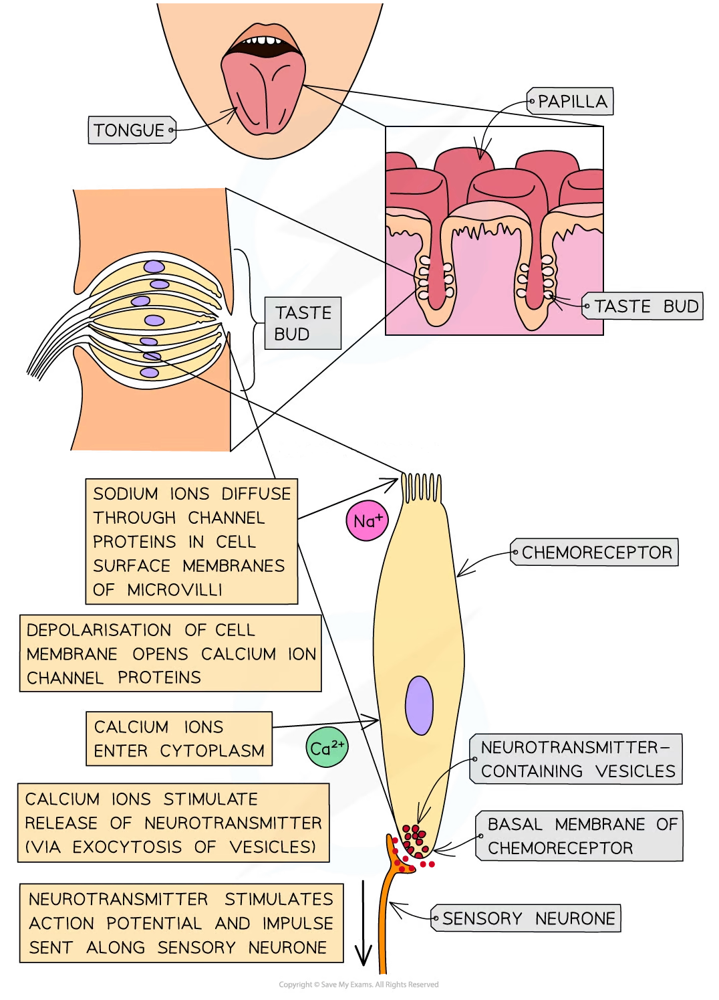
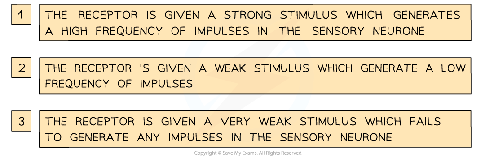
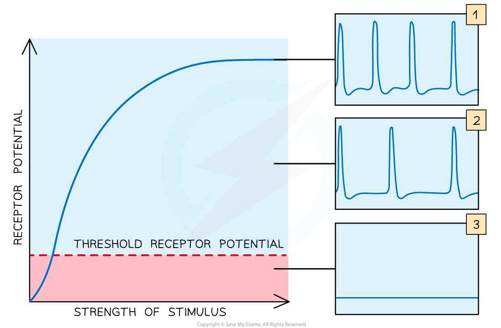

# Sequence of Events Resulting in an Action Potential

## Sequence of Events Resulting in an Action Potential

> **Spec point** — `spcpt_yJKhD6bMVCP6N3d2` · describe the sequence of events that results in an action potential in a sensory neurone, using a chemoreceptor cell in a human taste bud as an example

## Sequence of events resulting in an action potential

- The **surface** of the **tongue** is covered in many small bumps known as **papillae**
- The surface of each papilla is covered in many **taste buds**
- Each taste bud contains many receptor cells known as **chemoreceptors**

  - These chemoreceptors are sensitive to **chemicals** in food and drinks
- Each chemoreceptor is covered with** receptor proteins**

  - Different receptor proteins detect different chemicals

### An example of the sequence of events that results in an action potential in a sensory neurone

- Chemoreceptors in the taste buds that detect **salt** (sodium chloride) respond directly to **sodium ions**
- If salt is present in the food (dissolved in saliva) being eaten:

  - Sodium ions **diffuse** through **highly selective **[channel proteins](https://www.savemyexams.com/a-level/biology/cie/22/revision-notes/4-cell-membranes--transport/4-2-movement-into--out-of-cells/4-2-1-diffusion/#channel-proteins) in the cell surface membranes of the **microvilli** of the **chemoreceptor cells**
  - This leads to the **depolarisation** of the chemoreceptor **cell membrane**
  - The **increase** in **positive charge** inside the cell is known as the **receptor potential**
  - If there is** sufficient stimulation** by sodium ions and sufficient depolarisation of the membrane, the receptor potential becomes large enough to stimulate **voltage-gated calcium ion channel proteins** to **open**
  - As a result, **calcium ions enter the cytoplasm** of the chemoreceptor cell and **stimulate exocytosis of vesicles containing neurotransmitters** from the basal membrane of the chemoreceptor
  - The neurotransmitter stimulates an **action potential** in the **sensory neurone**
  - The sensory neurone then transmits an **impulse** to the brain

*Tasting salt—an example of the sequence of events that results in an action potential in a sensory neurone*

- When receptors (such as chemoreceptors) are stimulated, they are **depolarised**
- If the stimulus is very **weak** or **below a certain threshold**, the receptor cells won’t be sufficiently depolarised and the sensory neurone will not be activated to send impulses
- If the stimulus is strong enough to increase the **receptor potential above the threshold** **potential** then the receptor will **stimulate the sensory neurone **to send impulses
- This is an example of the **all-or-nothing principle**

  - An impulse is only transmitted if the **initial stimulus is sufficient** to increase the membrane potential above a **threshold potential**
- Rather than staying constant, **threshold levels in receptors often increase with continued stimulation**, so that a greater stimulus is required before impulses are sent along sensory neurones

*The receptor potential increases as the strength of the stimulus increases. As the strength of the stimulus increases beyond the threshold, the frequency (not amplitude) of impulses increases*

> **Exam Hint**
> Some receptors, like the chemoreceptors described above, are **specialised cells** that detect a **specific type of stimulus** and affect the sensory neurone’s electrical activity. Other receptors are just the **ends of the sensory neurones** (for example, many types of touch receptors).
