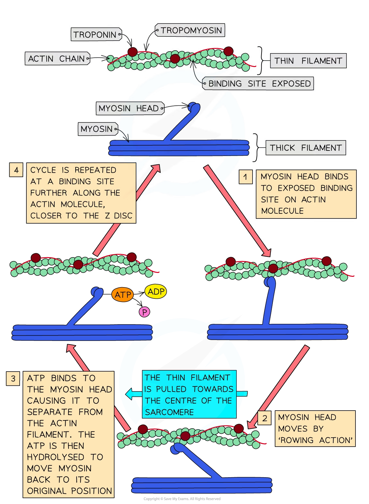

# Sliding Filament Model of Muscular Contraction

## Sliding Filament Model of Muscular Contraction

> **Spec point** — `spcpt_PwkDhP6Q3HXMNp9K` · explain the sliding filament model of muscular contraction including the roles of troponin, tropomyosin, calcium ions and ATP

## Sliding filament model of muscular contraction

### Structure of thick and thin filaments in a myofibril

- The **thick filaments** within a myofibril are made up of **myosin molecules**

  - These are **fibrous protein molecules** with a **globular head**
  - The **fibrous part** of the myosin molecule **anchors** the molecule into the thick filament
  - In the thick filament, many myosin molecules lie next to each other with their globular heads all** pointing away **from the M line
- The **thin filaments** within a myofibril are made up of **actin molecules**

  - These are **globular protein molecules**
  - Many actin molecules link together to form a **chain**
  - **Two** actin chains **twist** together to form one** thin filament**
  - A **fibrous** protein known as **tropomyosin** is twisted around the two actin chains
  - Another protein known as **troponin** is attached to the actin chains at regular intervals

### How muscles contract—the sliding filament model

- Muscles cause movement by **contracting**
- During muscle contraction, **[sarcomeres within myofibrils](https://www.savemyexams.com/a-level/biology/cie/25/revision-notes/15-control-and-coordination/15-1-control-and-coordination-in-mammals/ultrastructure-of-striated-muscle/?_ai=internal-linking)**** shorten as the Z discs are pulled closer together**
- This is known as the **sliding filament model of muscle contraction** and occurs via the following process:

  - An **action potential arrives **at the [neuromuscular junction](https://www.savemyexams.com/a-level/biology/cie/25/revision-notes/15-control-and-coordination/15-1-control-and-coordination-in-mammals/stimulating-contraction-in-striated-muscle/?_ai=internal-linking)
  - **Calcium ions** are **released** from the **sarcoplasmic reticulum** (SR)
  - Calcium ions **bind to troponin molecules**, stimulating them to **change shape**
  - This causes **troponin** and **tropomyosin** proteins to **change position** on the actin (thin) filaments
  - **Myosin binding sites are exposed **on the actin molecules
  - The **globular heads of the myosin molecules bind **with these sites, forming cross-bridges between the two types of filament
  - The **myosin heads move and pull the actin filaments towards the centre of the sarcomere**, causing the muscle to contract a very small distance
  - ATP binds to the myosin heads, causing them to change shape and release (detach from) the actin filaments; the myosin heads (ATPase) then hydrolyse the ATP, releasing energy
  - The myosin heads move back to their **original positions** and bind to **new binding sites** on the actin filaments, **closer to the Z disc**
  - The myosin heads move again, pulling the actin filaments **even closer to the centre of the sarcomere**, causing the sarcomere to **shorten** once more and pulling the Z discs closer together
  - ATP binds to the myosin heads once more so they detach again, and its hydrolysis provides the energy to return the heads to their original positions
  - As long as troponin and tropomyosin are not blocking the myosin-binding sites and the muscle has a supply of ATP, this process **repeats** until the muscle is **fully contracted**

*The sliding filament model of muscle contraction*

> **Exam Hint**
> The sliding filament model can be difficult to visualise fully with diagrams. To help you more clearly understand the steps involved, try to find some animations or videos of the sliding filament model online to see the movement of the myosin heads and thin (actin) filaments during muscle contraction!
