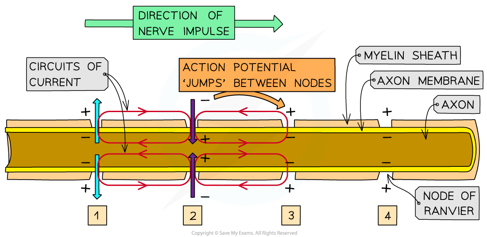
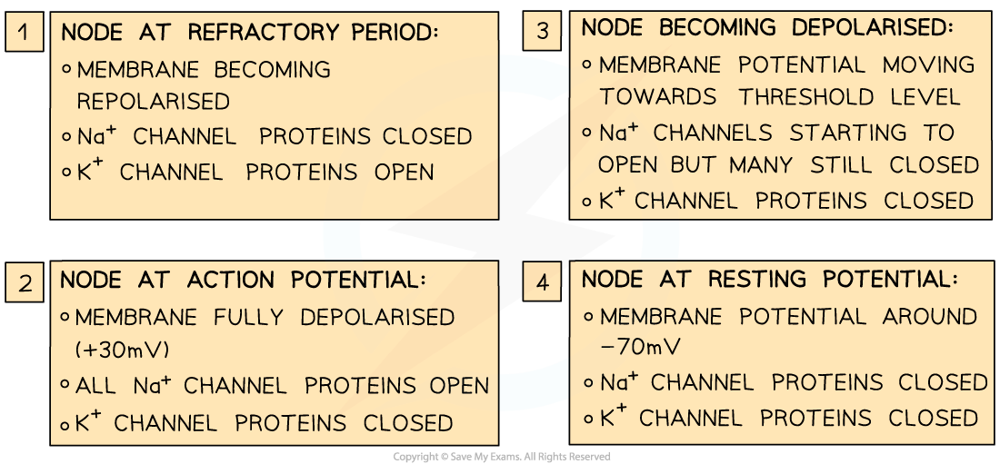

# Speed of Conduction of Impulses

## Speed of Conduction of Impulses

> **Spec point** — `spcpt_Tnhbs98km73sCbwD` · describe and explain the rapid transmission of an impulse in a myelinated neurone with reference to saltatory conduction

## Speed of conduction of impulses

- The **speed of conduction **of an impulse refers to **how quickly the impulse is transmitted** along a neurone
- It is determined by two main factors:

  - the **presence or absence of myelin** (i.e., whether or not the axon is insulated by a myelin sheath)
  - the **diameter of the axon**

### Myelination and saltatory conduction

- In **unmyelinated** neurones, the speed of conduction is **very slow**
- By insulating the axon membrane, the presence of **myelin increases the speed at which action potentials can travel** along the neurone:

  - In sections of the axon that are surrounded by a myelin sheath, **depolarisation** (and the **action potentials** that this would lead to) **cannot occur**, as the myelin sheath **stops** the diffusion of sodium ions and potassium ions
  - Action potentials can only occur at the **nodes of Ranvier** (small uninsulated sections of the axon)
  - The local circuits of current that trigger depolarisation in the next section of the axon membrane exist between the nodes of Ranvier
  - This means the **action potentials ‘jump’ from one node to the next**
  - This is known as **saltatory conduction**
  - This allows the impulse to travel **much faster** (up to 50 times faster) than in an unmyelinated axon of the same diameter

*Transmission of an action potential in a myelinated axon by saltatory conduction*

### Diameter

- The speed of conduction of an impulse along neurones with **thicker axons** is **greater** than along those with thinner ones

  - Thicker axons have an **axon membrane** with a **greater surface area** over which diffusion of ions can occur
  - This **increases the rate of diffusion** of sodium ions and potassium ions
  - This in turn **increases the rate** at which **depolarisation** and **action potentials** can occur
