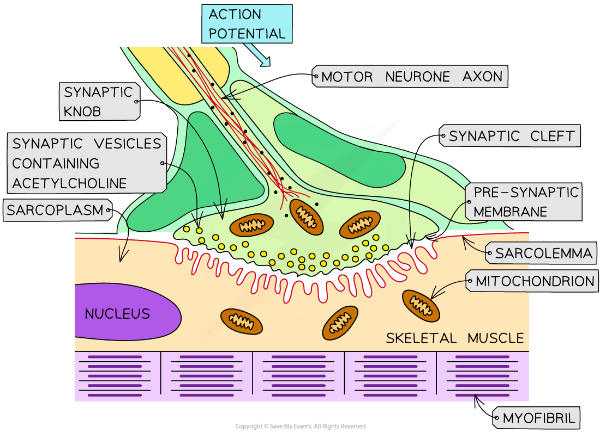
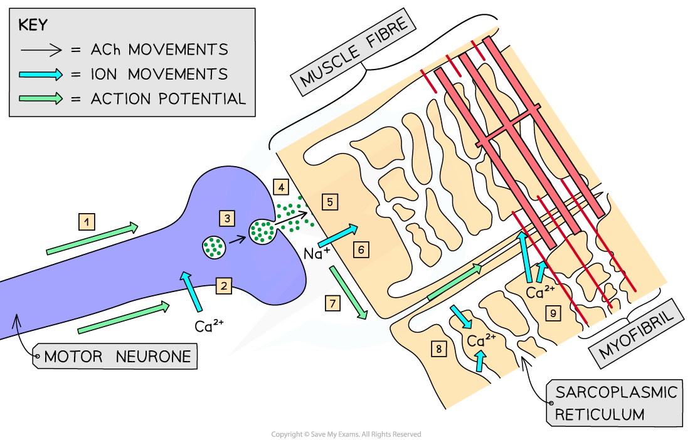
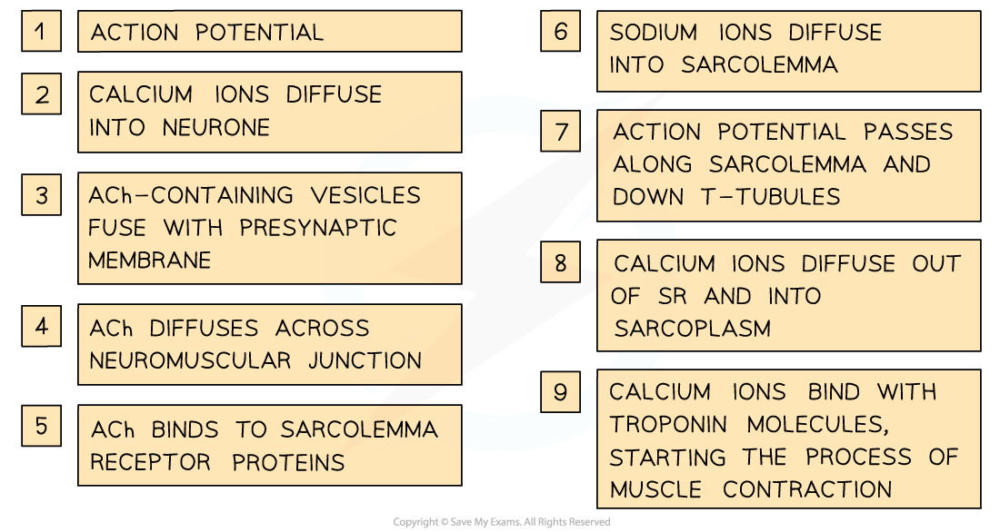

# Stimulating Contraction in Striated Muscle

## Stimulating Contraction in Striated Muscle

> **Spec point** — `spcpt_5jSbjyx5CnQ7TnJ6` · describe the roles of neuromuscular junctions, the T-tubule system and sarcoplasmic reticulum in stimulating contraction in striated muscle

## Stimulating contraction in striated muscle

- Striated muscle **contracts** when it receives an **impulse** from a **motor neurone **via the **neuromuscular junction**
- When an impulse travelling along the axon of a motor neurone arrives at the **presynaptic membrane**, the action potential causes **calcium ions to diffuse** into the neurone

*The neuromuscular junction is where the nerve impulse arrives at a muscle cell*

- Inward diffusion of Ca2+ ions stimulates **vesicles** containing the neurotransmitter **acetylcholine** (ACh) to **fuse** with the presynaptic membrane

  - The ACh that is released diffuses across the neuromuscular junction and **binds to receptor proteins** on the **sarcolemma** (surface membrane of the muscle fibre cell)
  - This stimulates **ion channels** in the sarcolemma to **open**, allowing **sodium ions** to **diffuse in**
  - This **depolarises the sarcolemma,** generating an **action potential** that passes down the **T-tubules** towards the centre of the muscle fibre
- These action potentials cause **voltage-gated calcium ion **[channel proteins](https://www.savemyexams.com/a-level/biology/cie/22/revision-notes/4-cell-membranes--transport/4-2-movement-into--out-of-cells/4-2-1-diffusion/#channel-proteins) in the membranes of the** sarcoplasmic reticulum** (which lie very close to the T-tubules) to **open**

  - **Calcium ions **diffuse **out of the sarcoplasmic reticulum** (SR) and **into the sarcoplasm** surrounding the myofibrils
  - Calcium ions **bind to troponin molecules**, stimulating them to **change shape**
  - This causes the **troponin** and **tropomyosin** proteins to **change position** on the thin (actin) filaments
  - The **myosin-binding sites are exposed **on the actin molecules
- The process of muscle contraction (known as the sliding filament model) can now begin

*How the myofibrils within muscle fibres are stimulated to contract*

> **Exam Hint**
> You may have noticed that there are a lot of similarities between the events at the neuromuscular junction and those that occur at cholinergic synapses. A cholinergic synapse is **between two neurones**, a neuromuscular junction is **between a neurone and muscle**. Make sure you understand the similarities and differences so that you don’t get confused between the two.
