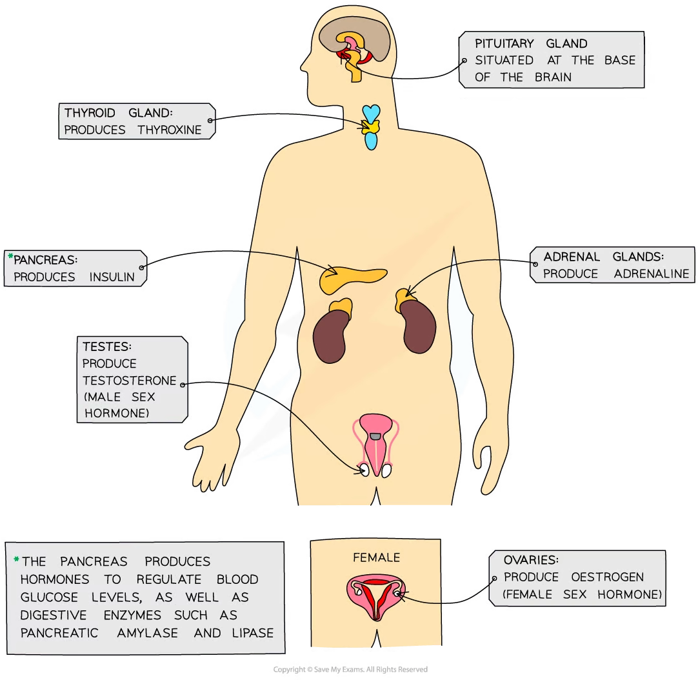
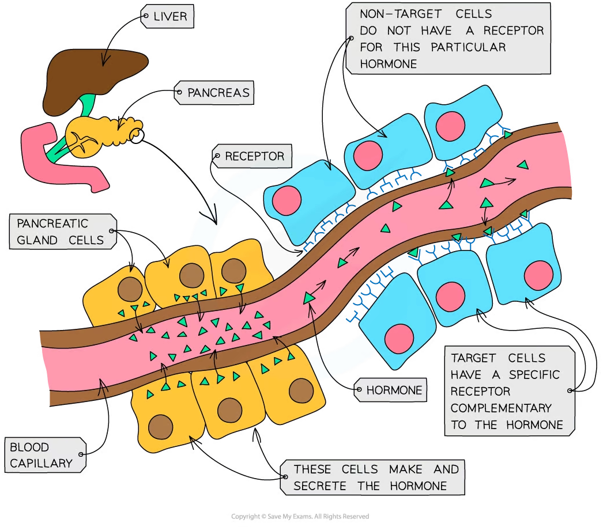

# The Endocrine System

## The Endocrine System

> **Spec point** — `spcpt_2ypxm97QJ6hWRfQF` · describe the features of the endocrine system with reference to the hormones ADH, glucagon and insulin

## The endocrine system

- A **hormone** is a **chemical substance** produced by an **endocrine gland** and carried by the **blood**

  - They are chemicals which **transmit information from one part of the organism to another** and bring about a **change**
  - They **alter** the **activity** of one or more specific** target organs**
- Hormones are used to control functions that **do not need instant responses**
- The endocrine glands that produce hormones in animals are known collectively as the **endocrine system**

  - A **gland** is a **group of cells** that produces and releases one or more substances (a process known as **secretion**)

*The major endocrine glands in the body*

- Hormones such as **insulin, glucagon, ADH and adrenaline** are **cell-signalling molecules** that are released into the blood
- Endocrine glands have a **good blood supply **because, when they make hormones, they need to get the hormones into the bloodstream (specifically the **blood plasma**) as soon as possible so they can travel around the body to the **target organs** to bring about a **response**
- Hormones only affect cells with **receptors** that the hormone can bind to

  - These are either found on the cell surface **membrane** or inside cells
  - Receptors have to be **complementary** to hormones for there to be an **effect**
- Hormones such as **insulin, glucagon and ADH** are peptides or small proteins

  - They are **water-soluble **and so **cannot cross the phospholipid bilayer** of cell surface membranes
  - These hormones bind to receptors on the cell surface membranes of their target cells, which activates **second messengers **to transfer the signal throughout the cytoplasm
- Hormones such as **testosterone, oestrogen and progesterone** are steroid hormones

  - They are **lipid-soluble** and so **can cross the phospholipid bilayer**
  - These hormones bind to receptors in the cytoplasm or nucleus of their target cells

*Hormones are synthesised and released into the bloodstream from a gland (such as the pancreatic gland) and circulate in the bloodstream, affecting target cells*
