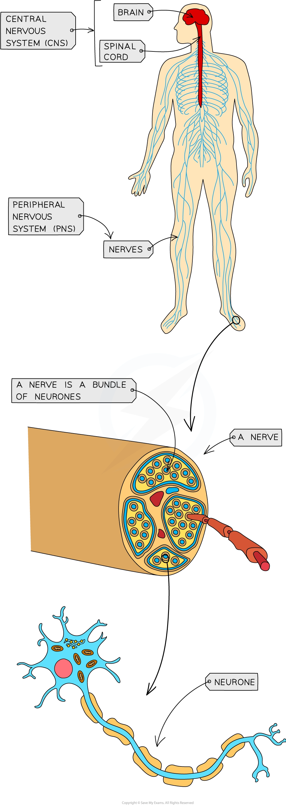

# The Nervous System

## The Nervous System

> **Spec point** — `spcpt_mztNJbH6fxbzBvHb` · compare the features of the nervous system and the endocrine system

## The nervous system

- The human nervous system consists of the following:

  - **Central nervous system** (CNS)—the brain and the spinal cord
  - **Peripheral nervous system** (PNS)—all of the nerves in the body
- It allows us to make sense of our surroundings and respond to them and to **coordinate and regulate body functions**
- Information is sent through the nervous system as** nerve impulses**

  - These are electrical signals that pass along nerve cells known as **[neurones](https://www.savemyexams.com/a-level/biology/cie/25/revision-notes/15-control-and-coordination/15-1-control-and-coordination-in-mammals/neurones/?_ai=internal-linking)**
- A bundle of neurones is known as a nerve
- Neurones **coordinate** the activities of **[sensory receptors](https://www.savemyexams.com/a-level/biology/cie/25/revision-notes/15-control-and-coordination/15-1-control-and-coordination-in-mammals/sensory-receptor-cells/?_ai=internal-linking)** (eg. those in the eye), **decision-making centres in the central nervous system**, and **effectors** such as muscles and glands

*The human nervous system comprises the central and peripheral nervous systems*

|   | **Nervous system** | **Endocrine system** |
|---|---|---|
| **Parts of the system** | Brains, spinal cord, nerves/neurones | Glands |
| **Type of message** | Electrical impulse | (Chemical) hormone |
| **Method of transmission** | Neurones | Bloodstream |
| **Effectors** | Muscles or glands | Target cells in specific tissues |
| **Speed of transmission** | Very fast | Slower |
| **Duration of effect** | Short - until electrical impulses stop | Longer - until the hormone is broken down |
