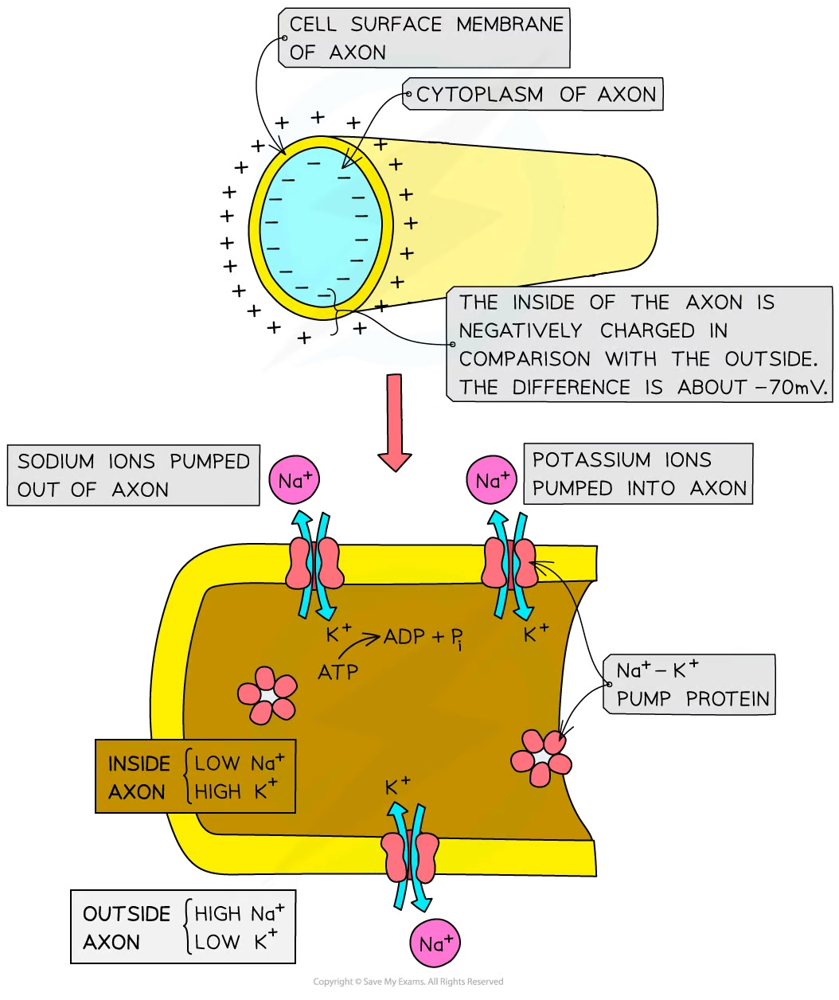
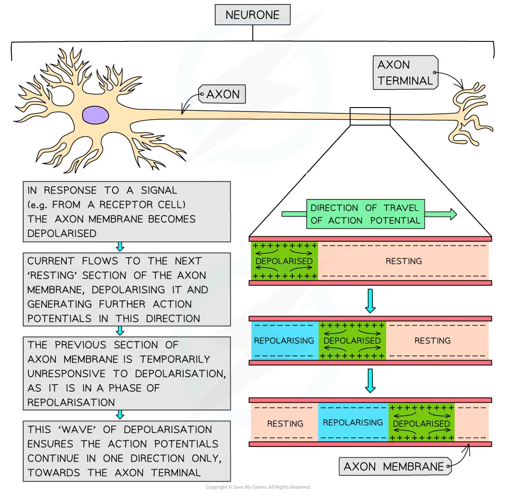
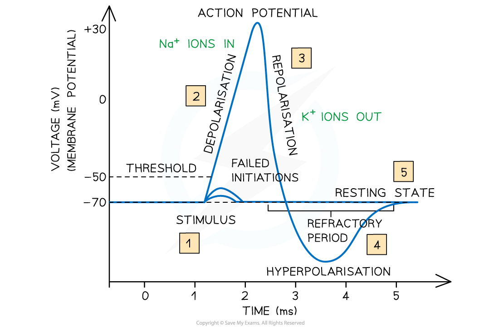

# Transmission of Nerve Impulses

## Transmission of Nerve Impulses

> **Spec point** — `spcpt_6ssDzDFZsFgMDpqD` · describe and explain changes to the membrane potential of neurones, including:
• how the resting potential is maintained
• the events that occur during an action potential
• how the resting potential is restored during the refractory period

## Transmission of nerve impulses

- **Neurones** transmit **electrical impulses**, which travel extremely quickly along the neurone **cell surface membrane** from one end of the neurone to the other
- Unlike a normal electric current, these impulses are **not** a flow of electrons
- These impulses, known as **action potentials**, occur via very **brief changes in the distribution of electrical charge** across the cell surface membrane

  - Action potentials are caused by the **rapid movement of sodium ions and potassium ions** across the membrane of the **axon**

### Resting potential

- In a **resting axon** (one that is **not transmitting impulses**), the **inside** of the axon always has a slightly **negative electrical potential** compared to the outside of the axon
- This **potential difference** is usually about** -70mV** (i.e. the inside of the axon has an electrical potential about 70mV **lower** than the outside)

  - This is called the **resting potential**
- Several factors contribute to **maintaining** the resting potential:

| **Factor** | **How the factor contributes to maintaining the resting potential** |
|---|---|
| Sodium-potassium pumps in the axon membrane | These pumps move sodium ions (Na+) out of the axon and potassium ions (K+) into the axon  The pump proteins use the energy from the hydrolysis of ATP to continue moving these ions against their concentration gradients |
| Many large, negatively charged molecules (anions) inside the axon | This attracts potassium ions, reducing the chance of them diffusing out of the axon |
| Different permeability of the axon membrane to sodium and potassium ions | The membrane is much more permeable to potassium ions than to sodium ions, so potassium ions diffuse out through open potassium ion channels faster than sodium ions diffuse in. This makes the inside more negative than the outside |
| Closure of voltage-gated channels (required for action potentials) in the axon membrane | Stops sodium ions flooding into the axon (potassium ions can still diffuse out slowly through potassium ion channels that are always open) |

*The resting potential of an axon and how it is maintained*

#### Action potentials

- There are [channel proteins](https://www.savemyexams.com/a-level/biology/cie/22/revision-notes/4-cell-membranes--transport/4-2-movement-into--out-of-cells/4-2-1-diffusion/#channel-proteins) in the **axon membrane** that allow **sodium ions** or** potassium ions **to pass through
- These open and close **depending on the electrical potential** (or voltage) **across the axon membrane** and are known as **voltage-gated channel proteins** (they are **closed** when the axon membrane is at its **resting potential**)
- When an **action potential** is stimulated (eg. by a receptor cell) in a neurone, the following steps occur:

  - **Sodium channel proteins** in the axon membrane **open**
  - **Sodium ions** pass **into the axon** down the **electrochemical gradient** (there is a greater concentration of sodium ions outside the axon than inside. The inside of the axon is negatively charged, attracting the positively charged sodium ions)
  - This **reduces the potential difference** across the axon membrane as the **inside** of the axon becomes **less negative** – a process known as **depolarisation**
  - This triggers **voltage-gated sodium channels** to open, allowing **more sodium ions** to enter and causing **more depolarisation**
  - This is an example of **positive feedback** (a small initial depolarisation leads to greater and greater levels of depolarisation)
  - If the potential difference reaches around** -50mV** (known as the **threshold value**), **many more channels open** and **many more sodium ions enter** causing the inside of the axon to reach a potential of around **+30mV**
  - **An action potential is generated**
  - The depolarisation of the membrane at the site of the first action potential causes **current** to flow to the **next section** of the **axon membrane**, **depolarising** **it** and causing sodium ion voltage-gated channel proteins to open
  
    - The 'flow' of current is caused by the diffusion of sodium ions along the axon from an area of high concentration to an area of low concentration
  - This triggers the **production of another action potential** in this section of the axon membrane and the process continues
  - In the body, this allows action potentials to begin at one end of an axon and then pass along the entire length of the axon membrane

*How an impulse is transmitted in one direction along the axon of a neurone*

### Repolarisation and the refractory period

- Very shortly (about 1 ms) after an action potential in a section of axon membrane is generated, **all the sodium ion voltage-gated channel proteins in this section close**, stopping any further sodium ions diffusing into the axon
- **Potassium ion voltage-gated channel proteins** in this section of axon membrane now **open**, allowing the diffusion of potassium ions **out of the axon**, down their concentration gradient
- This **returns the potential difference to normal** (about -70mV) – a process known as **repolarisation**

  - There is actually a short period of **hyperpolarisation**
  - This is when the potential difference across this section of the axon membrane briefly becomes **more negative **than the normal resting potential
- The potassium ion voltage-gated channel proteins then **close** and the sodium ion channel proteins in this section of the membrane** become responsive to depolarisation again**

  - Until this occurs, this section of the axon membrane is in a **period of recovery** and is **unresponsive**
  - This is known as the [refractory period](https://www.savemyexams.com/a-level/biology/cie/25/revision-notes/15-control-and-coordination/15-1-control-and-coordination-in-mammals/the-refractory-period/?_ai=internal-linking)

*How the membrane potential changes during an action potential*

> **Exam Hint**
> During the refractory period, a section of the axon is unresponsive. This is very important as it ensures that ‘new’ action potentials are generated after, rather than before or during the original action potential. This makes the action potentials discrete events and means the impulse can only travel in one direction. This is essential for the successful and efficient transmission of nerve impulses along neurones.
