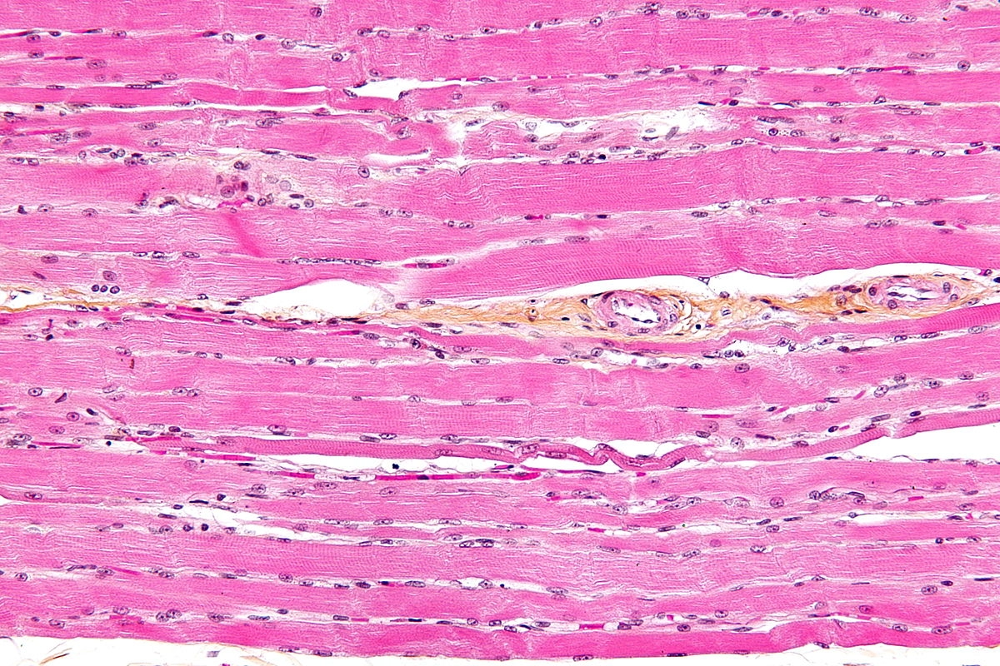
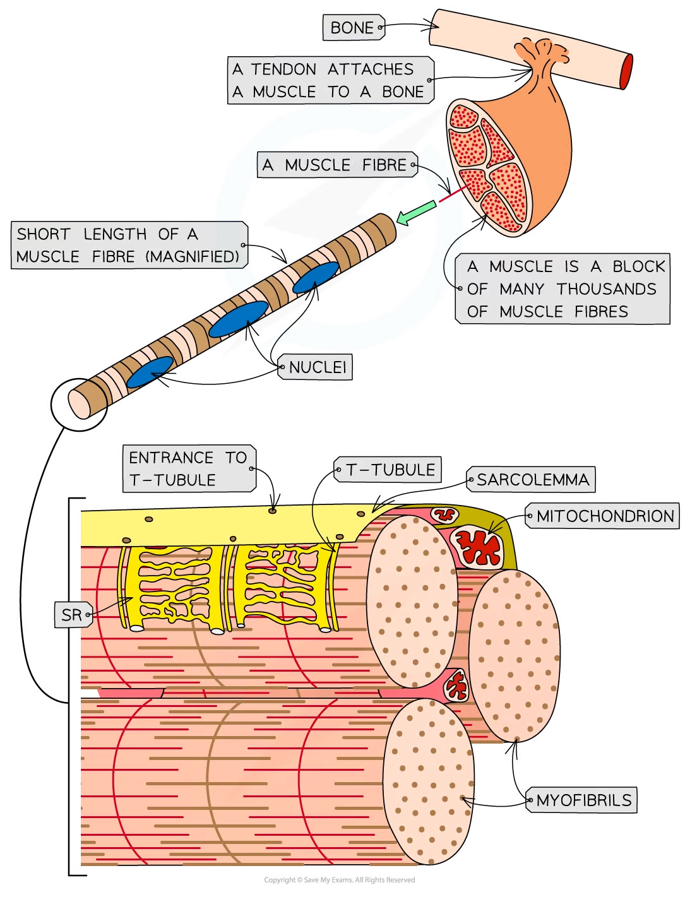
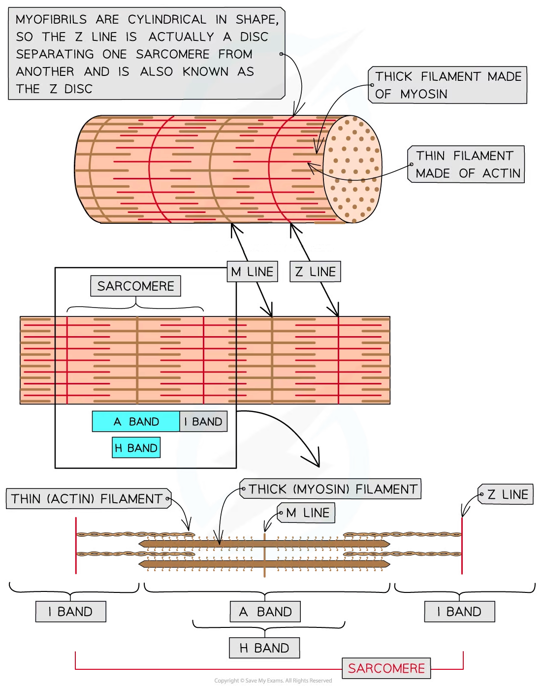

# Ultrastructure of Striated Muscle

## Ultrastructure of Striated Muscle

> **Spec point** — `spcpt_3p8kN482RMmhH62g` · describe the ultrastructure of striated muscle with reference to sarcomere structure using electron micrographs and diagrams

## Ultrastructure of striated muscle

- **Striated muscle** makes up the muscles in the body that are attached to the skeleton

  - 'Striated' means it is striped/streaky in appearance

*Skeletal striated muscle as seen under the microscope, after staining  Image by Nephron, CC BY-SA 3.0, via Wikimedia Commons*

- Striated muscle is made up of **muscle fibres**
- A muscle fibre is a **highly specialised **cell-like **unit**:

  - Each muscle fibre contains an organised arrangement of **contractile proteins in the cytoplasm**
  - Each muscle fibre is surrounded by a **cell surface membrane**
  - Each muscle fibre contains **many nuclei**—this is why muscle fibres are not usually referred to as cells
- The different parts of a muscle fibre have different names from the equivalent parts of a normal cell:

  - Cell surface membrane = **sarcolemma**
  - Cytoplasm = **sarcoplasm**
- The sarcoplasm contains **mitochondria** and **myofibrils**

  - The mitochondria carry out [aerobic respiration](https://www.savemyexams.com/a-level/biology/cie/22/revision-notes/12-energy--respiration/12-2-respiration/12-2-2-the-four-stages-in-aerobic-respiration/) to generate the **ATP required for muscle contraction**
  - Myofibrils are **bundles of actin and myosin filaments**, which[ slide past each other during muscle contraction](https://www.savemyexams.com/a-level/biology/cie/25/revision-notes/15-control-and-coordination/15-1-control-and-coordination-in-mammals/sliding-filament-model-of-muscular-contraction/?_ai=internal-linking)

*The ultrastructure of striated muscle and of a section of muscle fibre*

### Myofibrils

- Myofibrils are located in the **sarcoplasm**
- Each myofibril is made up of **two types of protein filament:**

  - **Thick** filaments made of **myosin**
  - **Thin** filaments made of **actin**
- These two types of filament are arranged in a particular order, creating different types of **band** and **line**

| **Part of myofibril** | **Description** |
|---|---|
| H band | Only thick myosin filaments present |
| I band | Only thin actin filaments present |
| A band | Contains areas where only myosin filaments are present and areas where myosin and actin filaments overlap |
| M Line | Attachment for myosin filaments |
| Z line | Attachment for actin filaments |
| Sarcomere | The section of myofibril between two Z lines |

*The structure of a myofibril*
