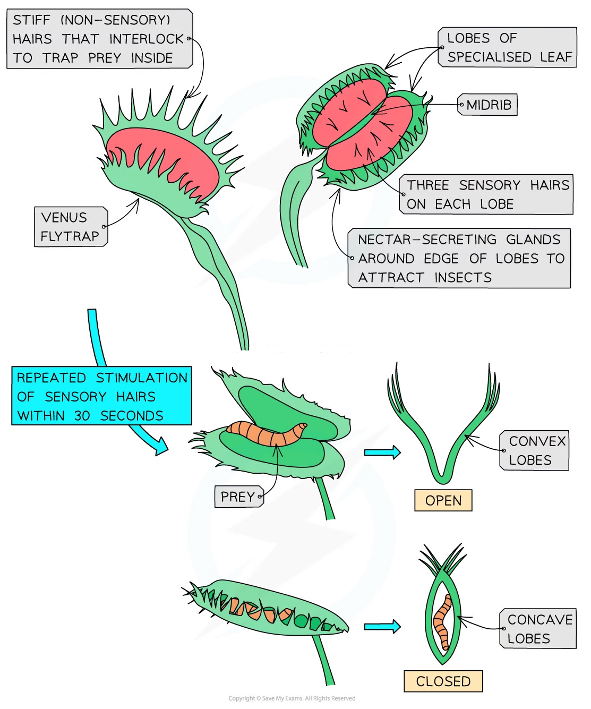

# Electrical Communication in the Venus Flytrap

## Electrical Communication in the Venus Flytrap

> **Spec point** — `spcpt_zc7ZZP4vXp7Kpzwc` · describe the rapid response of the Venus fly trap to stimulation of hairs on the lobes of modified leaves and explain how the closure of the trap is achieved

## Electrical communication in the Venus flytrap

- The Venus flytrap is a **carnivorous plant** that can gain nitrogen compounds by **trapping and digesting small animals**, mainly insects
- The specialised leaf is divided into **two** **lobes** on either side of a midrib

  - The inside of the lobes is **red **and has **nectar-secreting glands** on the edges to attract insects
- Each lobe has three **stiff sensory hairs** that detect touch
- If an insect touches one of these hairs, **action potentials are generated**
- These action potentials cause the two lobes to **fold together** along the midrib, capturing the insect

*The Venus flytrap has specialised features that enable it to catch and digest insects*

### How the closure of the trap is achieved

- The closure of the leaves occurs when the sensory hairs are touched repeatedly, generating an action potential as follows:

  1. an insect lands on the leaf and touches the sensory hairs
  2. **calcium ion channels** in hinge cells at the base of the hair open
  3. calcium ions flow into hinge cells and generate a *receptor potential*
  4. if two of the sensory hairs are stimulated at the same time, or one hair is stimulated twice within around 30 seconds, an **action potential** occurs and is propagated across the cells of the trap
  
    - If repeat stimulation does not occur then the trap resets and the process needs to start again from the beginning; this ensures that the plant does not waste energy by closing when an insect is not present
  5. the hinge cells at the base of the trap swell/expand (due to water moving in), and the trap closes
  
    - Sealing the trap requires **ongoing activation** of the sensory hairs, which occurs when the prey continues to move around inside the closed trap
  6. further stimulation of the sensory hairs causes **calcium ions** to enter **gland cells** where they stimulate the **exocytosis of vesicles** containing** digestive enzymes**
  7. the trap then stays closed for up to a week to allow the prey to be digested and the nutrients from it to be absorbed by the plant
