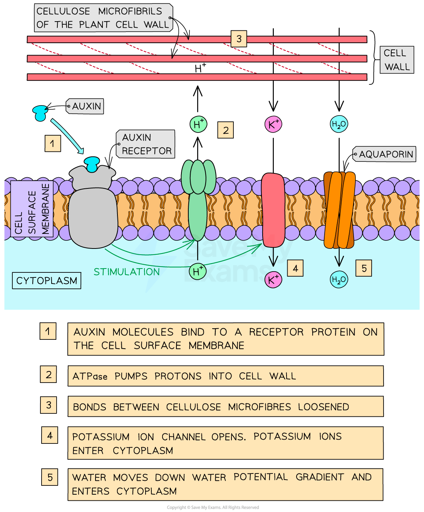

# The Role of Auxin in Elongation Growth

## The Role of Auxin in Elongation Growth

> **Spec point** — `spcpt_MyCNYNJrpdPZFvT2` · explain the role of auxin in elongation growth by stimulating proton pumping to acidify cell walls

## The role of auxin in elongation growth

- **Plant** **hormones** (also known as **plant growth regulators**) are responsible for most communication within plants
- **Auxins** are a type of plant growth regulator that influence many aspects of growth, including **elongation growth** which determines the **overall length of roots and shoots**
- The principle chemical in the group of auxins made by plants is **IAA** (indole 3-acetic acid) and this chemical is often simply referred to as **‘auxin’**

  - Auxins are a class of plant hormones that regulate growth in plants
- Auxin (IAA) is **synthesised in the growing tips of roots and shoots** (ie. in the **meristems**, where cells are **dividing**)
- Growth in these meristems occurs in three stages:

  - Cell **division** by mitosis
  - Cell **elongation **by absorption of water
  - Cell **differentiation**
- **Auxin** (IAA) is involved in **controlling growth by elongation**

### Controlling growth by elongation

- Auxin molecules bind to a **receptor protein** on the cell surface membrane
- Auxin stimulates **ATPase proton pumps** to pump **hydrogen ions** from the cytoplasm **into the cell wall **(across the cell surface membrane)
- This **acidifies** the cell wall (lowers the pH of the cell wall)
- This activates proteins known as **expansins**, which** loosen the bonds between **cellulose** microfibrils**
- At the same time, **potassium ion channels **are stimulated to **open**
- This leads to an **increase in potassium ion concentration in the cytoplasm**, which **decreases the water potential of the cytoplasm**
- This causes the cell to **absorb water** by **osmosis** (water enters the cell through **aquaporins**)
- This **increases** the **internal pressure **of the cell, causing the **cell wall** to **stretch** (made possible by expansin proteins)
- The cell **elongates**

*The role of auxin (IAA) in controlling growth by elongation*
