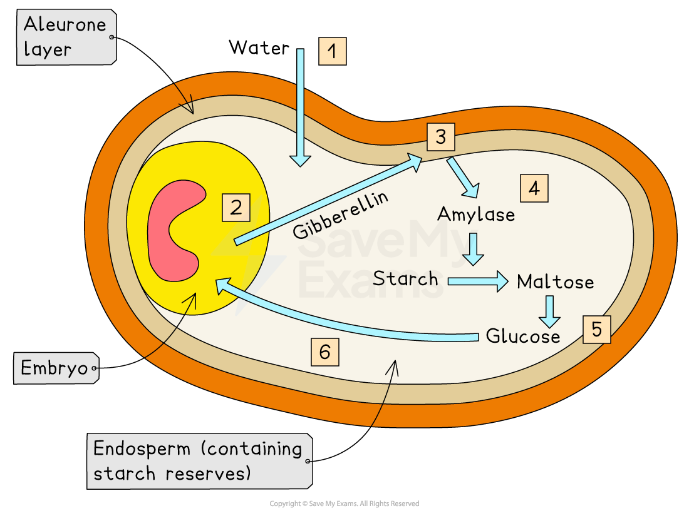
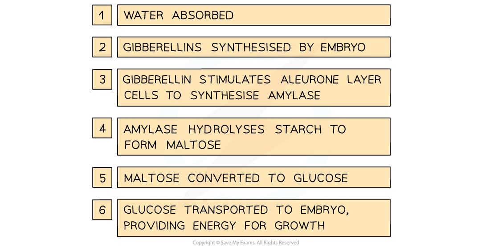

# The Role of Gibberellin in Germination of Barley

## The Role of Gibberellin in Germination of Barley

> **Spec point** — `spcpt_y5b3cPCpXFMprgpt` · describe the role of gibberellin in the germination of barley

## The role of gibberellin in germination of barley

- Gibberellins are a type of **plant growth regulator** involved in controlling **seed germination** and **stem elongation**
- When a barley seed is shed from the parent plant, it is in a state of **dormancy** (contains very little water and is metabolically inactive)
- This allows the seed to **survive harsh conditions** until the conditions are right for successful germination (e.g. the seed can survive a cold winter until temperatures rise again in spring)
- The barley seed contains:

  - An **embryo**—will grow into the new plant when the seed germinates
  - An **endosperm**—a starch-containing energy store surrounding the embryo
  - An **aleurone layer**—a protein-rich layer on the outer edge of the endosperm
- When the conditions are right, the barley seed starts to **absorb water** to begin the process of **germination**
- This stimulates the **embryo** to produce **gibberellins**
- Gibberellin molecules diffuse into the **aleurone layer** and stimulate the cells there to **synthesise the enzyme amylase**

  - In barley seeds, it has been shown that gibberellin does this by **regulating genes involved in the synthesis of amylase**, causing an **increase in the transcription of mRNA coding for amylase**
- The amylase **hydrolyses starch **molecules in the **endosperm**, producing soluble **maltose** molecules
- The maltose is **converted to glucose** and transported to the **embryo**
- This glucose can be **respired** by the embryo, providing the embryo with the **energy** needed for it to **grow**

*Gibberellin stimulates germination in barley seeds—note that gibberellin travels to the aleurone layer after it is released from the embryo, and amylase is then released from the aleurone layer into the endosperm*
