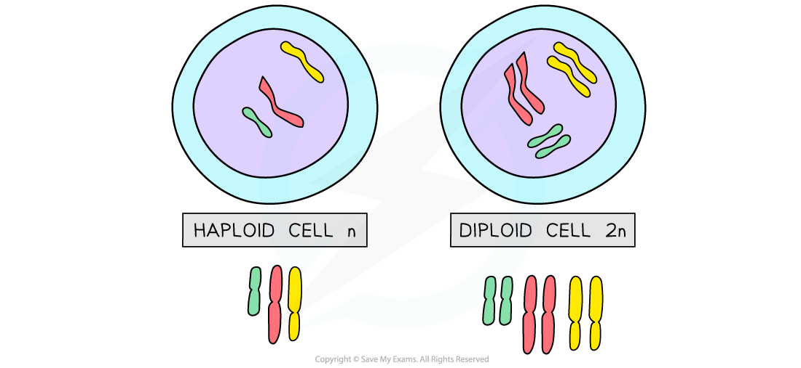
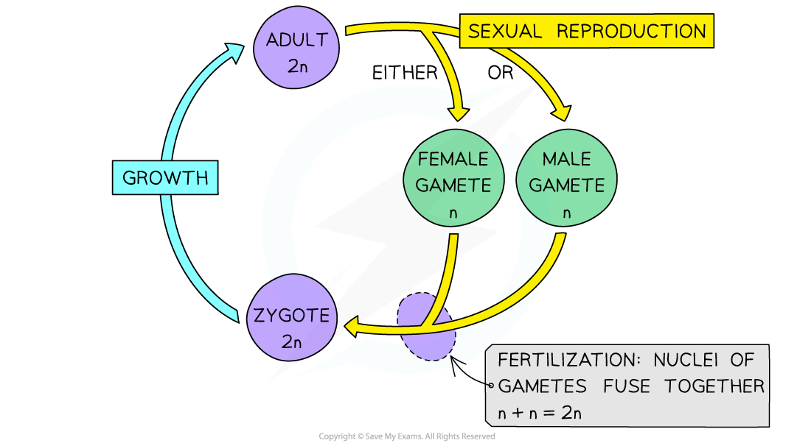

# Haploidy & Diploidy

## Haploid & Diploid cells

> **Spec point** — `spcpt_FbTnvxtyFSbX9DdZ` · explain the meanings of the terms haploid (n) and diploid (n)

## Haploid & diploid cells

- A diploid cell is a cell that contains **two complete sets of chromosomes (2n)**

  - These chromosomes contain the DNA necessary for protein synthesis and cell function
  - Nearly all cells in the human body are **diploid** with 23 **pairs** (46 individual) of chromosomes in their nucleus
- Haploid cells contain **one complete set of chromosomes (n)**

  - In other words they have half the number of chromosomes compared to diploid cells
  - Humans have **haploid** cells that contain 23 chromosomes (no pairs) in their nucleus
  - These haploid cells are called **gametes** and they are involved in sexual reproduction
  - For humans they are the female egg and the male sperm
- **Haploidy **and **diploidy **are terms that can be applied to cells across different species

  - They describe the number of **sets **of chromosomes, not the total number of chromosomes

*Haploid (n) and diploid (2n) cells*

> **Exam Hint**
> Red blood cells are an exception when it comes to chromosome number as they don’t have a nucleus!
> 
> You may be asked to estimate the number of chromosomes that would be present in the haploid cell of any species.  For example, dogs have 78 chromosomes in their diploid cells. When trying to find the number of chromosomes in their haploid cells simply remember that **diploid is 2n** and **haploid is n**, meaning you just need to divide the number of chromosomes by 2. So dogs have 39 chromosomes in their haploid cells!

## The Need for Reduction Division during Meiosis

> **Spec point** — `spcpt_S8CtpMwBWB6j5JRP` · explain the need for a reduction division during meiosis in the production of gametes

## The need for reduction division during meiosis

- During fertilisation the **nuclei of ***gametes* **fuse together** to form the **nucleus of** **the ***zygote*
- Both gametes must contain the correct number of chromosomes in order for the zygote to be viable. If a zygote has too many or too few chromosomes it may not survive
- For a diploid zygote this means that the **gametes must be haploid**

  - n + n = 2n
  - Where n is the haploid number of chromosomes and 2n is the diploid number of chromosomes
- **[Meiosis ](https://www.savemyexams.com/a-level/biology/cie/25/revision-notes/16-inheritance/16-1-passage-of-information-from-parents-to-offspring/meiosis-in-animal-and-plant-cells/?_ai=internal-linking)**[produces haploid gametes](https://www.savemyexams.com/a-level/biology/cie/25/revision-notes/16-inheritance/16-1-passage-of-information-from-parents-to-offspring/meiosis-in-animal-and-plant-cells/?_ai=internal-linking) during sexual reproduction
- The first cell division (this is not referring to the first *stage*) of meiosis is a **reduction division**

  - This is a **nuclear division that reduces the chromosome number **of a cell
  - In humans the chromosome number is reduced from 46 (diploid) to 23 (haploid)
- The reduction in chromosome number during meiosis ensures the gametes formed are haploid

*The maintenance of chromosome number through reduction division in a mammalian life cycle*
