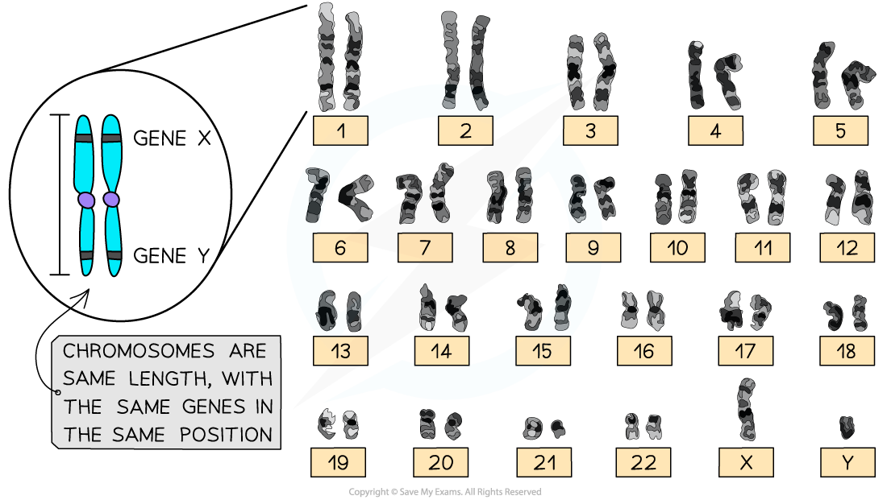

# Homologous Chromosomes

## Homologous Chromosomes

> **Spec point** — `spcpt_WQGcBPQv8BvKYWmc` · explain what is meant by homologous pairs of chromosomes

## Homologous chromosomes

- In *[diploid](https://www.savemyexams.com/a-level/biology/cie/25/revision-notes/16-inheritance/16-1-passage-of-information-from-parents-to-offspring/haploidy-and-diploidy/?_ai=internal-linking)*[ cells](https://www.savemyexams.com/a-level/biology/cie/25/revision-notes/16-inheritance/16-1-passage-of-information-from-parents-to-offspring/haploidy-and-diploidy/?_ai=internal-linking) there are two complete sets of chromosomes in the nucleus
- *Chromosomes* have a characteristic shape

  - They have a **fixed length**
  - The **position of the centromere** is in a particular location
- These characteristic features allow for each chromosome to be identified in a photomicrograph
- In photomicrographs chromosomes are often grouped into their **homologous pairs**
- **Homologous** **chromosomes**:

  - Carry the** same genes in the same positions **(*[locus](https://www.savemyexams.com/a-level/biology/cie/25/revision-notes/16-inheritance/16-2-the-roles-of-genes-in-determining-the-phenotype/key-terms-in-genetics/?_ai=internal-linking)*)
  - Are the **same shape**
- During fertilisation a diploid *zygote* is formed

  - In a zygote one chromosome of each homologous pair comes from the female gamete and the other comes from the male gamete
- Having the same genes in the same order helps homologous chromosomes line up alongside each other during meiosis

*Human karyogram showing homologous chromosomes*

> **Exam Hint**
> Although homologous pairs of chromosomes contain the same genes in the same order they don’t necessarily carry the same alleles (form) of each gene! i.e. We all have the genes to create eyes, some have the allele to create blue eyes and others the allele for brown eyes, for example.
> 
> (A karyogram, as seen in the image, is an organised picture of an organism’s chromosomes arranged in pairs by size and shape.)
