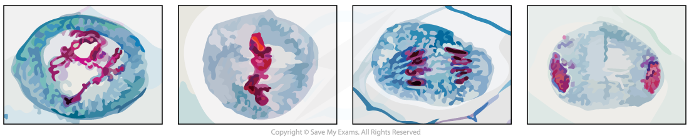
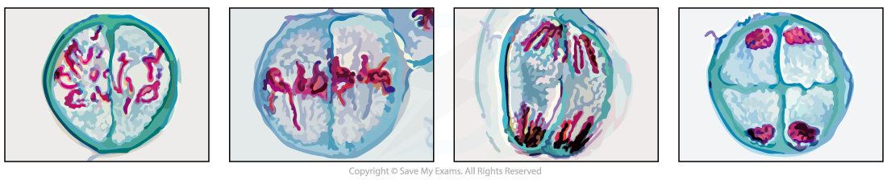

# Identifying the Stages of Meiosis

## Identifying the Stages of Meiosis

> **Spec point** — `spcpt_ThmvJ6xmMxMwHgtR` · interpret photomicrographs and diagrams of cells in different stages of meiosis and identify the main stages of meiosis

## Identifying the stages of meiosis

- Cells undergoing *meiosis* can be observed and photographed using specialised microscopes
- The different stages of meiosis have distinctive characteristics meaning they can be identified from photomicrographs or diagrams

### Meiosis I or Meiosis II

- **Homologous chromosomes** pair up side by side in meiosis I only
- This means if there are **pairs of chromosomes** in a diagram or photomicrograph **meiosis I** must be occurring
- The number of cells forming can help distinguish between meiosis I and II
- If there are **two new cells** forming it is **meiosis I** but if there are **four new cells** forming it is **meiosis II**

### The distinguishing features at each stage of Meiosis I

- Prophase I: **Homologous pairs** of chromosomes are visible
- Metaphase I: Homologous pairs are lined up **side by side** along the **equator** of spindle
- Anaphase I:** Whole chromosomes **are being pulled to opposite **poles** with **centromeres intact**
- Telophase I: There are **2 groups** of condensed chromosomes around which nuclei membranes are forming
- Cytokinesis: Cytoplasm is dividing and **cell membrane is pinching inwards **to form **two cells**

### The distinguishing features at each stage of Meiosis II

- Prophase II: **Single whole chromosomes** are visible
- Metaphase II: Single whole chromosomes are lined up along the **equator** of the spindle in **single file** (at 90 degree angle to the old spindle)
- Anaphase II: **Centromeres divide **and **chromatids **are being pulled to opposite **poles**
- Telophase II: Nuclei are forming around the **4 groups** of condensed chromosomes
- Cytokinesis: Cytoplasm is dividing and **four haploid cells **are forming

#### Identifying the stages of meiosis

| **Stage** | **Micrograph** |
|---|---|
| **Prophase I** One group of chromosomes becomes visible as the DNA condenses |  |
| **Metaphase I** Chromosome pairs are located along the middle of the spindle |  |
| **Anaphase I** Whole chromosomes are being pulled away from the middle |  |
| **Telophase I** There are two groups of chromosomes, one at each pole The nucleus is reforming and the cytoplasm is pinching in |  |
| **Prophase II** Two groups of chromosomes are visible as the DNA condenses |  |
| **Metaphase II** Chromosomes line up along the middle of the spindles in single-file |  |
| **Anaphase II** Chromatids are pulled away from the middle of the spindles |  |
| **Telophase II** There are four groups of chromosomes and the cytoplasm is pinching in |  |

#### Meiosis I Photomicrographs

*Prophase I, Metaphase I , Anaphase I and Telophase I as seen in photomicrographs*

#### Meiosis II Photomicrographs

*Prophase II, Metaphase II , Anaphase II and Telophase II as seen in photomicrographs*

> **Exam Hint**
> The acronym PMAT can help you remember what is happening in each stage:
> 
> - **P** for Prophase where chromosomes are **Preparing **to divide
> - **M** for Metaphase** for the middle **of the spindle and cell which is where the chromosomes will be lined up.
> - **A** for Anaphase, remember **A for away **from the middle to the poles, which is where the chromosomes / chromatids are being pulled
> - **T** for telophase where we have **Two **cells (for meiosis I at least!)
