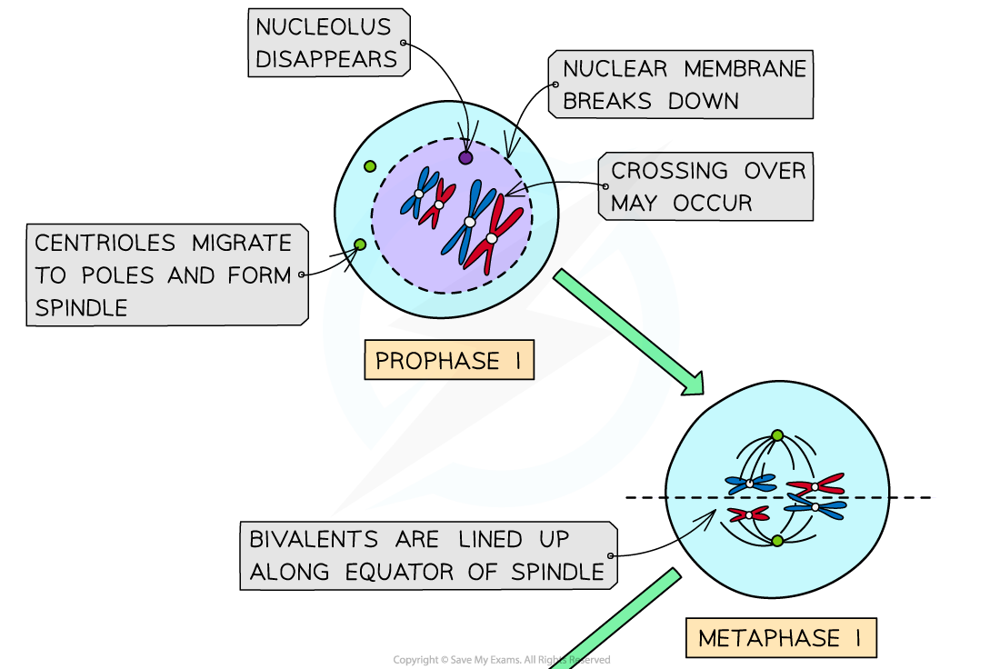
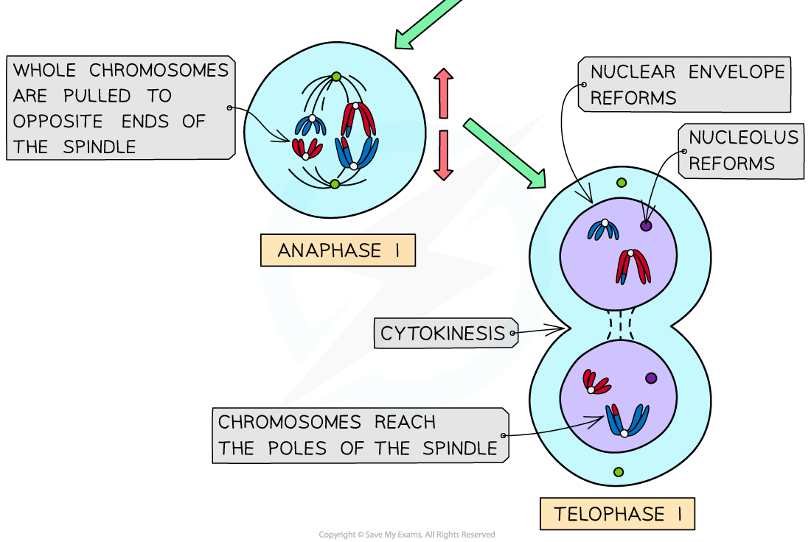
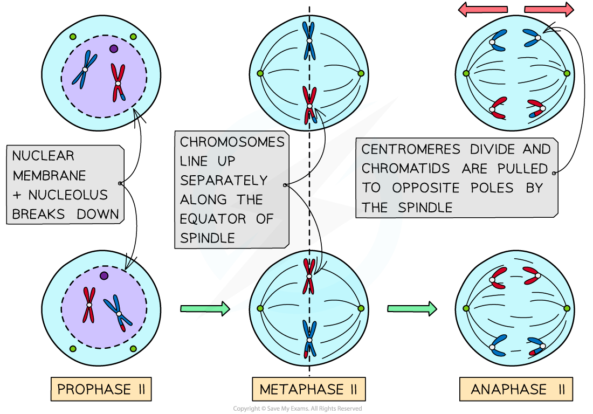
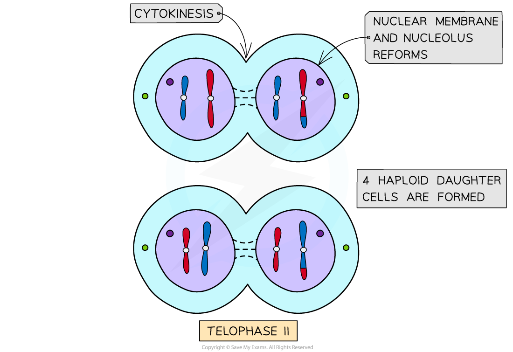

# Meiosis in Animal & Plant Cells

## Meiosis in Animal & Plant cells

> **Spec point** — `spcpt_6J4sj9NzgFbkm8kY` · describe the behaviour of chromosomes in plant and animal cells during meiosis and the associated behaviour of the nuclear envelope, the cell surface membrane and the spindle

## Meiosis in animal & plant cells

- Meiosis is a form of **nuclear division** that results in the **production of ***[haploid](https://www.savemyexams.com/a-level/biology/cie/25/revision-notes/16-inheritance/16-1-passage-of-information-from-parents-to-offspring/haploidy-and-diploidy/?_ai=internal-linking)***[ cells](https://www.savemyexams.com/a-level/biology/cie/25/revision-notes/16-inheritance/16-1-passage-of-information-from-parents-to-offspring/haploidy-and-diploidy/?_ai=internal-linking)**[ from ](https://www.savemyexams.com/a-level/biology/cie/25/revision-notes/16-inheritance/16-1-passage-of-information-from-parents-to-offspring/haploidy-and-diploidy/?_ai=internal-linking)*[diploid](https://www.savemyexams.com/a-level/biology/cie/25/revision-notes/16-inheritance/16-1-passage-of-information-from-parents-to-offspring/haploidy-and-diploidy/?_ai=internal-linking)*[ cells](https://www.savemyexams.com/a-level/biology/cie/25/revision-notes/16-inheritance/16-1-passage-of-information-from-parents-to-offspring/haploidy-and-diploidy/?_ai=internal-linking)
- It produces *gametes* in plants and animals that are used in **sexual reproduction**
- It has many similarities to mitosis however it has **two divisions**: meiosis I and meiosis II
- Within each division there are the following stages: **prophase, metaphase, anaphase and telophase**

### First division of meiosis: Meiosis I

#### Prophase I

- **DNA condenses** and becomes visible as chromosomes
- DNA replication has already occurred so each chromosome consists of **two sister** *chromatids* joined together by a centromere
- The chromosomes are arranged side by side in **homologous pairs**

  - A pair of homologous chromosomes is called a **bivalent**
- As the homologous chromosomes are very close together the **crossing over** of non-sister chromatids may occur. The point at which the crossing over occurs is called the **chiasma** (chiasmata; plural)
- In this stage centrioles migrate to opposite poles and the **spindle is formed**
- The **nuclear envelope breaks down** and the nucleolus disintegrates

#### Metaphase I

- The **bivalents line up along the equator of the spindle**, with the spindle fibres attached to the centromeres

#### Anaphase I

- The homologous pairs of chromosomes are separated as **microtubules pull whole chromosomes to opposite ends **of the spindle
- The centromeres do not divide

#### Telophase I

- The chromosomes arrive at opposite poles
- Spindle fibres start to break down
- **Nuclear envelopes form around the two groups of chromosomes** and nucleoli reform
- Some plant cells go straight into meiosis II without reformation of the nucleus in telophase I

#### Cytokinesis

- This is when the **division of the cytoplasm** occurs
- Cell organelles also get distributed between the two developing cells
- In **animal **cells:

  - The **cell surface membrane** pinches inwards creating a **cleavage furrow** in the middle of the cell which contracts, dividing the cytoplasm in half
- In **plant **cells:

  - Vesicles from the Golgi apparatus gather along the equator of the spindle (the cell plate). The **vesicles** merge with each other to form the **new cell surface membrane.** Layers of [cellulose](https://www.savemyexams.com/a-level/biology/cie/22/revision-notes/2-biological-molecules/2-2-carbohydrates--lipids/2-2-6-cellulose/) are laid down to form the primary and secondary walls of the cell
- The end product of cytokinesis in meiosis I: **two haploid cells**

  - These cells are haploid as they contain half the number of **centromeres**

*The different stages of Meiosis I in an animal cell*

### Second division of meiosis : Meiosis II

- There is **no interphase** between meiosis I and meiosis II so the DNA is not replicated
- The second division of meiosis is almost identical to the stages of mitosis

#### Prophase II

- The **nuclear envelope breaks down** and **chromosomes condense**
- A **spindle forms at a right angle to the old one**

#### Metaphase II

- **Chromosomes** line up in a **single file along the equator **of the spindle

#### Anaphase II

- Centromeres divide and individual **chromatids are pulled to opposite poles**
- This creates **four groups of chromosomes** that have half the number of chromosomes compared to the original parent cell

#### Telophase II

- **Nuclear membranes form** around each group of chromosomes

#### Cytokinesis

- **Cytoplasm divides **as new cell surface membranes are formed **creating four haploid cells**

  - Each cell contains the same number of centromeres (and so chromosomes) as at the start of meiosis II, but each chromosome now consists of a single chromatid rather than two sister chromatids (previously chromatids)

*Prophase II, Metaphase II and Anaphase II in Meiosis II of an animal cell*

*Telophase II and cytokinesis in Meiosis II of an animal cell*

> **Exam Hint**
> Understanding the difference between **chromosomes **and **chromatids **can be difficult.
> 
> We count chromosomes by the **number of centromeres present**. So when the 46 chromosomes duplicate during interphase and the **amount of DNA in the cell doubles** there are still only 46 chromosomes present because there are still only 46 centromeres present. However, there are now 92 chromatids, which are strands of replicated chromosomes.
