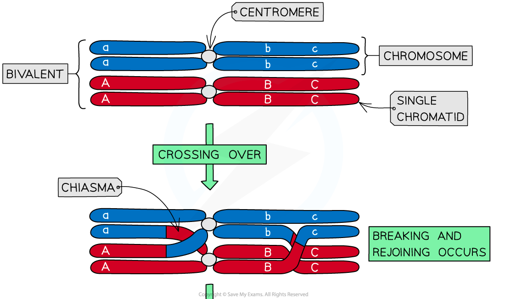
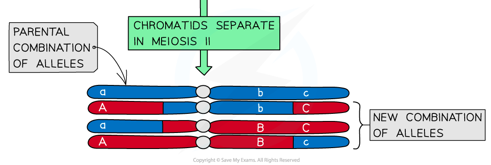
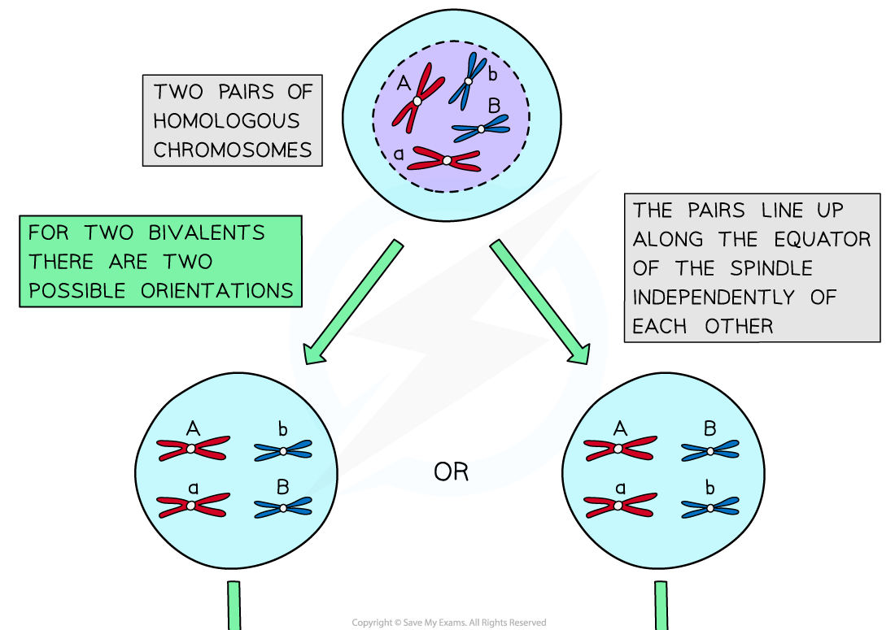
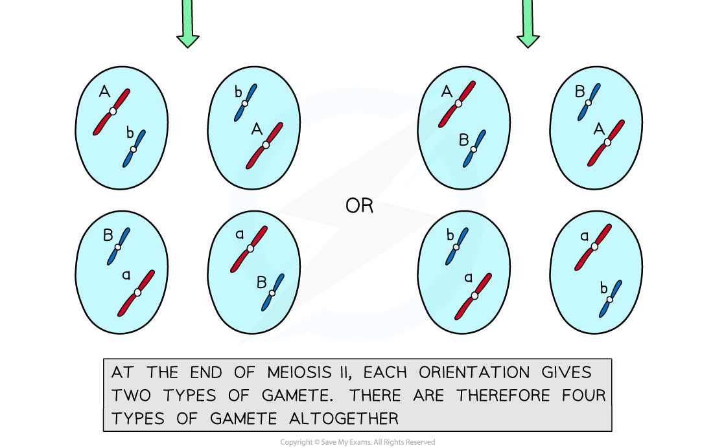
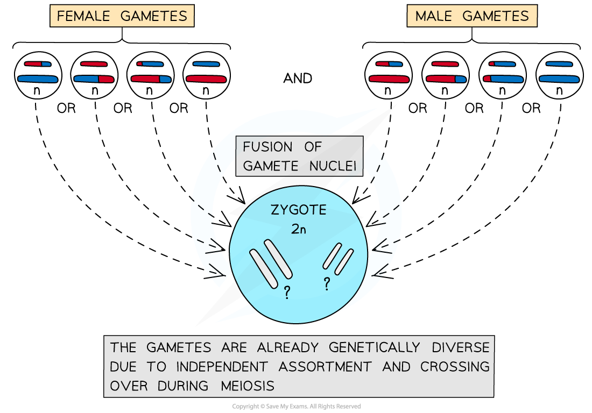

# Meiosis: Sources of Genetic Variation

## Meiosis: Sources of Genetic Variation

> **Spec point** — `spcpt_cmSk2yK23Hn2QdjF` · explain that crossing over and random orientation (independent assortment) of pairs of homologous chromosomes and sister chromatids during meiosis produces genetically different gametes

## Meiosis: sources of genetic variation

- Having **genetically different offspring** can be **advantageous** for *natural selection*
- **Meiosis** has several mechanisms that **increase the genetic diversity of gametes** produced
- Both **crossing over** and** independent assortment** (random orientation) result in **different combinations of** *alleles* in gametes

### Crossing over

- Crossing over is the process by which **non-sister chromatids exchange alleles**
- Process:

  - During **[meiosis I](https://www.savemyexams.com/a-level/biology/cie/25/revision-notes/16-inheritance/16-1-passage-of-information-from-parents-to-offspring/meiosis-in-animal-and-plant-cells/?_ai=internal-linking)** homologous chromosomes pair up and are in very close proximity to each other
  - The **non-sister chromatids can cross over** and get entangled
  - These crossing points are called **chiasmata**
  - The entanglement places stress on the DNA molecules
  - As a result of this, a section of chromatid from one chromosome may **break and rejoin **with the chromatid from the other chromosome
- This swapping of alleles is significant as it can result in a **new combination of alleles on the two chromosomes**
- There is usually at least one, if not more, chiasmata present in each bivalent during meiosis
- Crossing over is more likely to occur further down the chromosome away from the centromere

*Crossing over of non-sister chromatids leading to the exchange of genetic material*

### Independent assortment

- Independent assortment is the production of **different combinations of alleles in daughter cells** due to the **random alignment of homologous pairs along the equator of the spindle** during **metaphase I**
- The different combinations of chromosomes in daughter cells **increases genetic variation **between gametes
- In prophase I homologous chromosomes pair up and in metaphase I they are pulled towards the equator of the spindle

  - **Each pair can be arranged with either chromosome on top**, this is completely **random**
  - The **orientation of one homologous pair is independent **(unaffected by the orientation of any other pair)
- The homologous chromosomes are then **separated **and pulled apart to different poles
- The combination of alleles that end up in each daughter cell depends on how the pairs of homologous chromosomes were lined up
- To work out the **number of different possible chromosome combinations **the **formula 2****n**** **can be used, where n corresponds to the number of chromosomes in a haploid cell

  - For humans this is 223 which calculates as 8 388 608 different combinations

*Independent assortment of homologous chromosomes leading to different genetic combinations in daughter cells*

> **Exam Hint**
> Several sources of genetic variation have been outlined above. It is also worth remembering that genetic variation can occur on an even smaller scale than chromosomes: **mutations** can occur within genes. A random mutation that takes place during DNA replication can lead to the production of new alleles and increased genetic variation.

## Fusion of Gametes

> **Spec point** — `spcpt_W7rXMBKtt5s3zBrJ` · explain that the random fusion of gametes at fertilisation produces genetically different individuals

## Fusion of gametes

- **Meiosis** creates **genetic variation** **between the gametes** produced by an individual through crossing over and independent assortment
- This means each gamete carries substantially **different alleles**
- During fertilisation any male gamete can fuse with any female gamete to form a *zygote*
- This **random fusion of gametes** at fertilisation creates genetic variation **between zygotes **as each will have a unique combination of alleles
- There is an almost zero chance of individual organisms resulting from successive sexual reproduction being genetically identical

*How meiosis and the random fusion of gametes affects genetic variation*

> **Exam Hint**
> These sources of genetic variation explain why relatives can differ so much from each other. Even with the same parents, individuals can be genetically unique due to the processes outlined above.
