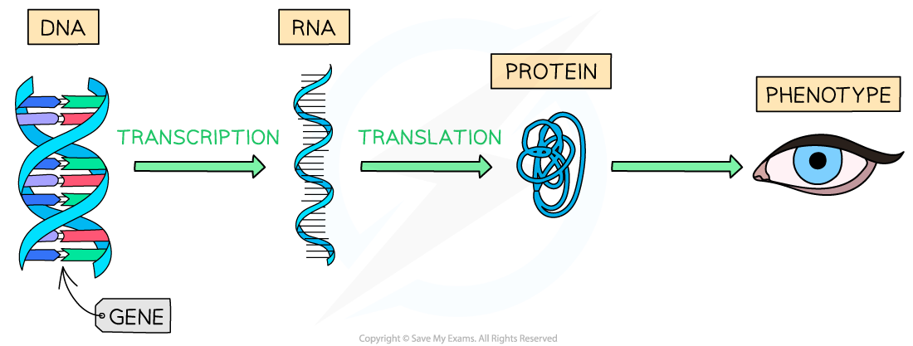
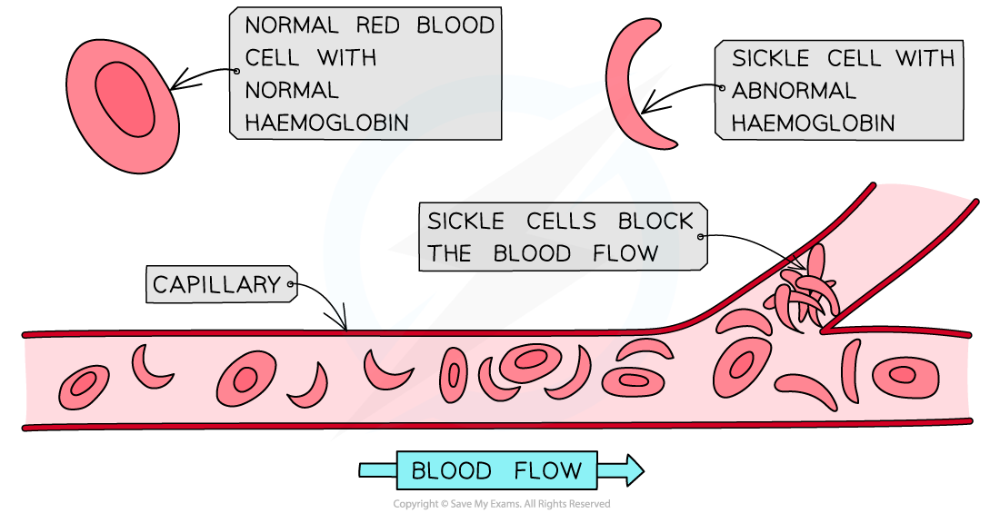

# Genes, Proteins & Phenotype

## Genes, Proteins & Phenotype

> **Spec point** — `spcpt_tqYKKVwsZzzdfPtW` · explain the relationship between genes, proteins and phenotype with respect to the:
• TYR gene, tyrosinase and albinism
• HBB gene, haemoglobin and sickle cell anaemia
• F gene, factor VIII and haemophilia
• HTT gene, huntingtin and Huntington’s disease

## Genes, proteins & phenotype

- A gene can affect a *phenotype* of an organism

  - A gene codes for a single protein
  - The protein affects the phenotype through a particular mechanism
- The phenotype of an individual can also be affected by the **environment**

*Genes code for mRNA which gets translated into a polypeptide (protein) that affects the phenotype of the organism*

### TYR gene and albinism

- Humans with albinism **lack the pigment melanin** in their skin, hair and eyes
- This causes them to have very pale skin, very pale hair and pale blue or pink irises in the eyes
- There is a metabolic pathway for producing melanin:

1. The amino acid tyrosine is converted to DOPA by the **enzyme tyrosinase**
2. DOPA is converted to dopaquinone again by the **enzyme tyrosinase**
3. Dopaquinone is converted to melanin

**tyrosine → DOPA → dopaquinone → melanin**

- A **gene called *****TYR*** located on chromosome 11 codes for the enzyme tyrosinase
- There is a **recessive allele** for the gene *TYR* that causes a lack of enzyme tyrosinase or the presence of inactive tyrosinase
- Without the tyrosinase enzyme tyrosine can not be converted into melanin

### HBB gene and sickle cell anaemia

- **Sickle cell anaemia** is a condition that causes individuals to have frequent infections, episodes of pain and anaemia
- Humans with sickle cell anaemia have **abnormal haemoglobin** in their red blood cells
- β-globin is a polypeptide found in haemoglobin that is coded for by the **gene *****HBB*** which is found on chromosome 11
- There is an **abnormal allele** for the gene *HBB* which produces a slightly different amino acid sequence to the normal allele

  - The change of a **single base** in the DNA of the abnormal allele results in an **amino acid substitution**
  
    - The DNA base sequence GAG is replaced by GTG
    
      - This means that CTC is replaced by CAC on the complementary DNA *template strand*, meaning that GAG is replaced by GUG in the resulting mRNA
  - This **change in amino acid sequence **results in an **abnormal β-globin** polypeptide
  
    - The amino acid Glu is replaced with Val
- The abnormal β-globin in haemoglobin affects the structure and **shape of the red blood cells**

  - They are pulled into a half moon shape
  - They **transport less oxygen** around the body
  - They stick to each other and clump together blocking capillaries
- A **homozygous **individual that has two abnormal alleles for the *HBB* gene produces **only sickle cell haemoglobin**

  - They **have sickle cell anaemia **and suffer from the associated symptoms
- A **heterozygous **individual that has one normal allele and one abnormal allele for the *HBB* gene will produce some **normal haemoglobin and some sickle cell haemoglobin**

  - They are a **carrier **of the allele
  - They may have no symptoms

*Normal red blood cells and Sickle cell blood cells—the sickle cells cause a blockage in the capillary and restrict blood flow*

### F8 gene and haemophilia

- **Factor VIII **is a coagulating agent that plays an essential role in** blood clotting**
- The gene ***F8*** codes for the Factor VIII protein
- There are **abnormal alleles** of the *F8* gene that result in:

  - Production of abnormal forms of factor VIII
  - Less production of normal factor VIII
  - No production of factor VIII
- A **lack of normal factor VIII prevents normal blood clotting** and causes the condition **haemophilia**
- The *F8* gene is located on the** X chromosome**

  - This means *F8* is a **sex-linked gene**
  - **Haemophilia is a sex-linked condition**
  
    - If males have an **abnormal allele** they will **have the condition** as they have only one copy of the gene
    - Females can be **heterozygous **for the *F8* gene and not suffer from the condition but act as a **carrier**

### HTT gene and Huntington's disease

- Huntington’s disease is a genetic condition that develops as a person ages
- Usually a person with the disease will not show symptoms until they are 30 years old or older
- An individual with the condition experiences **neurological degeneration**; they lose their ability to walk, talk and think
- The disease is ultimately fatal
- It has been found that individuals with Huntington's disease have **abnormal alleles of the *****HTT***** gene**

  - The *HTT* gene codes for the protein **huntingtin** which is involved in neuronal development
  - People that have a large number (>40) of **repeated CAG triplets** present in the nucleotide sequence of their *HTT* gene suffer from the disease
- The **abnormal allele is dominant **over the normal allele

  - If an individual has one abnormal allele present they will suffer from the disease

| **Gene** | **Key molecules involved** | **Genotype** | **Phenotype** |
|---|---|---|---|
| TYR | Tyrosinase enzyme and melanin | Homozygous for abnormal allele | Albinism |
| HBB | Haemoglobin | Heterozygous | Carrier |
| Homozygous for abnormal allele | Sickle cell anaemia |   |   |
| F8 | Factor VIII | Heterozygous female | Carrier |
| Male with one abnormal allele or female homozygous for abnormal allele | Haemophilia |   |   |
| HTT | Huntingtin | Heterozygous | Huntington's disease |
| Homozygous for abnormal allele | Huntington's disease |   |   |

> **Exam Hint**
> You may be asked to predict the inheritance of diseases like the ones above.
> 
> An example question would be: *Max and Jane are trying for a baby but they are concerned about the possibility of their child having haemophilia. Neither Max or Jane have haemophilia themselves but Jane’s father had the condition. What are chances that their child could have haemophilia?*
> 
> For questions like this, it is very important to gather early on whether the abnormal allele that causes the disease is **dominant **or **recessive **and if there is any **sex linkage**. In this example for haemophilia, the abnormal allele is recessive and the gene is sex-linked. Then the next step would be to work out the genotypes of the parents from the information given and use this to create a **genetic diagram.**
