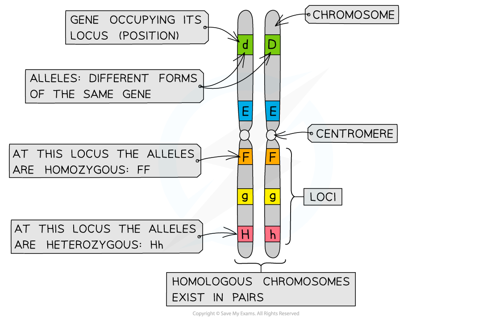
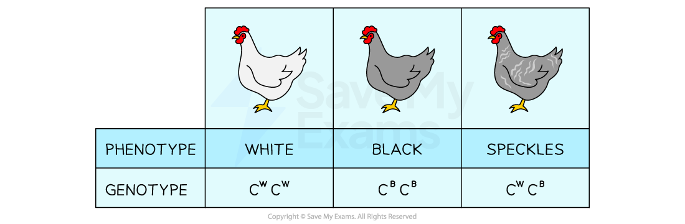
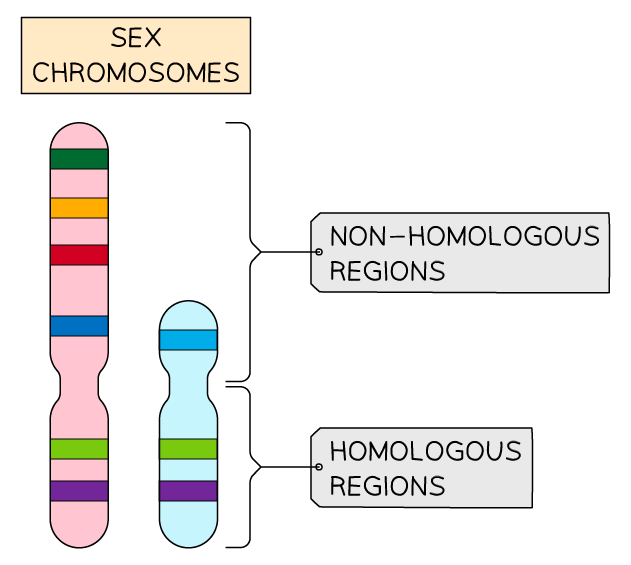

# Key Terms in Genetics

## Key Terms in Genetics

> **Spec point** — `spcpt_YDhcHHt9PBMj6tp4` · explain the terms gene, locus, allele, dominant, recessive, codominant, linkage, test cross, F, F, phenotype, genotype, homozygous and heterozygous

## Key terms in genetics

### Genes and alleles

- The DNA contained within chromosomes is essential for cell survival
- Every **chromosome** consists of a long DNA molecule which **codes for several different proteins**
- A length of DNA that codes for a single polypeptide or protein is called a **gene**
- The **position of a gene** on a chromosome is its **locus** (plural: loci)
- Each gene can exist in two or more different forms called **alleles**
- Different alleles of a gene have slightly **different nucleotide sequences** but they still occupy the **same position **(locus) on the chromosome

*Chromosomes showing genes, alleles and loci*

#### Example of alleles

- One of the genes for coat colour in horses is Agouti
- This gene for coat colour is found on the same position on the same chromosome for all horses
- Hypothetically there are two different alleles of that gene found in horses: **A** and **a**
- Each allele can produce a different coat colour:

  - Allele **A** → black coat
  - Allele **a** → chestnut coat

### Genotype and phenotype

- The chromosomes of eukaryotic cells occur in **homologous pairs** (there are two copies of each chromosome)
- As a result cells have **two copies of every gene**
- As there are two copies of a gene present in an individual that means there can be **different allele combinations within an individual**
- The **genotype** of an organism refers to the **alleles of a gene **possessed by that individual. The different alleles can be represented by letters
- When the two allele copies are identical in an individual they are said to be **homozygous**
- When the two allele copies are different in an individual they are said to be **heterozygous**
- The genotype of an individual affects their **phenotype**
- A phenotype is the **observable characteristics** of an organism

#### Example of genotype and phenotype

- Every horse has two copies of the coat colour gene in all of their cells
- A horse that has two black coat alleles **A **has the genotype **AA** and is **homozygous**

  - The **phenotype **of this horse would be a black coat
- In contrast a horse that has one black coat allele **A** and one chestnut coat allele **a** would have the genotype **Aa** and is **heterozygous**

  - The **phenotype **of this horse would also be a black coat
- A horse that has two coat alleles **a **has the genotype **aa** and is **homozygous**

  - The **phenotype **of this horse would be chestnut

### Dominance

- Not all alleles affect the phenotype in the same way
- Some alleles are **dominant **and represented by the **capital **letter:

  - They are **always expressed** in the phenotype
  - This means they are expressed in both heterozygous **and **homozygous individuals
- Others are **recessive **and represented by the **lower case** letter

  - They are only** expressed** in the phenotype **if no dominant allele** is present
  - This means that it is **only** expressed when present in a homozygous individual

#### Example of dominance

- If for horses the allele **A** for a black coat is dominant and the allele **a** for a chestnut coat is recessive the following genotypes and phenotypes occur:

  - Genotype **AA** → black coat
  - Genotype **Aa** → black coat
  - Genotype **aa →** chestnut coat

### Codominance

- Sometimes** both alleles can be expressed** in the phenotype at the same time
- This is known as codominance
- When an individual is **heterozygous **they will express both alleles in their phenotype
- When writing the genotype for codominance the gene is symbolised as the capital letter and the alleles are represented by different superscript letters, for example **I****A****I****A**

#### Example of codominance

- **Blood Groups**

  - A good example of codominance can be seen in human blood types
  - The gene for blood types is represented in the genotype by **I **and the three alleles for human blood types are represented by **A**, **B** and **O**
  - Allele for blood type **O** is recessive to both group **A** and group** B** alleles
  - Allele **A** results in blood type **A** (IAIA or IAIO) and allele **B** results in blood type **B **(IBIB or IBIO)
  - If both allele **A** and allele **B** are present in a heterozygous individual they will have blood type **AB** (IAIB)
- **Feather Colour**

### F1, F2 and test crosses

- When a **homozygous dominant **individual is crossed with a **homozygous recessive** individual the offspring are called the **F****1 ****generation**

  - All of the F1 generation are **heterozygous**
- If two individuals from the F1 generation are then crossed, the offspring they produce are called the** F****2**** generation**
- A [test cross ](https://www.savemyexams.com/a-level/biology/cie/22/revision-notes/16-inheritance/16-2-the-roles-of-genes-in-determining-the-phenotype/16-2-4-predicting-inheritance-test-crosses/)can be used to try and **deduce the genotype of an unknown individual **that is expressing a dominant phenotype

  - The individual in question is crossed with an individual that is expressing the **recessive phenotype**
  - The resulting phenotypes of the offspring provide sufficient information to suggest the genotype of the unknown individual
  - If there are any offspring expressing the recessive phenotype then the unknown individual must have a heterozygous genotype

### Linkage

- There are two types of linkage in genetics: **sex linkage** and **autosomal linkage**
- **Sex linkage**:

  - There are two sex chromosomes: X and Y
  - Women have two copies of the X chromosome (XX) whereas men have one X chromosome and one shorter Y chromosome (XY)
  - Some **genes are found on a region of a sex chromosome X that is not present on the **sex chromosome Y
  
    - This is called the **non-homologous region**
  - As the **inheritance of these genes is dependent on the sex** of the individual they are called sex-linked genes
  - Most often sex-linked genes are found on the longer X chromosome
  
    - Haemophilia is well known example of a sex-linked disease
  - Sex-linked genes are represented in the genotype by writing the alleles as superscript next to the sex chromosome.
  
    - For example a particular gene that is found only on the X chromosome has two alleles **G** and **g**. The genotype of a heterozygous female would be written as XGXg. A males genotype would be written as XGY

*Sex-linked genes are typically found within the non-homologous region of the sex chromosomes*

- **Autosomal linkage**:

  - This occurs on the *autosomes*
  - Two or more genes on the same chromosome **do not assort independently** during meiosis
  - These genes are linked and they stay together in the original parental combination

> **Exam Hint**
> When referring to the different alleles be careful about your notation:
> 
> - When describing a dominant allele use capitals (for example allele **B** )
> - When describing a recessive allele use lower case ( for example allele **b** ).
> - Be careful when choosing the letters to represent the alleles when writing the genotype. Use letters that are easy to distinguish between the capital and the lower case (e.g., B and b).
