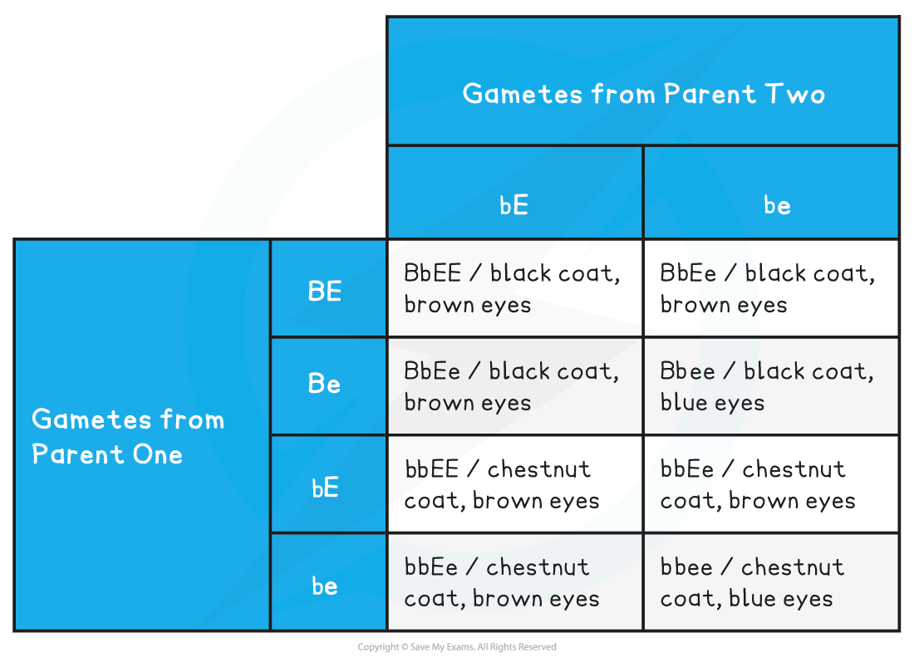
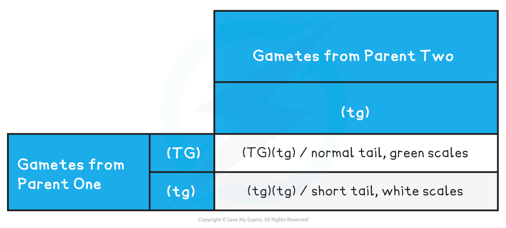

# Predicting Inheritance: Dihybrid Crosses

## Predicting Inheritance: Dihybrid Crosses

> **Spec point** — `spcpt_wvt3PnFWWDG3m8Sc` · interpret and construct genetic diagrams, including Punnett squares, to explain and predict the results of dihybrid crosses that involve autosomal linkage and epistasis

## Predicting inheritance: dihybrid crosses

### Dihybrid crosses

- **Monohybrid crosses** look at how the alleles of **one gene** transfer across generations
- **Dihybrid crosses** look at how the alleles of **two genes **transfer across generations
- The genetic diagrams for both types of crosses are very similar
- There are several more genotypes and phenotypes involved
- When writing the different genotypes write the two alleles for one gene, followed immediately by the two alleles for the other gene. **Do not mix up the alleles from the different genes**

  - If there was a gene with alleles **Y** and **y **and another gene with alleles **G** and **g **an example genotype for an individual would be **YYGg**

#### Worked example: dihybrid genetic diagram

- Horses have a single gene for coat colour that has two alleles:

  - **B**, a dominant allele produces a black coat
  - **b**, a recessive allele produces a chestnut coat
- Horses also have single gene for eye colour

  - **E**, a dominant allele produces brown eyes
  - **e**, a recessive allele produces blue eyes
- In this example a horse which is **heterozygous** for **both genes** has been crossed with a horse that is **homozygous** for **one gene** and **heterozygous** for the **other**

Parental phenotypes: black coat, brown eyes x chestnut coat, brown eyes

Parental genotypes:   **BbEe              **                        **bbEe**

Parental gametes:      **BE** or **Be** or **bE** or **be**          **bE** or **be**

*Dihybrid cross punnett square*

Predicted ratio of phenotypes in offspring – 3 black coat, brown eyes :  3 chestnut coat, brown eyes : 1 black coat, blue eyes  : 1 chestnut coat, blue eyes

### Autosomal linkage

- **Dihybrid crosses** and their predictions rely on the assumption that the genes being investigated behave independently of one another during meiosis
- **Not all genes assort independently during meiosis**
- Some genes which are located on the **same chromosome** display autosomal linkage and **stay together in the original parental combination**
- Linkage between genes affects how parental alleles are passed onto offspring through the gametes
- When writing linked genotypes it can be easier to keep the linked alleles within a bracket

  - For example an individual has the genotype **FFGG** however if there is linkage between the two genes then it would be written as (**FG**)(**FG**)

#### Worked example: explaining autosomal linkage

- The genes for tail length and scale colour in a species of newt have displayed autosomal linkage
- The gene for tail length has two alleles :

  - Dominant allele **T** produces a normal length tail
  - Recessive allele **t** produces a shorter length tail
- The gene for scale colour has two alleles:

  - Dominant allele **G** produces green scales
  - Recessive allele **g** produces white scales
- A newt heterozygous for a normal tail and green scales is crossed with a newt that has a shorter tail and white scales

Parental phenotypes: normal tail, green scales x short tail, white scales

Parental genotypes:    **(TG)(tg)           **      **(tg)(tg)**

Parental gametes:        **(TG)** or **(tg)     **      **(tg)**

*Dihybrid cross with linkage punnett square*

Predicted ratio of phenotypes in offspring – 1 normal tail, green scales : 1 short tail, white scales

Predicted ratio of genotypes in offspring – 1 (TG)(tg) : 1 (tg)(tg)

### Epistasis

- In some cases **one gene can affect the expression of another gene**
- This is called epistasis: the interaction of two genes at different loci, where the alleles of one gene affect the expression of the other gene
- If epistasis is present it needs to be taken into account when determining the phenotypes of individuals
- The whole combination of alleles from the different genes dictates the phenotype

#### Worked example: explaining epistasis

- There is a gene that dictates the feather colour of pigeons
- The gene has two alleles (**R / r**) :

  - Allele** R** codes for a pigment that produces grey feathers
  - Allele **r** doesn’t produce a pigment, resulting in white feathers
- Another gene has also been found to have an effect on feather colour
- This gene has two alleles (**F / f)** :

  - The dominant allele **F **stops grey feathers being produced even if the allele** R** is present
- These are the possible phenotypes:

  - **RRFF**   white feathers
  - **RrFF   **white feathers
  - **rrFF**   white feathers
  - **RRFf   **white feathers
  - **RrFf  **white feathers
  - **rrFf   **white feathers
  - **rrff   **white feathers
  - **RRff**   grey feathers
  - **Rrff   **grey feathers

> **Exam Hint**
> When you are working through different genetics questions you may notice that test crosses involving autosomal linkage predict solely **parental type** offspring (offspring that have the same combination of characteristics as their parents). However in reality **recombinant** offspring (offspring that have a different combination of characteristics to their parents) are often produced. This is due to the **crossing over** that occurs during meiosis. The crossing over and exchanging of genetic material **breaks the linkage** between the genes and recombines the characteristics of the parents.So if a question comes along that asks you why recombinant offspring are present you now know why!
