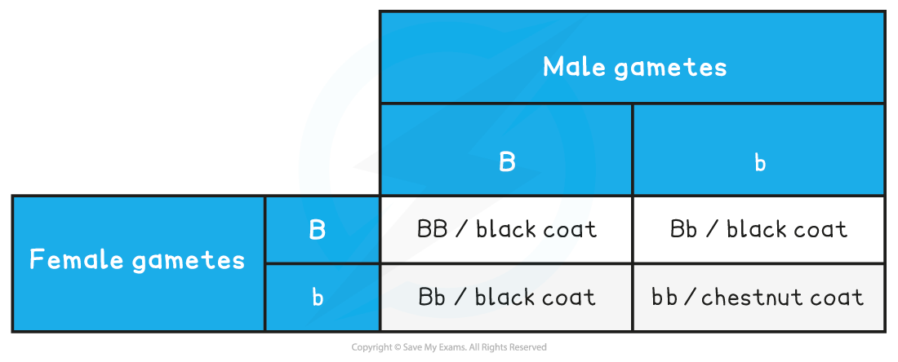
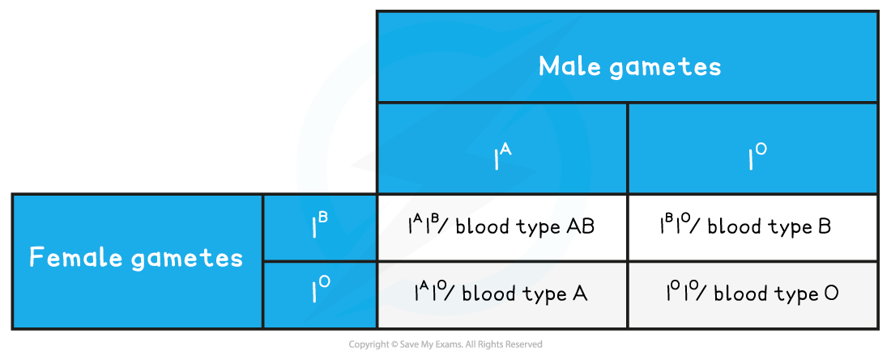
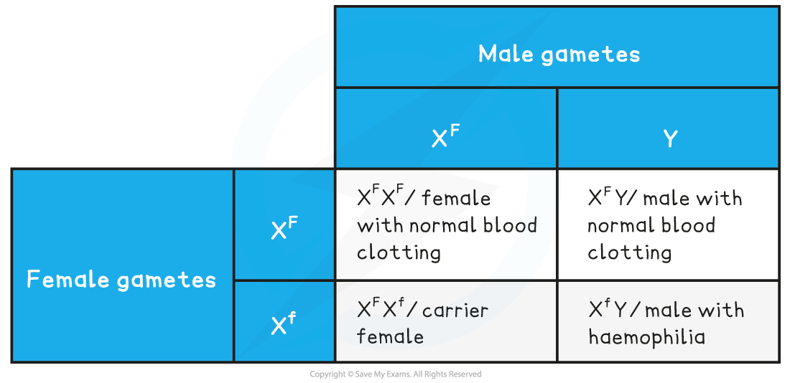

# Predicting Inheritance: Monohybrid Crosses

## Predicting Inheritance: Monohybrid Crosses

> **Spec point** — `spcpt_bsk8sG5vvmrS6DNy` · interpret and construct genetic diagrams, including Punnett squares, to explain and predict the results of monohybrid crosses and dihybrid crosses that involve dominance, codominance, multiple alleles and sex linkage

## Predicting inheritance: monohybrid crosses

### Monohybrid inheritance

- Monohybrid inheritance looks at how the **alleles for a single gene are passed on from one generation to the next**
- Known information about the genotypes, phenotypes and the process of meiosis are used to make **predictions **about the phenotypes of offspring that would result from specific breeding pairs
- When two individuals **sexually reproduce **there is an equal chance of either allele from their homologous pair making it into their gametes and subsequently the nucleus of the zygote

  - This means there is an **equal chance of the zygote inheriting either allele from their parent**
- **Genetic diagrams** are often used to present this information in a clear and precise manner so that predictions can be made

  - These diagrams include a characteristic table called a **Punnett square**
- The predicted genotypes that genetic diagrams produce are all based on **chance**

  - There is no way to predict which gametes will fuse so sometimes the observed or real-life results can differ from the predictions

#### Worked example: genetic diagram

- One of the genes for the coat colour of horses has the following two alleles:

  - **B**, a *dominant* allele produces a black coat when present
  - **b**, a *recessive* allele produces a chestnut coat when present in a *homozygous* individual
- In this example a *heterozygous* male is crossed with heterozygous female

Parental phenotype:   black coat x black coat

Parental genotype:     **Bb       **            **Bb**

Parental gametes:      **B** or **b**              **B** or **b**

*Monohybrid punnett square with heterozygotes*

- Predicted ratio of phenotypes in offspring – 3 black coat : 1 chestnut coat
- Predicted ratio of genotypes in offspring – 1 BB : 2 Bb : 1 bb

### Codominance

- When working with codominant alleles the genetic diagrams can be constructed in a similar way, however the genotypes are represented using a capital letter for the gene and superscript letters for the alleles (e.g. IAIA)
- There will be **more possible phenotypes** and so the predicted ratios will be different

#### Worked example: codominance

- The gene for blood type has three alleles:

  - A, a dominant allele produces blood type A
  - B, a dominant allele produces blood type B
  - O, two recessive alleles will produce blood type O
- In this example a blood type A person is crossed with a blood type B person

Parental phenotype:   Blood type A x Blood type B

Parental genotype:     **I****A****I****O****      **            **I****B****I****O**

Parental gametes:      **I****A** or **I****O**             **I****B** or **I****O**

*Monohybrid punnett square with codominance*

Predicted ratio of phenotypes in offspring - 1 Blood type AB : 1 Blood type A : 1 Blood type B : 1 Blood type O

Predicted ratio of genotypes in offspring: 1 **I****A****I****B** : 1 **I****A****I****O** : 1 **I****B****I****O** : 1 **I****O****I****O**

### Sex-linkage

- Sex-linked genes are only **present on one sex chromosome and not the other**
- This means the sex of an individual affects what alleles they pass on to their offspring through their gametes
- If the gene is on the X chromosome **males (XY) will only have one copy** of the gene, whereas females (XX) will have two
- There are** three phenotypes** for **females** - normal, carrier and has the disease, whereas **males** have only **two** phenotypes – normal or has the disease

#### Worked example: sex-linkage

- Haemophilia is a well known sex-linked disease
- There is a gene **found on the X chromosome **that codes for a protein called factor VIII. Factor VIII is needed to make blood clot
- There are two alleles for factor VIII, the dominant **F** allele which codes for normal factor VIII and the recessive** f** allele which results in a lack of factor VIII
- When a person possesses only the recessive allele **f**, they don’t produce factor VIII and their blood can't clot normally
- The genetic diagram below shows how two parents with normal factor VIII can have offspring with haemophilia

Parental phenotypes: carrier female x normal male

Parental genotypes:      XFXf                              XFY

Parental gametes:      XF or Xf                        XF or Y

*Monohybrid punnett square with sex-linkage*

Predicted ratio of phenotypes in offspring - 1 female with normal blood clotting : 1 carrier female : 1 male with haemophilia : 1 male with normal blood clotting

Predicted ratio of genotypes in offspring: 1 **X****F****X****F** : 1 **X****F****X****f**** **: 1 **X****F****Y** : 1** X****f****Y**

> **Exam Hint**
> Make sure to include **all of your working out **when constructing genetic diagrams. It is not enough just to complete a punnett square, you need to show that you have thought about the **possible gametes **that can be produced by each parent. Also, remember to state the **phenotype** as well as the genotype of the offspring that result from the cross. Read the questions carefully when answering sex-linked inheritance questions – is the question asking for a probability for **all** children or is it asking about a specific gender (boys or girls).
