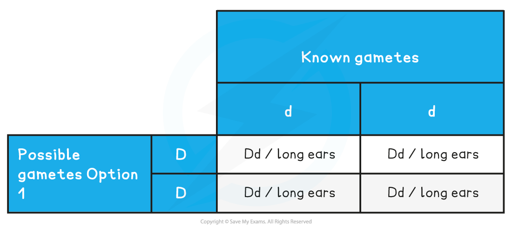
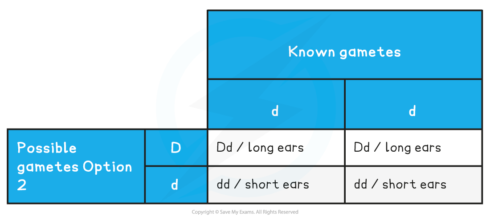

# Predicting Inheritance: Test Crosses

## Predicting Inheritance: Test Crosses

> **Spec point** — `spcpt_47HmVvDzr2y8HV4q` · interpret and construct genetic diagrams, including Punnett squares, to explain and predict the results of test crosses

## Predicting inheritance: test crosses

- A [test cross](https://www.savemyexams.com/a-level/biology/cie/22/revision-notes/16-inheritance/16-2-the-roles-of-genes-in-determining-the-phenotype/16-2-4-predicting-inheritance-test-crosses/) can be used to **deduce the ***genotype*** of an unknown individual that is expressing a dominant ***phenotype*
- The individual in question is crossed with an individual that is expressing the **recessive phenotype**
- This is because an individual with a recessive phenotype has a known genotype
- The resulting phenotypes of the offspring provides sufficient information to suggest the genotype of the unknown individual

### Results

- For a **monohybrid **test cross:

  - If **no** offspring exhibit the recessive phenotype then the unknown genotype is **homozygous dominant**
  - If **at least one** of the offspring exhibit the recessive phenotype then the unknown genotype is **heterozygous**
- For a **dihybrid **test cross:

  - If no offspring exhibit the recessive phenotype for either gene then the unknown genotype is **homozygous dominant **for both genes
  - If some offspring show the recessive phenotype for one gene, but no offspring show the recessive phenotype for the other gene, then the unknown genotype is **heterozygous for one gene and homozygous dominant for the other**
  - If at least one of the offspring exhibit the recessive phenotype for both genes then the unknown genotype is **heterozygous for both** genes

#### Worked example: test crosses

- Rabbits have a single gene for ear length that has two alleles:

  - **D**, a dominant allele that produces long ears
  - **d**, a recessive allele that produces shorter ears
- A breeder has a rabbit with long ears and they want to know the genotype of the rabbit

  - There are two possibilities: **DD** or **Dd**
- The breeder crosses the long-eared rabbit with a short-eared rabbit

  - A rabbit displaying the recessive short ear phenotype has to have the genotype **dd**

*Test cross possibility one*

Predicted ratio of phenotypes of offspring – 1 long ears

Predicted ratio of genotypes of offspring – 1 Dd

*Test cross possibility two*

Predicted ratio of phenotypes of offspring – 1 long ears : 1 short ears

Predicted ratio of genotypes of offspring – 1 Dd : 1 dd

- The breeder identifies the different phenotypes present in the offspring
- There is at least one offspring with the short ear phenotype
- This tells the breeder that their rabbit has the genotype **Dd**
- If the rabbit was genotype **DD** none of the offspring would have short ears

> **Exam Hint**
> Make sure before you start a test cross you think about the following: how many genes are there, how many alleles of each gene are there, which is the dominant allele, what type of dominance is it and is there linkage or epistasis between genes?
