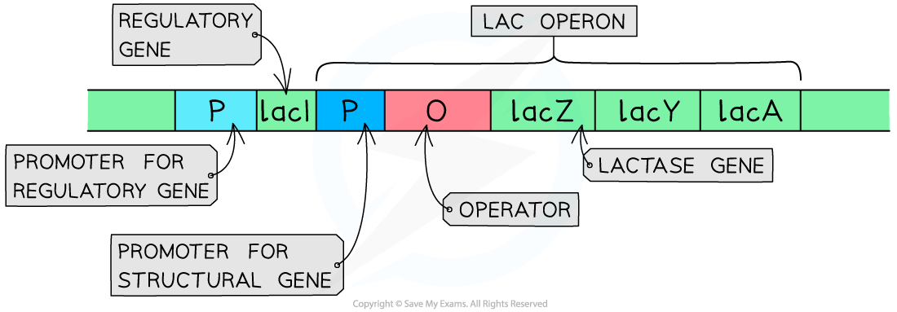
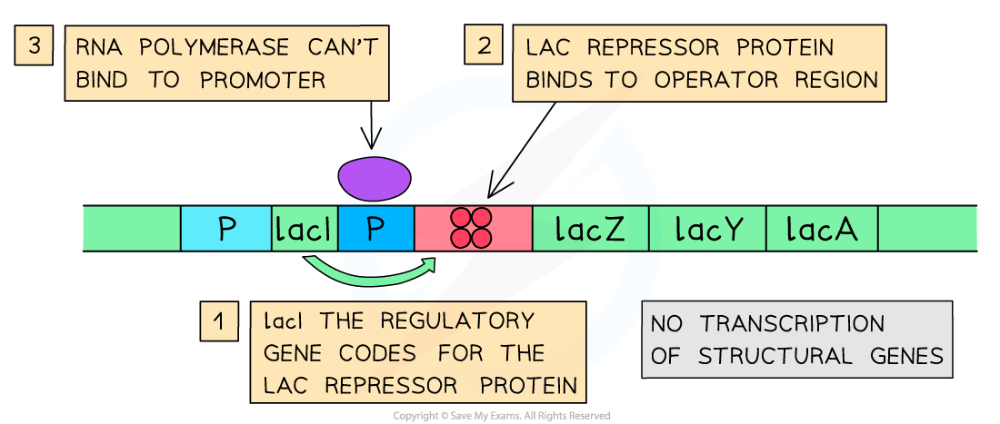
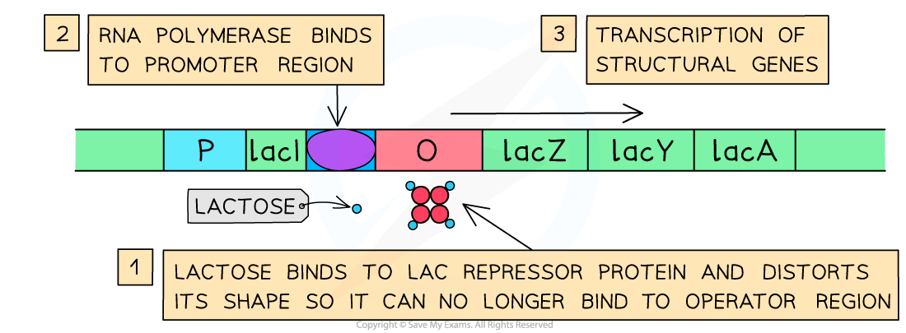

# Gene Control: Lac Operon

## Gene Control: Lac Operon

> **Spec point** — `spcpt_btgtPGdWMPHrt9fW` · explain genetic control of protein production in a prokaryote using the lac operon

## Gene control: lac operon

- *Regulatory genes* control *structural genes* and their levels of **protein production**
- Regulatory genes sometimes have control over several structural genes at once
- Structural genes in **prokaryotes** can form an **operon**: a group or a cluster of genes that are controlled by the same promoter
- The** lac operon** found in some bacteria is one of the most well-known of these
- The lac operon controls the production of the enzyme **lactase** (also called β-galactosidase) and two other structural proteins
- Lactase breaks down the substrate lactose so that it can be used as an energy source in the bacterial cell
- It is an** ****[inducible](https://www.savemyexams.com/a-level/biology/cie/25/revision-notes/16-inheritance/16-3-gene-control/gene-control/?_ai=internal-linking)**[ enzyme](https://www.savemyexams.com/a-level/biology/cie/25/revision-notes/16-inheritance/16-3-gene-control/gene-control/?_ai=internal-linking) that is **only synthesised when lactose is present**
- This helps prevent the bacteria from wasting energy and materials

### Structure of the lac operon

- The components of the lac operon are found in the following order:

  - *Promoter* for structural genes
  - *Operator*
  - Structural gene ***lacZ*** that codes for **lactase**
  - Structural gene *lacY* that codes for permease (allows lactose into the cell)
  - Structural gene *lacA* that codes for transacetylase
- Located to the left (upstream) of the lac operon on the bacterium's DNA there is also the:

  - Promoter for regulatory gene
  - Regulatory gene*** lacI ***that codes for the ***lac***** repressor protein**
- The lac repressor protein has **two binding sites** that allow it to bind to the **operator** in the lac operon and also to **lactose** (the **effector** molecule)

  - When it binds to the operator it **prevents the transcription** of the structural genes as RNA polymerase cannot attach to the promoter
  - When it binds to lactose the shape of the repressor protein distorts and it can **no longer bind to the operator**

*The components of the Lac operon along with the upstream regulatory gene and its associated promoter*

### When lactose is absent

- The following processes take place when lactose is **absent** in the medium that the bacterium is growing in:

  - The regulatory gene is transcribed and translated to produce *lac* repressor protein
  - The *lac* **repressor protein binds to the operator** region upstream of *lacZ*
  - Due to the presence of the repressor protein **RNA polymerase is unable to bind to the promoter region**
  - Transcription of the structural genes does not take place
  - **No lactase enzyme is synthesized**

*The repressor protein binding to the operator region of the Lac operon and preventing transcription of the structural gene*

### When lactose is present

- The following processes take place when lactose is present in the medium that the bacterium is growing in:

  - There is an uptake of lactose by the bacterium
  - The **lactose binds to the second binding site on the repressor** protein, distorting its shape so that it cannot bind to the operator site
  - **RNA polymerase is then able to bind to the promoter region** and transcription takes place
  - The mRNA from all three structural genes is translated
  - **Enzyme lactase is produced** and lactose can be broken down and used for energy by the bacterium

*Lactose binding to the repressor protein which frees up the operator region of the Lac operon so RNA polymerase can bind and begin transcription of the structural genes*

> **Exam Hint**
> The example above explains how the genetic control of an inducible enzyme works. You could get some questions on the genetic control of** ***repressible enzymes*.
> 
> In this mechanism an effector molecule also binds to a repressor protein produced by a regulatory gene. However this binding actually **helps the repressor bind to the operator region **and prevent transcription of the structural genes. So it's the opposite of the lac operon: when there is **less of the effector** molecule, the repressor protein cannot bind to the operator region and **transcription of the structural genes goes ahead,** meaning the enzyme is produced.
