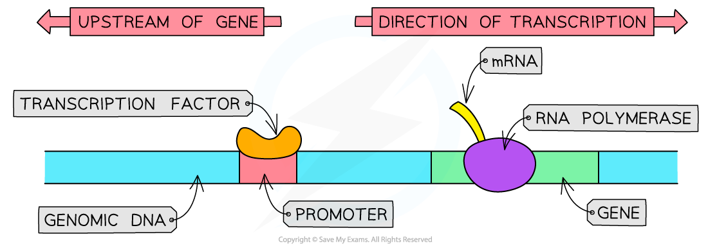
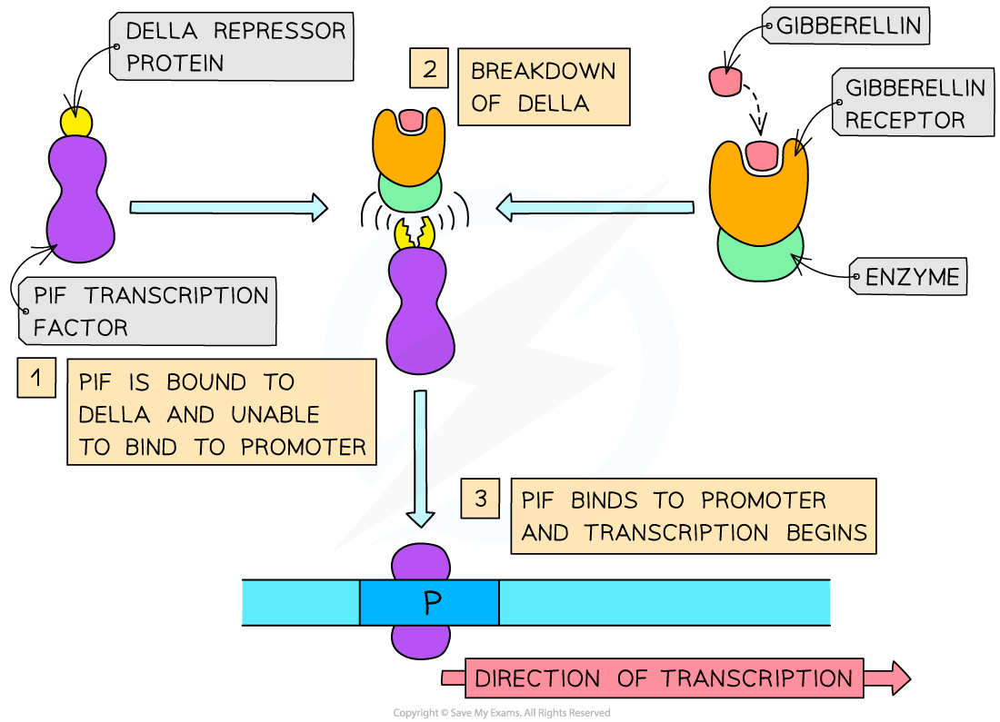

# Gene Control: Transcription Factors

## Gene Control: Transcription Factors

> **Spec point** — `spcpt_Y9mZ8254cC3zTVpg`

## Gene control: transcription factors

- Prokaryotes use *operons* to control the expression of genes in cells
- **Eukaryotes **also use **transcription factors **to control gene expression
- A transcription factor is a protein that **controls the transcription of genes** by binding to a specific region of DNA
- They ensure that genes are being expressed in the correct cells, at the correct time and to the right level
- It is estimated that ~10% of human genes code for transcription factors

  - There are several types of transcription factors that have varying effects on gene expression
  - This is still a relatively young area of research and scientists are working hard to understand how all the different transcription factors function
  - Transcription factors **allow organisms to respond to their environment**
  - Some hormones achieve their effect via transcription factors

### How transcription factors work

- Some transcription factors **bind to the promoter** region of a gene

  - This binding can either **allow or prevent the transcription** of the gene from taking place
- The presence of a transcription factor will either **increase or decrease the rate** of transcription of a gene
- For example,** PIF** is a transcription factor found in plants that activates the transcription of the amylase gene

*A transcription factor binding to the promoter region of a gene which allows RNA polymerase to bind and for transcription to occur*

## Gene Control: Gibberellin

> **Spec point** — `spcpt_ZyFrJWsxq4CbFg6B` · explain how gibberellin activates genes by causing the breakdown of DELLA protein repressors, which normally inhibit factors that promote transcription

## Gene control: gibberellin

- Plant cells use *transcription factors* in a similar way to animal cells
- Gibberellin is a **hormone** found in plants (e.g. wheat and barley) that **controls **[seed germination](https://www.savemyexams.com/a-level/biology/cie/25/revision-notes/15-control-and-coordination/15-2-control-and-coordination-in-plants/the-role-of-gibberellin-in-germination-of-barley/?_ai=internal-linking)** **by stimulating the synthesis of the enzyme amylase
- It does this by influencing **transcription of the amylase gene**

  - When gibberellin is applied to a germinating seed there is an increased amount of the mRNA for amylase present

### Mechanism for gene control by gibberellin

- The **breakdown of DELLA protein by gibberellin** is necessary for the synthesis of amylase
- The following components are involved:

  - *Repressor protein* **DELLA**
  - Transcription factor **PIF**
  - **Promoter** of amylase gene
  - Amylase **gene**
  - **Gibberellin**
  - Gibberellin **receptor and enzyme**
- The process occurs as follows:

  - DELLA protein is bound to PIF, **preventing it from binding to the promoter** of the amylase gene so no transcription can occur
  - Gibberellin binds to a gibberellin receptor and enzyme which starts the **breakdown of DELLA**
  - **PIF** is no longer bound to DELLA protein and so it **binds to the promoter** of the amylase gene
  - Transcription of amylase gene begins
  - Amylase is produced

*The breakdown of DELLA protein by Gibberellin allows the transcription factor PIF to bind to the promoter for the amylase gene and for transcription to initiate*

> **Exam Hint**
> In your exam you may be asked to explain why RNA analysis is important with regards to gene expression. From the outside most cells look almost identical with the same DNA in their nucleus. However we know that they are most likely expressing different genes.
> 
> When a cell expresses a gene, RNA is produced by **transcription**. This RNA present in a cell can be analysed. Scientists can match the RNA present in a cell to specific genes and work out which genes are being expressed in that specific cell.
