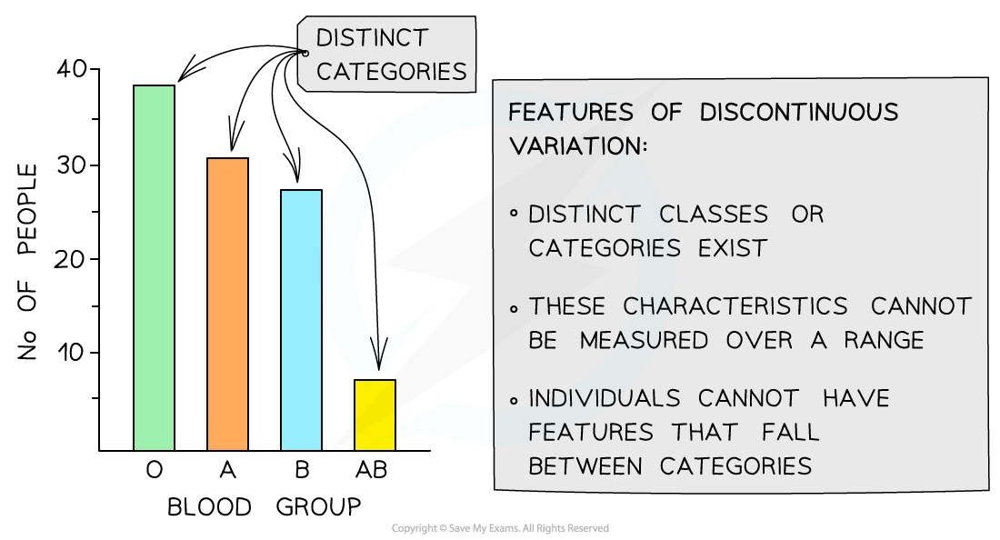
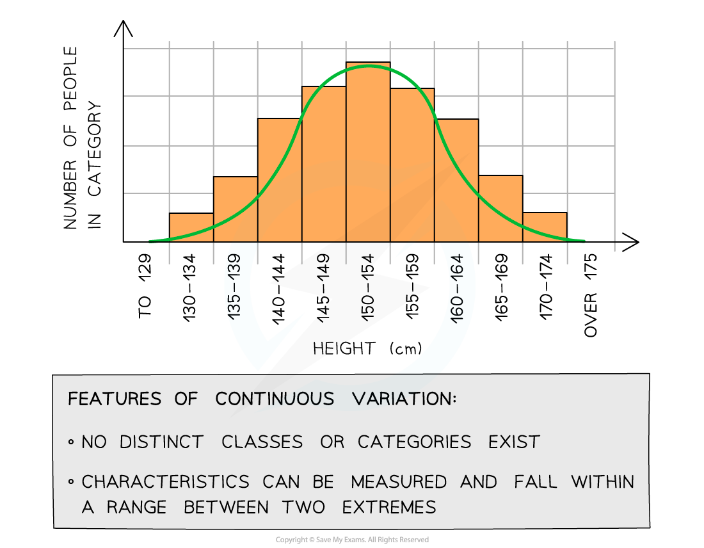

# Variation: Discontinuous & Continuous

## Variation: Discontinuous & Continuous

> **Spec point** — `spcpt_K4zN4xsNKX7QQFmG` · explain what is meant by discontinuous variation and continuous variation

## Variation: discontinuous & continuous

- The term **variation** refers to the differences that exist between at least two things (be it a level, presence, quantity or feature of something)
- Concerning natural selection, variation refers to the** differences that exist between individuals of a species**

  - This may also be referred to as ***intraspecific*** variation
- The variation observed in the ***phenotypes*** of organisms can be due to qualitative or quantitative differences

### Discontinuous variation

- **Qualitative differences** in the phenotypes of individuals within a population give rise to **discontinuous variation**
- Qualitative differences fall into discrete and distinguishable **categories,** usually with no intermediates (a feature can’t fall in between categories)

  - For example, there are four possible ABO blood groups in humans; a person can only have one of them
- It is easy to identify discontinuous variation when it is present in a table or graph due to the distinct categories that exist when data is plotted for particular characteristics

*The population variation in blood types: an example of discontinuous variation with qualitative differences*

### Continuous variation

- [Continuous variation](https://www.savemyexams.com/a-level/biology/cie/22/revision-notes/17-selection--evolution/17-1-variation/17-1-2-variation-discontinuous--continuous/#discontinuous-variatiom) occurs when there are **quantitative differences** in the phenotypes of individuals within a population for particular characteristics
- Quantitative differences do not fall into discrete categories like in [discontinuous variation](https://www.savemyexams.com/a-level/biology/cie/22/revision-notes/17-selection--evolution/17-1-variation/17-1-2-variation-discontinuous--continuous/#discontinuous-variation)
- Instead, for these features, a **range of values** exists between two extremes within which the phenotype will fall

  - For example, the mass or height of a human is an example of continuous variation
- The lack of categories and the presence of a range of values can be used to identify continuous variation when it is presented in a table or graph

*Population variation in height: an example of continuous variation with quantitative differences*

## The Genetic Basis of Variation

> **Spec point** — `spcpt_DftCBhJwFn84CNKf` · explain the genetic basis of discontinuous variation and continuous variation

## The genetic basis of variation

- **Discontinuous variation** refers to the differences between individuals of a species where the differences are **qualitative** (categoric)
- **Continuous variation** is the differences between individuals of a species where the differences are **quantitative** (measurable)
- Each type of variation can be explained by **genetic **and/or** environmental factors**

### Genetic basis of discontinuous variation

1. This type of variation occurs solely due to **genetic factors**
2. The environment has no direct effect
3. At the genetic level:

  - Different **genes** have **different effects** on the phenotype
  - Different **alleles** at a single gene locus have a** large effect **on the phenotype
  - Remember diploid organisms will inherit two alleles of each gene; these alleles can be the same or different
4. A good example of this is the *F8* gene that codes for the blood-clotting protein Factor VIII

  - The different alleles at the *F8* gene locus dictate whether or not normal Factor VIII is produced and whether the individual has the condition **haemophilia**

### Genetic basis of continuous variation

- This type of variation is caused by an **interaction between genetics and the environment**
- Phenotype = **genotype + environment**
- At the genetic level:

  - Different **alleles** at a single locus have a **small effect** on the phenotype
  - Different **genes** can have the **same effect** on the phenotype and these add together to have an** additive effect**
  - If a large number of genes have a combined effect on the phenotype they are known as **polygenes**

### The additive effect of genes

- The height of a plant is controlled by two unlinked genes **H **/ **h **and **T **/ **t**
- The two genes have an **additive** effect
- The recessive alleles **h** and **t **contribute ***x*** cm to the plant's height
- The dominant alleles **H** and **T** contribute 2***x*** cm to the plant's height
- The following genotypes will have the following phenotypes:

  - **h h t t :  *****x*** + ***x*** + ***x*** + ***x*** = 4***x*** cm
  - **H H T T : **2***x*** + 2***x*** + 2***x*** + 2***x*** = 8***x*** cm
  - **H h T t : **2***x*** + ***x*** + 2***x*** + ***x*** = 6***x*** cm
  - **H H T t : **2***x*** + 2***x*** + 2***x*** + ***x*** = 7***x*** cm
  - **H h T T : **2***x*** + ***x*** + 2***x*** + 2***x*** = 7***x*** cm
  - **h h T t : *****x*** + ***x*** + 2***x*** + ***x*** = 5***x*** cm
  - **H h t t : **2***x*** + ***x*** + ***x*** + ***x*** = 5***x*** cm

> **Exam Hint**
> Be careful when answering questions that involve polygenes or genes with an additive effect. It is not a given that each gene will have the same effect on the phenotype as in the example above so make sure to double check the information you have been given in the question.
