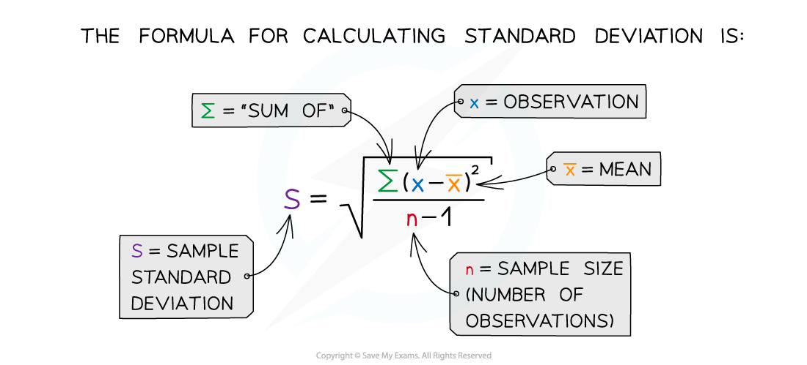
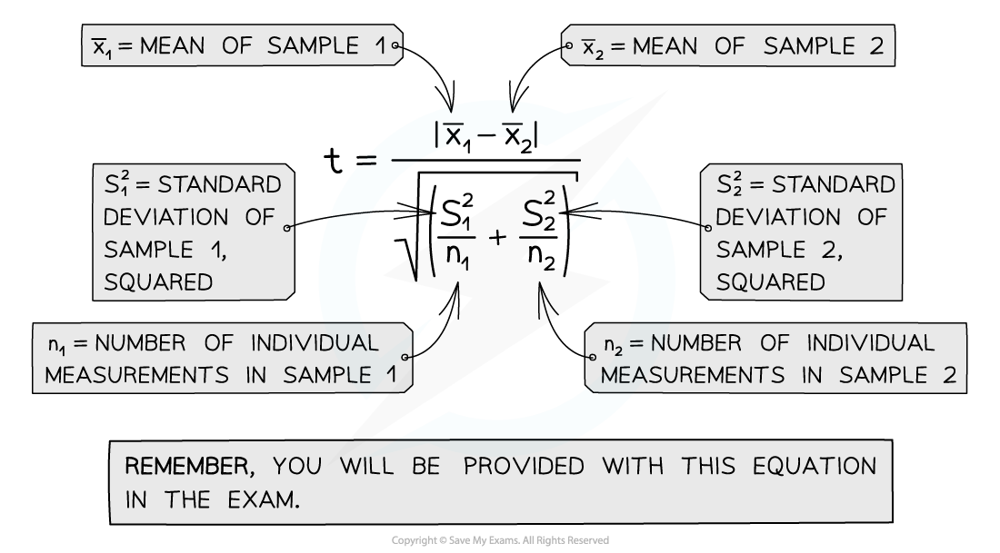

# Variation: t-test Method

## Variation: t-test Method

> **Spec point** — `spcpt_Ccd47V7YjMXN9d89` · use the t-test to compare the means of two different samples

## Variation: t-test method

- A statistical test called the **t-test** can be used to **compare the means of two sets of data **and determine whether they are **significantly** different or not

  - The formula for the t-test will be provided in the exam, but formulae for how to calculate the number of *degrees of freedom* is not provided in the exam and must be learnt
- The sets of data must follow a roughly **normal distribution**, and be **continuous** and the **standard deviations** should be approximately equal
- The standard deviation (*s*) must be calculated for each data set before the t-test can be carried out
- A **null hypothesis **should also be given

  - This is a statement of what we would expect if there is **no** **significant difference** between two means, and that any differences seen are due to **chance**
- If there is a statistically significant difference between the means of two sets of data, then the observation is not down to chance and the ***null hypothesis*** can be **rejected**

*Calculating the standard deviation*

### Using the t-test to compare two means

- The steps below outline the general steps in a *t-test*; for a worked example, see the [next page](https://www.savemyexams.com/a-level/biology/cie/25/revision-notes/17-selection-and-evolution/17-1-variation/variation-t-test-worked-example/)
- Null hypothesis: there is no statistically significant difference between the means of sample 1 and sample 2
- **Step 1**:  Calculate the mean for each data set:

x̄1 is the mean for sample 1, and x̄2 is the mean for sample 2

- **Step 2**:  Calculate the ***standard deviation*** for each set of data, s1 = standard deviation of sample 1 and s2 = standard deviation of sample 2

$S_{n} = \sqrt{ \frac{ \sum ( x - \bar{x} )^{2}}{n - 1} }$

- **Step 3**:  Square the standard deviation and divide by *n* (the number of observations) in each sample, for both samples:

$\frac{s^{2}_{1}}{n_{1}}\mathrm{and}\frac{s^{2}_{2}}{n_{2}}$

- **Step 4:**  Add the values from step 3 together and take the square root:

`sqrt( ( s ^2 _ 1 / n _ 1 + s ^2 _ 2 / n _ 2 ) )`

- **Step 5:**  Divide the difference between the two means (see step 1) with the value calculated in step 4 to get the *t* value:

- **Step 6:**  Calculate the **degrees of freedom **(*v*) for the whole data set (remember the formulae for this will **not** be given in the exam): $\mathrm{v} = ( \mathrm{n}_{1} - 1 ) + ( \mathrm{n}_{2} - 1 )$
- **Step 7:**  Look at a table that relates *t* values to the probability that the differences between data sets is due to chance to find where the *t *value for the degrees of freedom (*v*) calculated lies

| **Degrees of freedom** | **Value of t** |   |   |   |
|---|---|---|---|---|
| **1** | 6.31 | 12.7 | 63.7 | 636.6 |
| **2** | 2.92 | 4.30 | 9.93 | 31.6 |
| **3** | 2.35 | 3.18 | 5.84 | 12.9 |
| **4** | 2.13 | 2.78 | 4.60 | 8.61 |
| **5** | 2.02 | 2.57 | 4.03 | 6.87 |
| **6** | 1.94 | 2.45 | 3.71 | 5.96 |
| **7** | 1.90 | 2.37 | 3.50 | 5.41 |
| **8** | 1.86 | 2.31 | 3.36 | 5.04 |
| **9** | 1.83 | 2.26 | 3.25 | 4.78 |
| **10** | 1.81 | 2.23 | 3.17 | 4.59 |
| Probability that chance could have produced this value of t | 0.10 | 0.05 | 0.01 | 0.001 |
| Confidence level | 90% | 95% | 99% | 99.9% |

- **Step 8**:  The greater the *t* value calculated (for any degree of freedom), the lower the probability of chance causing any significant difference between the two sample means

  - Identify where the *t *value calculated lies with respect to the confidence levels provided
  - If the *t* value is **greater than the critical value **(obtained from the table at a probability level of 0.05) then any **difference** between the means of the two data sets is said to be **statistically significant**
  
    - There is a less than 5 % probability that any difference is due to chance
    - The **null hypothesis **can be** rejected**
  - If the *t* value is** less than the critical value** (obtained from the table at a probability level of 0.05) then there is **no significant difference** between the means of the two data sets
  
    - The probability that any difference is due to chance is higher than 5 %
    - The** null hypothesis is accepted**
- Using the table above, if a value of *t *was calculated to be 2.38 at 5 degrees of freedom, then it lies between the critical values of 2.02 and 2.57
- Therefore, the probability that chance produced any difference between the two means is between 5 and 10 %; this is a higher than 5 % probability that the difference is due to chance
- The null hypothesis would be **accepted **and it would be said that there is no significant difference between the data sets

> **Exam Hint**
> If you need to calculate the t value you will be given the formula in the exam. Generally, questions on the t-test require you to:
> 
> - Know why a *t*-test is being used to analyse the data
> - State the null hypothesis
> - Know how the degrees of freedom are calculated
> - State the conclusion (are the differences between the two means significant or not?)
> 
> You must be careful when giving conclusions to statistical tests; be sure to state that the ***difference*** between data sets is significant, not just that the data is significant.
