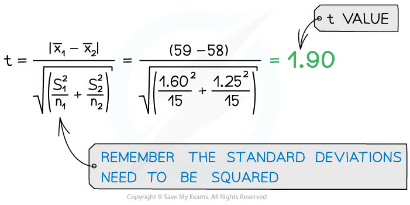

# Variation: t-test Worked Example

## Variation: t-test Worked Example

> **Spec point** — `spcpt_z6SPBh8ZnFRthjnP` · use the t-test to compare the means of two different samples

## Variation: t-test worked example

> **Worked Example**
> The ear lengths of two populations of rabbits were measured.
> 
> Ear lengths of population A (mm):
> 
> 62, 60, 59, 61, 60, 58, 59, 60, 57, 56, 59, 58, 60, 59, 57
> 
> Ear lengths of population B (mm):
> 
> 58, 59, 57, 59, 59, 57, 55, 60, 57, 58, 59, 58, 57, 58, 59
> 
> Use the t-test to determine whether there is a significant difference in ear length between the two populations.

### Solution

- Null hypothesis: There is ***no significant difference*** between the ear lengths of the rabbits in populations *A* and *B*
- Sample sizes: **Step 1: Calculate the mean for each data set:**

  - Population *A*: n1 = 15
  - Population *B*: n2 = 15

Mean for population A  *x̅*1 = 885 ÷ 15 = 59 mm

Mean for population B  *x̅*2 = 870 ÷ 15 = 58 mm

Step 2: Calculate the standard deviation (*s*) for each set of data

| **Population A** | **Population B** |   |   |
|---|---|---|---|
| Difference between value and mean  **(x - x̄)** | Difference between value and mean  **(x - x̄)****2** | Difference between value and mean  **(x - x̄)** | Difference between value and mean  **(x - x̄)****2** |
| 62 - 59 = 3 | 9 | 58 - 58 = 0 | 0 |
| 60 - 59 = 1 | 1 | 59 - 58 = 1 | 1 |
| 59 - 59 = 0 | 0 | 57 - 58 = -1 | 1 |
| 61 - 59 = 2 | 4 | 59 - 58 = 1 | 1 |
| 60 - 59 = 1 | 1 | 59 - 58 = 1 | 1 |
| 58 - 59 = -1 | 1 | 57 - 58 = -1 | 1 |
| 59 - 59 = 0 | 0 | 55 - 58 = -3 | 9 |
| 60 - 59 = 1 | 1 | 60 - 58 = 2 | 4 |
| 57 - 59 = -2 | 4 | 57 - 58 = -1 | 1 |
| 56 - 59 = -3 | 9 | 58 - 58 = 0 | 0 |
| 59 - 59 = 0 | 0 | 59 - 58 = 1 | 1 |
| 58 - 59 = -1 | 1 | 58 - 58 = 0 | 0 |
| 60 - 59 = 1 | 1 | 57 - 58 = -1 | 1 |
| 59 - 59 = 0 | 0 | 58 - 58 = 0 | 0 |
| 57 - 59 = -2 | 4 | 59 - 58 = 1 | 1 |
| Total ∑(x - x̄)2 | **36** | Total ∑(x - x̄)2 | **22** |

To find the standard deviations divide the sum of each square by *n* - 1 for each data set, and take the square root of each value

| **Population A (n****1**** = 15)** | **Population B (n****2**** = 15)** |
|---|---|
| n1 - 1 = 14 | n2 - 1 = 14 |
| ∑(x - x̄)2 = 36  so 36 ÷ 14 = 2.57 | ∑(x - x̄)2 = 22  so 22 ÷ 14 = 1.57 |
| $\sqrt{2.57}=1.60$ | $\sqrt{1.57}=1.25$ |
| `straight s subscript 1 equals square root of fraction numerator sum for blank of open parentheses straight x minus straight x with bar on top close parentheses squared over denominator straight n minus 1 end fraction end root equals 1.60` | `straight s subscript 2 equals square root of fraction numerator sum for blank of open parentheses straight x minus straight x with bar on top close parentheses squared over denominator straight n minus 1 end fraction end root equals 1.25` |

**Step 3: **Square the standard deviation and divide by *n* (the number of observations) in each sample, for both samples: 1.602 ÷ 15 = 0.171 (population A) and 1.252 ÷ 15 = 0.104 (population B)

**Step 4: **Add the values from step 3 together and find the square root: 0.171 + 0.104 = 0.275, and √0.275 = 0.524

**Step 5: **Divide the difference between the two means by the value from step 4: (59 - 58) ÷ 0.524 = 1.91

| **Population A** | **Population B** |
|---|---|
| x̄1 = 59 | x̄2 = 58 |
| s1 = 1.60 | s2 = 1.25 |
| n1 = 15 | n2 = 15 |

**Step 6: **Calculate the degrees of freedom *(v)* for all the data:

$v=(n_{1}-1)+(n_{2}-1)=14+14=28$

**Step 7: **Look at a table that relates *t* values to the probability that the difference between data sets is due to chance to find where the *t* value of *1.91* for 28 degrees of freedom (*v*) calculated lies

| **Degrees of freedom** | **Value of t** |   |   |   |
|---|---|---|---|---|
| **28** | 1.70 | 2.05 | 2.76 | 3.67 |
| Probability that chance would have produced this value of t | 0.1 | 0.05 | 0.01 | 0.001 |

**Step 8: **Draw a conclusion about the statistical relevance of the data

We are using a probability level of 0.05 (a 95% confidence level), which gives a critical value of 2.05. However, our t value is 1.91, less than the critical value. So the null hypothesis should be **accepted**

This means the null hypothesis should be **accepted**, as there are **no significant differences** between the two sets of results (any differences between the means of the ear length of rabbits in the two populations are due to chance)
