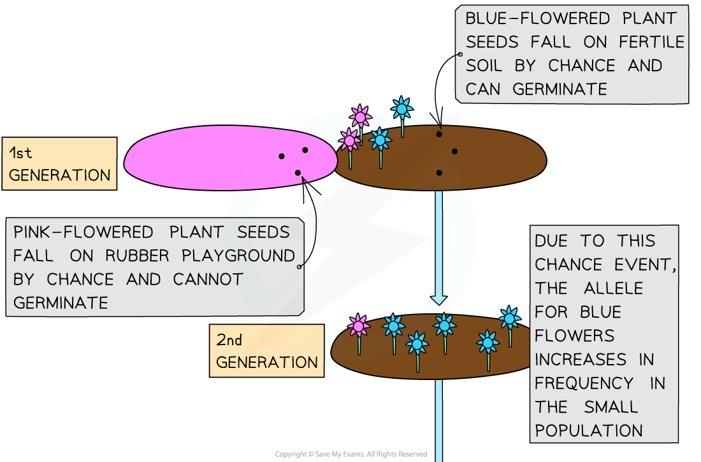
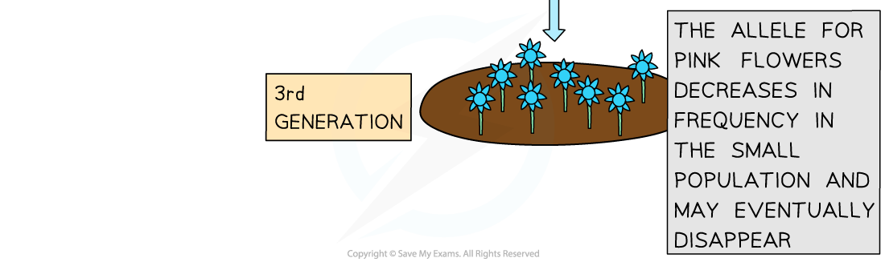
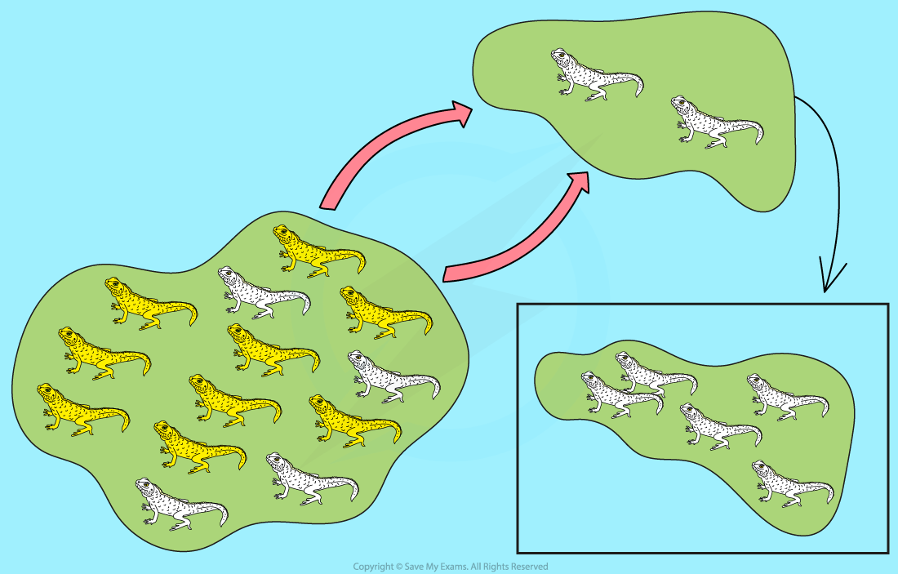
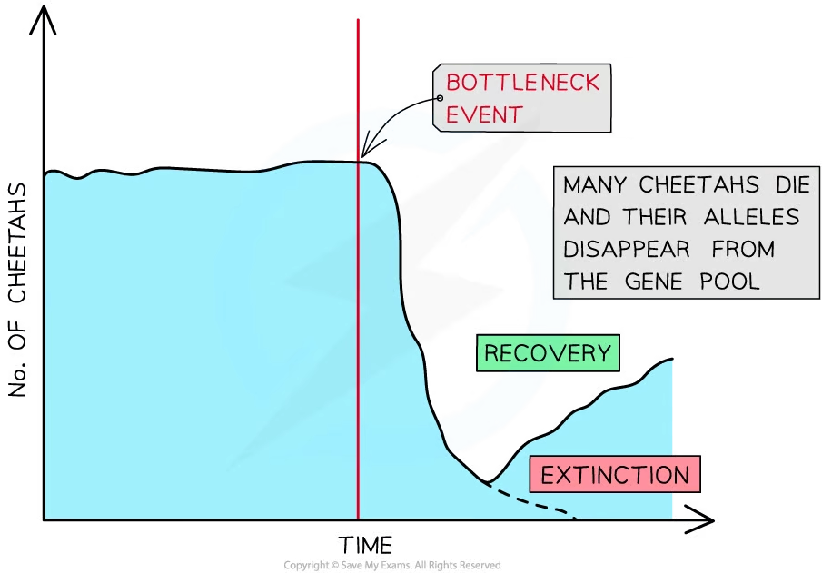

# Natural Selection: Changes in Allele Frequencies

## Natural Selection: Changes in Allele Frequencies

> **Spec point** — `spcpt_Mp79MQwDxS5kfyPr` · explain how selection, the founder effect and genetic drift, including the bottleneck effect, may affect allele frequencies in populations

## Natural selection: changes in allele frequencies

- Evolution involves changes in allele frequencies over time
- This can be caused by *natural selection*

  - Selection pressures (caused by abiotic and biotic factors) decrease the likelihood that certain individuals with specific alleles survive to reproductive age, preventing them from passing on their alleles to their offspring
- In addition to natural selection, it is also possible for allele frequencies to change as a result of chance; this can occur due to a process known as **genetic drift**
- Other processes that can cause changes in allele frequencies due to chance events include

  - **The founder effect**
  - **The bottleneck effect**

### Natural selection

- When a **new allele** arises in a population or a **change in the environment **occurs, directional selection can happen
- Directional selection produces a **gradual change** in allele frequencies over several generations

  - There is always **phenotypic variation** within a population
  - There is a **selection pressure** in the environment, e.g. the presence of a predator
  - Some individuals in a population may have a phenotype that aids their survival in the presence of a selection pressure
  
    - The phenotype is **produced by particular alleles**
  - Individuals with the favoured phenotype are fitter and so more likely to reproduce and **pass on the advantageous alleles** to their offspring
  - Those who do not possess the advantageous allele or phenotype are less likely to survive and pass on their alleles to their offspring
  - So over time and several generations, the **frequency of the advantageous allele increases** and the frequency of other alleles decreases

### Genetic drift

- When a population is very small, **chance** can affect which alleles get passed on to the next generation

  - **Meiosis** results in haploid gametes, meaning that a fertilisation event only passes on half of the alleles of an individual
  - The half that gets passed on is the result of **random fertilisation**, and the other half of the alleles may not make it to the next generation
- Over time some alleles can be lost or passed on **purely by chance**; this is genetic drift
- Genetic drift is more likely to affect allele frequencies in a **small population**

  - eg. if a coin is tossed 10 times it is quite likely that heads comes up only 2 or 3 times (far from half), whereas if a coin is tossed 100 times the proportion of heads will almost always be close to half
  - Similarly, the chances of a certain allele simply being lost by chance as a result of random fertilisation are much greater if only 10 pairs of birds are breeding than if there are 100 pairs of birds breeding

#### Example: genetic drift in plants

- In a small population of five plants growing near a playground with a rubber floor, three of the plants have blue flowers and two of the plants have pink flowers
- By chance, most of the seeds from the pink-flowered plants end up on the rubber floor of the playground while all the seeds from the blue-flowered plants land on fertile soil where they are able to germinate and grow

  - Note that the seeds from the pink flower do not fall on the impermeable surface because of any disadvantageous allele in the plant's genome, but purely by chance, eg. because of a gust of wind or a passing animal
- If this happens **by chance** over several generations the **allele for the pink flowers may be lost** from this population

*An example of how genetic drift can occur*

### The founder effect

- The founder effect occurs when a small number of individuals from a large parent population start a **new population**

  - The founder effect can come about as the result of chance
  
    - E.g., a chance event such as a storm may separate a small group of individuals from the main population
- As the new population is made up of only a few individuals from the original population, **only some of the total alleles from the parent population **will be present

  - In other words, **not all of the gene pool is present **in the smaller population
- Because the population that results from the founder effect is very small it is **more susceptible to the effects of genetic drift**

#### Example: the founder effect in lizards

- **Anole lizards** inhabit most Caribbean Islands and they can travel from one island to another via floating debris or vegetation
- A small number of lizards may be separated from the main population on a larger island and carried away to a smaller island by a chance event such as a large ocean wave or a storm
- The lizards arriving at a new island may only carry a small range of alleles between them, with many more alleles present in the lizard population on the original island

  - eg. the lizards on the original island could display a range of scale colours from white to yellow and the two individual lizards that arrived on the island may have white scales
  
    - This means that the whole population that grows on that island might only have individuals with white scales
    - In comparison, the original island population has a mixture of white and yellow-scaled individuals.
- If the yellow allele were recessive and present as a single copy in the original two lizards that arrived on the island, the chance of it being lost as a result of genetic drift is increased due to the small size of the gene pool

*The founder effect on lizards and their scale colour*

### The bottleneck effect

- The **bottleneck** effect is similar to the founder effect
- It occurs when a previously large population suffers a **dramatic fall in numbers**
- A major environmental event can greatly reduce the number of individuals in a population which in turn **reduces the ***genetic diversity* in the population as **alleles are lost**
- The surviving individuals end up breeding and **reproducing with close relatives**

#### Example: bottleneck effect in cheetahs

- A clear example of a genetic bottleneck can be seen in **cheetahs** today
- Roughly 10,000 years ago there was a large and genetically diverse cheetah population
- Most of the population was** suddenly killed** off when the **climate changed **drastically at the end of the Ice Age
- As a result, the surviving cheetahs were isolated in **small populations** and lots of *inbreeding* occurred
- This meant that the cheetah population today has a **lack of genetic variation**
- This is problematic for **conservation** as genetic variation within a species increases the likelihood that the species is able to **respond** in the event of any environmental changes

  - Remember the environment exerts a selection pressure on organisms

*The bottleneck effect in cheetahs after the Ice Age*

| **Process** | **Result** |
|---|---|
| **Natural selection** | **Selection pressures** produce a **gradual change** in allele frequencies over several generations. |
| **Founder effect** | Changes in allele frequencies occur in a **different direction** for the newly isolated small population in comparison to the larger parent population due to** chance.** |
| **Genetic drift** | Gradual change in allele frequencies in a small population due to **chance** and not natural selection. |
| **Bottleneck effect** | **Reduction in the gene pool** of a population due to a dramatic decrease in population size. |
